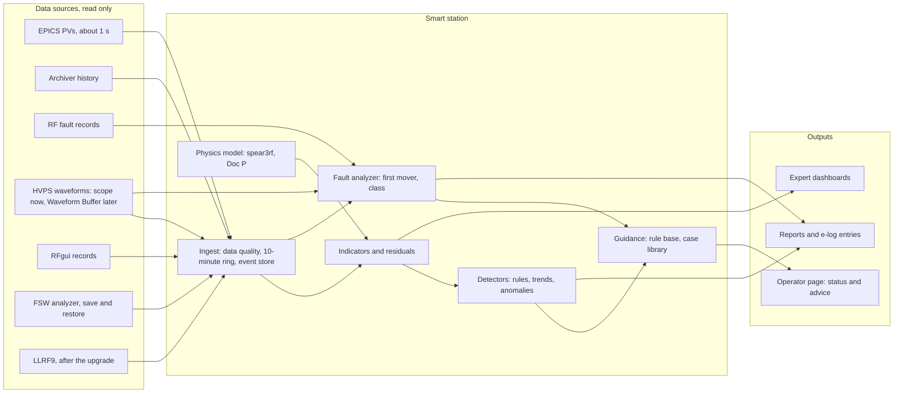

# SPEAR3 RF Smart Station — Design and Plan

Status: proposal for review, 9 October 2026. The smart station is the purpose of this note. The RF
performance study (closed-loop measurements of 2 October 2026, fault records, historical data) is its
foundation: it supplies the model, the baselines and the first analyzers.
Author: F. Wang (with analysis support).
Doc P is the physics and plant reference that the smart station's model implements; results confirmed
here are carried into Doc P.

Contents: §1–§4 define the smart station (purpose, rules, data, architecture); §5–§6 are its
foundation (model, validation, analyzers); §7–§12 describe its functions; §13–§15 give the plan, the
decisions needed and the risks. Appendix A lists the legacy tools and record formats, Appendix B the
methods notes.

---

## 1. Purpose

The smart station is a read-only monitoring and analysis layer on the SPEAR3 RF station: the HVPS,
the klystron, the LLRF (legacy VXI now, LLRF9 after the upgrade), the four cavities and their tuners,
the waveguide and loads, and the utilities. Its aim is easy operation and predictable, well-planned
maintenance. It:

- assesses health and performance against a physics model and against the station's own history;
- flags potential problems early and predicts approaching limits;
- analyzes every fault automatically and tells the operator what to do;
- measures loop performance in normal operation, without disturbing the beam, and supports AP
  studies;
- guides the LLRF9 commissioning, with the legacy station as the reference.

| Goal | What the smart station does | Main inputs |
| --- | --- | --- |
| i. Health and performance | From a 10-minute window of EPICS data (1 s), or from archived history, computes indicators for every subsystem, compares them with the model and with baselines, trends them over weeks and years, and flags degradation | EPICS, archiver, HVPS waveforms (§3, §7) |
| ii. Watch and react | Checks the station every minute. On a trip it collects the RF fault records and the HVPS waveforms, finds the first signal to leave its normal band, classifies the event and gives an action level | Fault records, HVPS waveforms (§8) |
| iii. Loop performance | Tracks the Robinson line, ripple lines and field noise against the model at the measured current; measures the klystron's small-signal response at every trip; analyzes RFgui data automatically; prepares and analyzes AP studies | FSW, fault records, RFgui records (§9) |
| iv. LLRF9 commissioning | Same indicators for both systems; the Doc P §8.8 procedure as a guided checklist with automatic analysis | LLRF9, Waveform Buffer (§10) |
| v. Prediction and planning | Margins to limits (klystron power and emission, tuner travel, HVPS components); what-if studies with the model | Trends, model (§11) |

**Scope.** The legacy station now. The same smart station serves the upgraded station; only the data
readers change (§3).

**Not in scope.** Control actions: the smart station never changes a machine setting. Optimization and
tuning decisions stay with the AP and RF experts, in AP time. Doc P and Doc L are not rewritten.

---

## 2. Principles and ground rules

### 2.1 Principles

- **Advisory and read-only.** The smart station never writes to machine PVs and never acts on the
  station. Operators and RF experts act, following their procedures. A measurement that touches the
  machine stays an expert-run procedure (§13.1).
- **Explainable.** Every flag shows its evidence (numbers, plots, the rule or model that fired) and its
  physics reason, linked to Doc P or Doc L. Physics models first, data-driven baselines second, machine
  learning only on residuals and only where it can be explained.
- **Model where validated, baseline elsewhere.** An indicator is compared with the model only where the
  model has been validated on station data (§5.2); otherwise with its own history.
- **Conditioned on the operating point.** Thresholds scale with beam current, voltage, insertion-device
  load, the HVPS unit in service and the machine state (user beam, injection, MD, RF off). A fixed
  threshold false-alarms (§5.6).
- **Validated before use.** Every indicator and rule is replayed on archived data and past trips
  (backtesting) to measure its detection and false-alarm rates before it reaches operators.
- **Configuration as data.** PV maps, channel maps, states, thresholds and rules live in reviewed,
  versioned files owned by the RF experts, not in code.
- **Small and maintainable.** One Python package (`spear3rf` plus monitor modules), tests, replay data,
  one service, documentation per indicator. Each data source can fail without stopping the others.

### 2.2 Ground rules for data access

| Resource | Rule |
| --- | --- |
| EPICS | Read only (`caget`, monitors); never `caput` from analysis code |
| RF fault records (`RF_DATA/SRF1`) | Read and copied; the analysis runs on the copies |
| B118 HVPS oscilloscope | Saved traces are read and copied. After a trip the event trace is saved before the scope is re-armed. Normal-operation captures only with the RF experts' agreement, in the order save set-up, acquire, restore set-up, re-arm: a new acquisition replaces the last event trace in the scope's memory, and the scope must be left armed on the HV-loss trigger |
| Waveform Buffer (upgrade) | Read only; thresholds, arming and resets belong to the RF experts and the MPS |
| R&S FSW on the cavity-A probe (dedicated) | Settings change only inside a save/restore wrapper: the full state is saved, the restore is verified setting by setting, and the instrument is returned to local. One capture takes about 1 min |
| RFgui (non-invasive MATLAB tools) | Run by the RF experts; the smart station analyzes their raw data |
| RFguiInvasive (opens loops, moves tuners, changes HVPS) | Only by the RF experts, beam off or in AP time |

---

## 3. Data sources

### 3.1 Overview

| Source | Content | Rate, length | Legacy station (now) | Upgrade | Used for |
| --- | --- | --- | --- | --- | --- |
| EPICS PVs | Settings, powers, voltages, currents, tuner positions, states, interlocks | About 1 s | `live_status.py` snapshots | Same, plus LLRF9, Waveform Buffer and PLC PVs | Indicators, operating point, trip detection |
| Archiver | History of the archived PVs | Archive rates | Access needed (§14) | Same | Baselines, trends, past events |
| RF fault records | RFP signal RAM (drive I/Q, `FBSIG` 3) and cavity RAM (one probe, I/Q); one amplitude history per IQA module (IQA1: klystron output) | 10.24 MHz, 51,200 samples (5 ms, most of it before the trip) | 15 slots in `RF_DATA/SRF1`, written at each trip and reused in turn; `STN:FAULT:NUM`, `STN:FAULT:TIME1` to `TIME15` | LLRF9 fault snapshots, Waveform Buffer RF channels | First mover; normal-operation response from the pre-trip part (§9) |
| HVPS waveforms (§3.2) | Output voltage and current, firing-circuit signals | About 100 ms | B118 four-channel oscilloscope, triggered on a loss of HVPS voltage | Waveform Buffer HVPS channels | HVPS health; the HVPS's part in trips |
| RFgui RAM records | `TOTAL`, `CAVITY`, `DRIVE`, with or without noise injection | 10.24 MHz, 2^18–2^19 samples | Expert-run; raw files in `RF_DATA` | LLRF9 network analyzer | Closed-loop TF and loop parameters (§5) |
| FSW spectrum analyzer | Cavity-A probe spectrum | About 1 min per capture | `fsw_matrix.py` with save/restore | Same | Robinson line, line harmonics, sidebands |
| Waveform Buffer RF channels | The six RF signals not on the LLRF9: circulator load reflected, station reference, waveguide load 1 forward and reflected, loads 2 and 3 reflected | 1 MSPS, 32 kS | None | Yes | Loads, reference, collector power |
| LLRF9 | Field, forward and reflected waveforms, fault snapshots, network analyzer with independent I and Q injection | Per LLRF9 set-up | None | Yes | Loop TF in two dimensions, first mover |

Record formats and the legacy tools are in Appendix A.

### 3.2 HVPS waveforms

**Now.** Four analog monitor signals come from the HVPS power section to B118, where a four-channel
oscilloscope near the controller enclosure records them. It triggers on a loss of the HVPS output
voltage (Doc L; Waveform Buffer design note `llrf/architecture/WaveformBuffersforLLRFUpgrade.docx`).

| Channel | Signal | Sensor | Shows |
| --- | --- | --- | --- |
| 1 | HVPS output voltage | About 10,000:1 resistive divider | Regulation, ripple, line sags, collapse |
| 2 | HVPS output current | Danfysik DC-CT in the termination tank | Klystron beam current, arcs, crowbar |
| 3 | Inductor 2 voltage | Inductor tap | T2 firing timing (a sawtooth) |
| 4 | Transformer 1 phase current | Transformer CT | T1 firing health (commutation spikes) |

Channel 4 is a current because HVPS1's internal T1 voltage monitor is open; on HVPS2 both sawtooths
are available. The two units swap at scheduled downs, so the channel map goes with the unit in service.
About 100 ms of data has proved useful: a trigger misfire can upset the regulation tens of milliseconds
before the station trips.

**Upgrade.** The four HVPS channels of the Waveform Buffer (IOC prefix `SRF1:WFBUF:`) take over these
signals. Doc 0 lists voltage, current and two inductor voltages; with the T1 voltage monitor open on
HVPS1, the channel map needs the same per-unit choice as the scope (§14). The design asks for at least
100 ms of circular buffer (1 MSPS with 128 kS, or 250 kS/s with 32 kS), a freeze on the fault summary,
about 1 s averages to EPICS in normal operation, over-voltage and over-current comparators, and the
collector power V·I − P_RF for the RF MPS.

**What the smart station reads from them.**

| Topic | Normal operation | Events |
| --- | --- | --- |
| Ripple | 60, 120, 360 and 720 Hz lines at the HVPS output. 720 Hz is the 12-pulse ripple; 360 Hz means an imbalance between the T1 and T2 sections; 60–180 Hz a phase or firing asymmetry. Compared with the same lines in the field (FSW, RF records) | Line growth before a trip |
| Firing | From the sawtooth and the phase-current spikes: firing interval and its spread, late or missing firings, firing angle versus operating point | Misfires and regulation upsets up to ~100 ms before the trip |
| Klystron beam | Perveance I/V^1.5, DC power V·I and, with the klystron forward power, efficiency and collector power. The in-phase ratio d ln I / d ln V at the ripple lines is 1.5 for a space-charge-limited gun and falls as the emission becomes temperature limited: a candidate early sign of cathode ageing, once the capacitive current and the sensor bandwidth are accounted for | Gun arcs (current spike with a voltage dip) |
| AC line | Sags and unbalance of the 12.47 kV supply | Line sags that trip the station |
| Protection | – | Crowbar (voltage collapse within microseconds), over-voltage, over-current |
| HVPS to RF | With simultaneous RF records: the drive and field lines against the HVPS-voltage lines, i.e. the klystron's pushing and the loop's rejection at each harmonic (Doc P D5) | – |

**Trips give simultaneous data.** The scope's pre-trigger part and the RF fault records both hold the
last milliseconds before a trip, so each trip gives HVPS and RF data from normal operation side by side,
as the fault records alone already gave the klystron response (§9). Aligning them needs a common mark:
the HV collapse when the HVPS trips first, otherwise the measured trigger delays of the two systems. In
the upgrade the Waveform Buffer and the LLRF9 freeze on the same fault summary.

**Requirement for the Waveform Buffer IOC (proposed).** Besides the fault freeze: periodic and
on-demand snapshots of all twelve channels in normal operation, without disturbing the fault buffers;
frozen buffers kept until archived; timestamps on one time base with the LLRF9 and the fault summary.

**Reference model.** `hvps/simulation/hvps_sim` (`generate_monitoring_signals.py`) produces the same
four signals for normal operation, start-up and an arc. It becomes a model reference only after
validation against captured waveforms; until then the HVPS indicators use baselines.

---

## 4. Architecture

| Layer | Content |
| --- | --- |
| Ingest | EPICS client (snapshot every 1 s to 1 min, monitors on state and fault PVs); archiver retrieval for baselines and back-fill; readers for RF fault records, IQA histories, RFgui records, FSW traces, scope traces and, after the upgrade, LLRF9 and Waveform Buffer data (Appendix A.3); data-quality checks (stale, frozen or out-of-range PVs, timestamp gaps) |
| Model | `spear3rf` (§5.1); HVPS reference from `hvps_sim` after validation |
| Indicators | Measured minus model, and measured minus baseline, per subsystem (§7.1); robust statistics per 10-minute window; long-term trends |
| Detectors | Rules (expert thresholds, §7.2), change detection on residuals (EWMA or CUSUM), trend extrapolation to limits and, later, multivariate anomaly scores on the residual vector |
| Fault analyzer | Trip detection (`STN:FAULT:NUM/TIME`, state changes), collection and alignment of the RF fault records and HVPS waveforms, first mover, classification (§8), similar past events |
| Guidance | Plain-language advice with a confidence level and the evidence; the action level of §8; escalation contacts |
| Outputs | Operator page (one screen, traffic lights per subsystem); expert dashboards; daily and weekly reports; post-fault reports as e-log entries; optional read-only PVs in their own namespace (e.g. `SRF1:MON:*`) for control-room displays, the alarm system and the archiver |

---

## 5. Foundation: the model and its validation

### 5.1 Model

`spear3rf` implements the small-signal physics of Doc P:

- **Steady state:** U0, φ_s, β, Q_L and detuning from the power balance; expected klystron power and
  reflection.
- **Direct loop:** H = −L/(1+L) with
  L(ω) = G e^{jθ} · lead · (1 + ω_i/(jω + ω_ℓ)) · (2.5 MHz pole) · e^{−jωτ} · ω_h/(jω + ω_h − jΔω),
  the RFP lead network and the lag network (f_i 2.93 kHz, leak 0.26 kHz).
- **Klystron:** widely linear, with amplitude gain s and AM/PM κ (`closed_loop_wl`); s = 1, κ = 0 is a
  linear klystron.
- **Beam and loop:** Robinson and coupled-bunch modes at the measured current; loop margins.
- **Time-domain twin:** `spear3rf.timedomain.simulate`, including the klystron's s and κ; validated
  against the characteristic equation to 0.3%.

### 5.2 Model readiness

| Area | Validated on | Status | Indicators use |
| --- | --- | --- | --- |
| Steady state | Snapshots of 7–8 October: U0 1.09–1.10 MeV from the power balance; power monitors consistent to 4.2% | Validated | Model |
| Direct loop, low current | Six runs at 20–22 mA (2 October): residuals at the noise level; Q_L agrees with the reflection data and the open-loop record | Validated | Model |
| Direct loop, high current | Four runs at 363–497 mA, with the klystron's s and κ measured in normal operation: rms 0.013–0.018, detuning within 4 kHz of the power balance | Validated | Model |
| Klystron, small signal | Ten fault records (pre-trip) | s validated; κ from an indirect ratio | Model for s; baseline for κ |
| Robinson mode | FSW line at 492–497 mA (8 October), TF poles (2 October) | Damping reproduced for a phase-path gain near 1; frequency 5–10% low (§5.5) | Model for σ, with a tolerance; baseline for f |
| Tuner model (`FREQ:OFFS`) | Power balance | Stale: up to 68 kHz off (cavity 3) | Flagged (§7.2) |
| Line harmonics | FSW baseline (8 October); June 2020 records (earlier tube) | Not yet tied to the HVPS ripple (§3.2) | Baseline |
| Spectrum features | Humps at ±2.7 kHz, spurs at ±20 to ±150 kHz | Unexplained | Baseline |
| HVPS | `hvps_sim` | Not validated against waveforms | Baseline |

### 5.3 Closed-loop measurements of 2 October 2026

Ten RFgui Measure Direct Closed runs, `COUNTS.A` 0.9 dB, 2.85 MV, in
`matlab_operations_prod/Measurement/ClosedLoopTF/2026-10-02` (all closed-loop records are now in
`Measurement/ClosedLoopTF`). The `DIRECT_I/Q_CLOSED` files are RFP signal-RAM
records of `TOTAL` (FBSIG 0) during the injection. With the station references
`OldData/testdata/NOISE_I/Q_BL.out`, fs = 10.24 MHz, 8192-point windows and conj(H1), the TF
recomputed from the records matches the `.fig` to |ratio| 0.9998–1.0003 and 0.25–0.46° rms.

Each run was fitted over 18.8–382 kHz with the direct-loop model of §5.1 and a linear klystron, G, θ,
τ, Q_L and Δf free (`spear3rf/scripts/analyze_measure_direct.py`). Residuals are at the noise level;
without the integral path the fit is about as good but returns 10% more G and 11% more Q_L (the 7600
of the proportional-only fits). Statistical errors are about 0.005 in G, 0.3° in θ, 4 ns, 50 in Q_L
and 0.4 kHz; repeated runs differ by more.

| Time | I (mA) | `PHASE.C` | G | θ | τ (ns) | Q_L | Δf (kHz) |
| --- | --- | --- | --- | --- | --- | --- | --- |
| 09:33 | 22 | −14° | 0.91 | −6.1° | 619 | 6650 | +1.9 |
| 09:41 | 22 | −17° | 0.89 | −2.8° | 626 | 6690 | +0.6 |
| 09:47 | 22 | −20° | 0.88 | +1.4° | 620 | 6940 | −1.1 |
| 09:49 | 22 | −23° | 0.87 | +5.4° | 625 | 7190 | −2.1 |
| 10:09 | 22 | −23° | 0.85 | +5.6° | 629 | 7010 | −1.1 |
| 13:44 | 363 | −23° | 0.53 | −6.4° | 684 | 4760 | −24.0 |
| 13:49 | 494 | −23° | 0.39 | +0.8° | 690 | 4650 | −34.7 |
| 13:51 | 497 | −20° | 0.42 | −5.3° | 673 | 4610 | −35.9 |
| 13:58 | 20 | −20° | 0.84 | −1.7° | 625 | 6520 | +0.1 |
| 17:20 | 395 | −20° | 0.58 | −18.5° | 664 | 4460 | −33.7 |

The 09:47 run is the October printout (routine fit 0.489 / 3447 / 621 ns / −178.6°). θ includes the
frequency-offset tracking then in use, which was not recorded. A run at 485 mA on 10 November 2025
(`PHASE.C` −14°) gives G 0.60, θ −27°, 595 ns, Q_L 4630, Δf −59 kHz. At high current these
complex-linear values are effective ones; the klystron explains them (§5.4).

### 5.4 Results

| Item | Result | Confidence |
| --- | --- | --- |
| Loop gain, low current | G = 0.88 ± 0.03 at 0.9 dB with the integral path in the model (0.96 without); 0.92 at today's 1.3 dB. This is the gain a 1-D injection sees: with the klystron's s = 0.40 in the model, the low-current refits give a phase-path gain of 1.0–1.4 (1.31 ± 0.44) with τ and Q_L unchanged (623 ns, 6770) | High (1-D value); medium (phase-path gain) |
| Loop delay | 624 ± 4 ns with the lead network and a 2.5 MHz pole in the model; 595 ns at 485 mA in Nov 2025. The fitted delay absorbs unmodelled phase: 484–683 ns for an amplifier pole from 1.5 MHz to infinity, lead on or off | Medium |
| Delay history | `PHASE.B` 699.5 ns = the cavityfit delay of the stored Configure Direct open-loop record (699 ns; 731 ns with the lead in the model), most likely fitted on the tube replaced in September 2020 (failed 3 Sept, new tube 7 Sept) and never updated. May 2020 closed loop (0 mA, `COUNTS.A` 5.1 dB): 700–780 ns. 2003 autosave: `PHASE.B` 515–550 ns. Present tube: 595–629 ns | Medium-high |
| Loaded Q | 6800 ± 250 (6500–7200) with the integral path, against 6760 from the reflection data and 6500–6560 from the open-loop record. The 7600 of the proportional-only fits was the missing integral path | High |
| Loop-phase sign | A more negative `PHASE.C` is a lead, 1.29° of loop phase per degree; θ = 0 at `PHASE.C` ≈ −19° (22 mA, tracking as then in use) | High |
| Tracking excess | φ_tr adds to `PHASE.C`, so a positive excess is a lag: +3° to +6° (8 Oct) lowers σ by 5–11% | Medium-high |
| High-current response | 363–497 mA: 3–7 dB below the linear model at 497 mA and broader; complex-linear fits need effective G 0.39–0.58, Q_L 4460–4760, τ 664–690 ns. **Explained by the klystron's amplitude compression**: with s = 0.40 and κ = 0.10 (next row) and the low-current G, τ, Q_L, the widely-linear model fits the four runs to rms 0.013–0.018 (complex-linear with the low-current values: 0.04–0.09), with the detuning within 4 kHz of the power balance. A 1-D injection alone cannot separate s from κ; the κ ≈ 1.2 of the TF-only fits was this degeneracy | High |
| Klystron small-signal response, normal operation | Pre-trip parts of 10 fault records (drive I/Q, cavity-3 probe I/Q and klystron output amplitude frozen together): **s = 0.40 ± 0.05** (output vs drive, coherence 0.93–0.98 at 50–200 kHz; same at ~40% and full power) and **κ = 0.10 ± 0.04** (drive → probe ratio, slightly biased toward a linear klystron). Agrees with the 2013 curves of an earlier tube (0.2–0.45) | High (s); medium (κ) |
| Robinson mode, model | 497 mA, lag network, s = 0.40, κ ≈ 0.1: σ = 950 s⁻¹ at 7.9 kHz for a phase-path gain of 1.0, 450 s⁻¹ at 8.2 kHz for 1.3. A linear klystron gives a negative σ (−270 to −390 s⁻¹) with the same network | High as a model fact |
| Robinson mode in the TF | Pole pair near ±f_s (78 Hz bins, window smearing modelled): 9.38 / 9.42 kHz, σ ≈ 1.0×10³ s⁻¹ at 363 / 395 mA; 8.32–8.44 kHz, σ 0.97–1.46×10³ at 494–497 mA; 8.65 kHz, 1.59×10³ at 485 mA (Nov 2025). Frequency 5% below the 8 Oct FSW line at the same current | Medium-high |
| Synchrotron line, 492–497 mA (8 Oct) | 8.79–8.83 kHz, σ = 1.09–1.16×10³ s⁻¹, Q 24–26 (2.5–2.7 α_rad). In 2021: 8.93 kHz, Q 11.1 | High (repeatability still to be measured) |
| Synchrotron motion in the TF | At most 15% change outside ±18 kHz (3% outside ±40 kHz); a beam-free fit to a beam-inclusive model returns its G and Q_L within 1% | High |
| RFgui noise injection | One-dimensional: the station references `NOISE_I_BL.out` and `NOISE_Q_BL.out` are the same sequence (correlation 0.9998); output impropriety 0.91–0.98 at 20–80 kHz. Configure Direct's `BL_SMALL` record is also one-dimensional (the Q sequence on both DACs). The 2003 repo copies are independent I/Q noise | High |
| Integral network | The RFgui lag network (f_i 2.9 kHz, leak 0.26 kHz): (i) the wideband fits return the reflection Q_L with it; (ii) a fit within ±25 kHz of the carrier gives f_i 3.0–4.2 kHz, leak < 0.15 kHz; (iii) the June 2020 drive / cavity-error ratio at the HVPS lines (0.36–2.9 kHz) follows an integral shape with G ≈ 2 (proportional excluded; lag vs ideal integrator not separated) | Medium-high |
| Amplitude/phase anisotropy (June 2020, earlier tube) | Direct loop on vs off (ripple loop off): 360 / 720 Hz phase lines −35 / −29 dB, amplitude lines −6 / −2 dB. Ripple loop alone: phase −26 / −18 dB, amplitude 0. Consistent with amplitude compression in the klystron | High as a fact |
| No coupled-bunch activity | f_rev ± f_s sidebands below −95 dBc | High |

### 5.5 Open questions, ranked

1. **Robinson frequency and phase-path gain.** Amplitude compression supplies most of the damping that
   a linear model misses: with s = 0.40 and κ ≈ 0.1 the model gives 950 s⁻¹ (phase-path gain 1.0) or
   450 s⁻¹ (1.3) at 497 mA, against about 10³ s⁻¹ measured. Open: the model frequency (7.9–8.2 kHz)
   is 5–10% below the measured 8.3–8.8 kHz, and the phase-path gain is known only to 1.0–1.4. The TF
   poles of 2 October (8.32–8.44 kHz at 494–497 mA) are also 5% below the FSW line of 8 October
   (8.79–8.83 kHz at 492–497 mA); the gain setting (0.9 vs 1.3 dB) moves f by only 50 Hz in the model.
   Candidates: the f_s calibration (α_c, V), the noise injection itself, fill and detuning.
2. **κ and the klystron operating point.** κ comes from an indirect ratio biased toward a linear
   klystron (the same ratio gives s 0.50). A record that holds the klystron output phase would measure
   κ directly. The dependence of s and κ on drive level and HV is not yet known.
3. **Tuner model.** `FREQ:OFFS` differs from the power-balance detuning by up to 68 kHz (cavity 3).
   Through the frequency-offset tracking this drives a loop-phase excess of +3° to +6° (a lag) that
   drifts within hours.
4. **Spectrum features.** Humps at ±2.7 kHz (about −63 dBc) that the integral path cannot produce
   (hypothesis: the upper end of the DSP ripple canceller, lines up to 2.88 kHz); discrete spurs at
   ±20 to ±150 kHz in the 3 MHz span.
5. **Headroom.** The klystron runs at 99% of the 800 kW IOC limit at 492–499 mA, with the drive 4.4 dB
   below the saturation setting.
6. **HVPS.** No normal-operation baseline of the four waveforms yet; the chain from HVPS ripple to the
   field lines (Doc P D5) is not yet measured on the present tube.

**Resolved.** The loaded Q (7600 was the missing integral path); the delay (`PHASE.B` = 699.5 ns most
likely belongs to the tube replaced in September 2020; the present delay is 625 ns); the high-current
response (amplitude compression in the klystron); the κ ≈ 1.2 of the TF-only fits (the s–κ
degeneracy of a 1-D injection). Data from earlier tubes (2013, 2020) serve only as cross-checks;
conclusions about the present station rest on 2025–2026 data.

### 5.6 Predictions versus beam current

Reference loop: G = 1, θ = 0, integral path f_i = 1 kHz (shared phase; an effective value that
reproduced the measured damping with a linear klystron), 625 ns, lead network not included (it adds
about 2%). Station: V = 2.848 MV, U0 = 1.099 MeV, optimum detuning; klystron power scaled to the
792 kW reading at 492 mA; α_rad = 428 s⁻¹.

| I (mA) | Δf (kHz) | Klystron (kW) | Reflected | f_coh (kHz) | σ (s⁻¹) | Q | σ/α_rad | Lag for σ = α_rad | Lag for σ = 0 |
| --- | --- | --- | --- | --- | --- | --- | --- | --- | --- |
| 50 | −3.6 | 432 | 26.8% | 10.00 | 441 | 71 | 1.03 | −3° | −72° |
| 100 | −7.2 | 468 | 21.0% | 9.96 | 479 | 65 | 1.12 | −6° | −45° |
| 200 | −14.4 | 544 | 12.4% | 9.78 | 616 | 50 | 1.44 | −12° | −33° |
| 300 | −21.6 | 625 | 6.8% | 9.51 | 795 | 38 | 1.86 | −18° | −33° |
| 400 | −28.8 | 712 | 3.3% | 9.15 | 963 | 30 | 2.25 | −25° | −37° |
| 500 | −36.0 | 805 | 1.2% | 8.73 | 1076 | 25.5 | 2.51 | −31° | −43° |
| 550 | −39.6 | 854 | 0.6% | 8.50 | 1101 | 24 | 2.57 | −35° | −47° |

- A high line Q at low current is normal (65–71 below 100 mA), so a fixed Q threshold false-alarms.
  Compare with the model at the measured current.
- The smallest phase-error margin to instability is at **200–300 mA** (−33°), not at 500 mA.
- The klystron reaches the 800 kW IOC limit at about 500 mA. There is no headroom for more current or
  a higher U0.
- Reflected power at low current (21–27% below 100 mA) is expected with β ≈ 3.7. The circulator loads
  must take about 100 kW at the start of a fill.
- Coupled-bunch growth from the fundamental (n = −1) stays below 3 s⁻¹, against 428 s⁻¹ of radiation
  damping.

The table will be redone with the measured klystron (s = 0.40, κ ≈ 0.1) and the lag network once open
questions 1 and 2 are narrowed. The effective f_i = 1 kHz matches the measured damping near 500 mA
only; the effective loop fitted at 497 mA (G 0.43, Q_L 4800, f_i 1.7 kHz) reproduces the 492 mA line
equally well but will differ at other currents.

---

## 6. Analyzers

Each validated method becomes a monitor module, with replay tests on the data it was demonstrated on.

| Analyzer | Input | Output | Status | Code |
| --- | --- | --- | --- | --- |
| A1 Snapshot and power balance | EPICS | Detuning, β, U0, tracking phase, power consistency, checks | In use (7–8 October) | `live_status.py` |
| A2 Closed-loop TF | RFgui records and station noise references | TF (checked against the `.fig`); fits with and without the integral path and with the widely-linear klystron; Robinson poles | Demonstrated: ten runs of 2 October 2026, one of November 2025, the May 2020 closed loop | `analyze_measure_direct.py` |
| A3 Klystron at a trip | RFP drive, cavity probe and IQA1 klystron output, pre-trip | s (output vs drive); κ − js (drive → probe ratio) | Demonstrated on ten fault records | `analyze_old_rf_data.py` |
| A4 Robinson line | FSW | f, σ, Q (Lorentzian fit); revolution-harmonic and coupled-bunch sidebands | In use (8 October) | `fsw_matrix.py`, `fsw_matrix_analyze.py` |
| A5 Line harmonics | FSW lines; RFP drive and cavity records | Amplitude and phase lines in field and drive; loop rejection per line | Demonstrated: FSW baseline 8 October; June 2020 records | `fsw_matrix_analyze.py`, `analyze_old_rf_data.py` |
| A6 Trip analyzer | Fault records, HVPS waveforms, EPICS | Trip time, first mover, class (§8) | To build; rules checked on stored records and saved traces | – |
| A7 HVPS waveforms | Scope traces; Waveform Buffer after the upgrade | Ripple lines, firing timing, perveance and its exponent, DC and collector power (§3.2) | To build; needs captures (§13.1) | – |
| A8 Baselines and trends | Archiver | Baselines per operating point, trends, change points | To build; needs archiver access (§14) | – |

What spectra can and cannot give, and the injection geometry behind A2, are in Appendix B.

---

## 7. Health indicators and flags

### 7.1 Indicators by subsystem

| Subsystem | Indicators | Source, cadence | Reference |
| --- | --- | --- | --- |
| HVPS | Voltage and current statistics, regulation error; ripple lines at the HVPS output (60–720 Hz) and in the field; firing interval and spread, late or missing firings; phase-current spike pattern; line sags; crowbar and trip counts | EPICS (1 s); HVPS waveforms (every trip, periodic when agreed); FSW lines (daily) | Baseline per operating point and per unit |
| Klystron | Perveance I/V^1.5 and its dynamic exponent d ln I/d ln V; efficiency and collector power; gain at the operating point and drive headroom to saturation; s and κ; heater voltage and current; body current | EPICS; HVPS waveforms; fault records (every trip) | Trend at fixed HV and heater power; model of P_out(V, P_drive); s = 0.40 ± 0.05 |
| LLRF and loops | Loop settings and changes (`COUNTS.A`, `PHASE.C/K/L`, `INTCOMP`, `LEADCOMP`, `TRACK`); tracking excess; ripple-loop coefficients; gain-tracking c_DC; `PHASE.B` vs measured delay; closed-loop TF (G, Q, delay, phase, integral region) | Snapshot (every capture); RFgui records (after any loop or hardware change) | Doc P loop model (Doc P Fig. 6); settings log |
| Field quality | Field amplitude and phase noise | RFgui Plot Total / Plot Cavity, or FSW I/Q (weekly) | Doc P §1.4 requirements |
| Cavities and tuners | U0, β and Q_L from the power balance; detuning vs tuner model; reflected power per cavity; tuner position vs travel; motor activity; temperature correlation | Snapshot | Doc P §2 and §7 model; coupler floor 1–3% at 500 mA |
| Waveguide, circulator, loads | Load powers, circulator match and temperature, power-monitor consistency (sum of cavity forward vs klystron) | Snapshot; Waveform Buffer RF channels after the upgrade | Power balance |
| Beam–RF | Robinson line f, σ, Q vs model at the measured current; coupled-bunch sidebands f_rev ± f_s | FSW: hourly and at 100–400 mA during fills; sidebands daily | §5.6 and the model |
| Utilities and interlocks | Cooling flows and temperatures, vacuum, arc-detector events, interlock and permit counts | EPICS | Baselines |

### 7.2 First rule set

Thresholds scale with the operating point. Status is for 8 October, 15:37, 492 mA.

| Flag | Condition | Status |
| --- | --- | --- |
| Robinson damping low | σ_meas / σ_model(I) below 0.7 (warning), below 0.5 or σ below 1.2 α_rad (alarm) | 1.0, OK |
| Line frequency off model | \|f_meas / f_model − 1\| > 3% (reference loop of §5.6) | 0.8%, OK |
| Klystron near power limit | P_kly above 97% of `KLYSOUTFRWD:POWER:MAX` | **99%, ON** |
| Drive headroom | Drive within 3 dB of the saturation setting | 4.4 dB, OK |
| Tuner model stale | \|`FREQ:OFFS` − power-balance detuning\| > 10 kHz (any cavity) | **68 kHz, ON** |
| Tracking excess | \|φ_tr − φ_tr,physics\| > 3° | **+6.4°, ON** (a lag: σ about 11% lower) |
| Reflected power | \|Γ\|² > 4% at ≥ 400 mA (any cavity) | 3.3% max, OK |
| Power-monitor consistency | Σ cavity forward vs klystron > 6% apart | 4.2%, OK |
| Line harmonics in the field | Any of 60/120/360/720/1080 Hz more than 10 dB above baseline | Baseline: 60 Hz −58/−60, 360 Hz −63/−64, 720 Hz −59/−63 dBc |
| Coupled-bunch sidebands | f_rev ± f_s above −80 dBc | Below −95 dBc, OK |
| Klystron small-signal response | s or κ at a trip more than three standard deviations from baseline | Baseline: s 0.40 ± 0.05, κ 0.10 ± 0.04 |
| HVPS ripple | 360 or 720 Hz at the HVPS output more than 6 dB above baseline | Baseline needed |
| HVPS firing | A late or missing firing, or a firing-interval spread above baseline | Baseline needed |
| Cathode emission | Perveance or its dynamic exponent falling faster than baseline at fixed heater power | Baseline needed |
| Loop setting changed | `COUNTS.A`, `PHASE.C`, `INTCOMP`, `LEADCOMP`, `TRACK` differ from the last capture | Info |

---

## 8. Fault analysis and guidance

On a trip the smart station freezes the last 10 minutes of EPICS data, collects the RF fault records
and the HVPS waveforms, aligns them (§3.2) and finds the first signal to leave its normal band. It then
classifies the event and gives one of four action levels: **reset allowed**, **reset once and watch**,
**call RF on-call**, **do not reset; expert**.

| Class | Typical first mover | Default action level (to be set by the RF experts) |
| --- | --- | --- |
| Beam loss or dump, no RF fault | Beam current falls before any RF or HVPS signal | Information only |
| Cavity or waveguide arc | Arc detector, reflected-power spike and vacuum burst in one cavity | Reset once and watch; repeated: RF on-call |
| HVPS firing fault | Irregular sawtooth or missing phase-current spikes, then a regulation excursion, possibly ~100 ms before the trip | HVPS expert |
| HVPS crowbar or over-current | Voltage collapse within microseconds with a current spike | Single crowbar: reset per procedure; repeated: HVPS expert |
| AC line sag | All HVPS signals sag together while the firing stays regular; often seen by other systems too | Reset once the line is normal |
| Klystron fault | Gun arc (current spike with a voltage dip), body current, heater, focus; drive/output mismatch | RF on-call |
| Detuning or tuner | Reflected power rising over seconds, tuner not following | RF on-call (tuner) |
| Loop instability | Oscillation growing at the loop or Robinson frequency before the trip | Do not reset; expert |
| Interlock chain (MPS, PPS, water, vacuum) | Permit dropped first | Owner system's procedure |
| Data or IOC problem | Stale or frozen PVs, IOC restart | Controls on-call |

The classifier starts as rules written with the RF experts and checked on the stored fault records and
saved scope traces. Every classified event, confirmed or corrected by an expert, enters a case library
that later supports similarity search and data-driven classification.

---

## 9. Loop performance and non-invasive measurements

**Robinson line.** FSW capture hourly with a snapshot (save/restore, return to local); f, σ and Q
against the model at the measured current (A4). First the repeatability (§13.1).

**Natural current scans.** FSW captures during refills after beam loss or maintenance, at about 100,
200, 300 and 400 mA (10–20 sweeps, 2–3 s, if the current ramps quickly; triggered from
`SRF1:STN:BEAM:CURR`). At 200 mA the line Q is set mainly by the loop-phase error, while at 500 mA θ
and f_i trade off equally, so a 200 mA + 500 mA pair separates them (reference loop of §5.6):

| Current | θ = −5° / 0 / +5° (f_i 1 kHz) | f_i = 0.9 / 1.0 / 1.1 kHz (θ 0) |
| --- | --- | --- |
| 200 mA | Q 57.4 / 49.9 / 44.4 | Q 48.8 / 49.9 / 51.1 |
| 500 mA | Q 27.5 / 25.5 / 23.9 | Q 23.7 / 25.5 / 27.5 |

**Klystron at every trip** (A3, demonstrated). The station freezes the RFP drive I/Q (signal RAM,
`FBSIG` 3), one cavity probe I/Q and the IQA1 klystron output amplitude together; the ~5 ms before the
trip is normal operation. Output vs drive gives s; the probe's response to drive amplitude relative to
drive phase gives κ − js, independent of the cavity and beam. Each trip adds a point, so s and κ are
tracked against time, HV and power. They decide the high-current loop and the damping.

**HVPS to RF at every trip** (§3.2). The HVPS waveforms and the RF records of the same trip give the
line harmonics at the HVPS output, at the drive and in the field: the klystron's pushing and the loop's
rejection at each line, on the present tube.

**Line harmonics, daily.** FSW `lines` set-up (3 Hz RBW) at the cavity probe; RFP drive and cavity
records when available (A5).

**RFgui measurements.** Every measurement placed in `RF_DATA` is analyzed automatically (A2): TF, fits
with the widely-linear model, Robinson poles, report.

**FSW differential spectrum** during an RFgui noise injection (expert run): the magnitude of the
closed-loop response at Hz resolution near the carrier (Appendix B.1).

**AP studies.** Scripted plans with the model's prediction prepared beforehand and the comparison
produced afterwards: INTCOMP on/off at about 300 mA (reference loop, linear klystron: σ 1.10×10³ s⁻¹,
Q 27, off; on, 790 s⁻¹, Q 38, for the effective 1 kHz path but 180 s⁻¹, Q 168, for the lag network;
to be recomputed with the measured klystron), gain and phase scans, injection in two dimensions.

**Options for the AP experts.** For each option the model quantifies damping, line Q, field-loop
margins, ripple rejection and klystron headroom versus current: the gain; the loop phase, including
tracking off with `PHASE.C` re-trimmed; the integral path (INTCOMP on/off, its strength and, on the
LLRF9, its phase rotation); recalibration of the tuner model. Acceptance follows Doc P §8.8 with the
current-scaled references of §5.6. The smart station changes no setting.

---

## 10. LLRF9 commissioning support

- The same indicators for both systems, so the legacy baseline is the acceptance reference.
- The Doc P §8.8 procedure as a guided checklist with automatic analysis: delay (about 870 ns
  expected), loop phase and gain, integral-path phase, Robinson line versus model at several currents,
  ripple rejection, tuner loop, fault capture.
- The LLRF9's own diagnostics (waveforms, network analyzer with independent I and Q injection) as extra
  sources; a two-dimensional transfer function settles the amplitude/phase question directly.
- The Waveform Buffer's HVPS and RF channels checked against the legacy signals (scope traces, IQA
  powers) before the switch-over, with its normal-operation snapshots (§3.2) in use from the start.

---

## 11. Prediction and planning

| Item | Method |
| --- | --- |
| Klystron end of life | Perveance and emission at fixed heater power, including the dynamic exponent from the HVPS waveforms; efficiency, gain, s and κ trends |
| Power headroom | Model of klystron power versus current, voltage and U0 (insertion-device load); the station is already at 99% of the 800 kW limit at 500 mA |
| Tuner travel | Seasonal drift (~4 kHz/yr) and tidal swing (~100 Hz) against the restricted ±10 mm travel at 20–30 kHz/mm |
| HVPS components | Firing statistics, ripple growth (capacitor ageing), crowbar and trip counts, SCR temperatures |
| What-if | Time-domain twin: gain, phase, current, U0, klystron ageing (s, κ), LLRF9 delay |

---

## 12. Operator experience

- One page: green, yellow or red per subsystem, with one sentence of meaning and one of action.
- Notifications only for confirmed, actionable conditions, with hysteresis and rate limits; the rest
  goes to the daily report.
- Post-fault report in the e-log within minutes: classification, evidence plots (RF records and HVPS
  waveforms), advice, similar past events.
- Weekly health report for the RF group: trends, margins, predicted maintenance, open issues.

---

## 13. Plan

### 13.1 Foundation work

**No machine impact.**

1. **Done.** RFgui raw data of 2 October and the historical data in `Measurement/OldData` collected;
   fits re-implemented and checked against the routine (A2); the klystron's s and κ from the stored
   fault records (A3).
2. **Current fault records.** The 15 sets of 3–7 October 2026 in `RF_DATA/SRF1` (times from
   `SRF1:STN:FAULT:TIMEn`), matched to archived current, HV and drive. Every later trip adds one.
3. **HVPS waveforms.** Saved scope traces of past trips with their dates, and the scope set-up
   (pre-trigger, record length, sampling); then a few normal-operation captures under the protocol of
   §2.2. These give the first baselines and the test data for A7.
4. **Synchrotron-line repeatability.** FSW capture plus snapshot every 30–60 min for 1–2 days: the
   scatter of σ and f, and their correlation with the tracking excess (expected dσ/dθ ≈ +12 s⁻¹/deg),
   ID gaps (U0) and klystron power.
5. **EPICS archiver.** `FREQ:OFFS`, power balance, current, `PHASE.K/L`, `COUNTS.A`,
   `INTCOMP`/`LEADCOMP`/`TRACK` over past fills: the tuner-model error versus position and the
   loop-setting history (e.g. 2021 vs 2026). First the ten run times of 2 October (09:33–17:20) and
   the trip times: `PHASE.K/L`, klystron forward and drive power, HVPS voltage and c_DC.

**Natural events.** Current scans at refills and every trip (§9).

**RF experts, beam off or low current, or AP time.**

1. Klystron AM/AM and AM/PM of the present tube at the operating voltage (and, if possible, with beam
   at two or three currents): drive steps of about ±0.5 dB around the operating point, recording output
   amplitude and phase (or Measure Klystron TF after fixing its `fs`). Confirms s = 0.40 and κ ≈ 0.1
   and gives their dependence on drive level and voltage.
2. Measure Direct Closed with independent I and Q noise, or I-only and Q-only runs (Appendix B.2), at
   about 20 mA and near 500 mA: direct and image responses, hence the amplitude and phase gains of the
   loop (open question 1).
3. Measure Direct Closed (and Plot Closed TF) with a simultaneous FSW differential capture
   (Appendix B.1). Archive the raw files.
4. Group Delay (open loop, beam off), optional: a check of Q_L ≈ 6800 and of the 624 ns delay with the
   present tube.
5. INTCOMP on/off synchrotron-line comparison at about 300 mA (AP time; §9).
6. RFP module inspection or schematic: confirms the lag and lead component values (lower priority).
7. If the experts choose to: Make Polynomials (beam off) to refresh `FREQ:OFFS`, or tracking off with
   `PHASE.C` re-trimmed (Doc P §8.7, finding 3); with tracking on, `PHASE.B` set to the present 625 ns.

**Synthesis.** Model calibrated with the measured s and κ in the widely-linear loop and Robinson
models; §5.6 redone versus current, loop settings and U0; indicators and thresholds (§7); options for
AP and LLRF9 settings (§9, §10). Confirmed results go to Doc P.

### 13.2 Milestones

| Milestone | Content | Acceptance |
| --- | --- | --- |
| M0 Foundation | §13.1: model validated, first baselines, analyzers A1–A5 | Open questions 1 and 2 narrowed; §5.6 redone with the measured klystron |
| M1 Health report | 10-minute EPICS capture, indicators and model residuals, HTML or PDF report; one year of archived baselines | Reproduces the 7–8 October findings automatically |
| M2 Watcher and fault analyzer | 1-minute cycle, trip detection, RF fault records and HVPS waveforms (A6, A7), first rule set, e-log entries (advisory) | Backtest on past trips: every trip detected; first mover right in at least 80% of an expert-labelled set; under one false alarm per week |
| M3 Loop performance | Scheduled FSW captures, Robinson tracking vs model, RFgui raw-data pipeline, klystron s and κ at every trip, HVPS-to-RF line transfer | s and κ agree with the dedicated measurement |
| M4 Prediction and LLRF9 | Trend models and margin forecasts; LLRF9 checklist; side-by-side indicators; Waveform Buffer data | Used in LLRF9 commissioning |
| M5 Extensions | Digital-twin what-if tool, anomaly detection on residuals, case-based search | By request |

---

## 14. Decisions and inputs needed

1. Access to the EPICS archiver: loop settings, klystron forward and drive power, HVPS voltage and
   `c_DC` at the 2 October run times and at the trip times of 3–7 October; `COUNTS.A`/`PHASE.C` on
   2 June 2020. A copy of the current fault records in `RF_DATA/SRF1` (15 sets, 3–7 October 2026).
   The other `RF_DATA/SRF1` files needed so far have been received (now `Measurement/ClosedLoopTF/2026-10-02`,
   `Measurement/OldData`).
2. HVPS oscilloscope: model and network interface; set-up (channels, scales, pre-trigger, record
   length, sampling); whether event traces are saved today, and copies of saved traces with their
   dates; which HVPS unit is in service; agreement on the capture protocol of §2.2.
3. Waveform Buffer (upgrade team): the normal-operation snapshots, retention and common time base
   proposed in §3.2, and the HVPS channel map for each unit.
4. Approval for periodic FSW captures (about 1 min each, with save/restore) and for captures triggered
   during refills.
5. RF-expert slots for §13.1: the klystron AM/AM and AM/PM of the present tube (confirms s = 0.40,
   κ ≈ 0.1), and Measure Direct Closed with independent I and Q noise (or I-only and Q-only) at low
   current and near 500 mA, with a simultaneous FSW capture.
6. AP time for the INTCOMP on/off line comparison at about 300 mA.
7. Whether the production MATLAB version that printed the October 2026 fit (lines "Fitted phase shift
   at cavity/RF frequency", gain to three decimals) can be added to `matlab_operations_prod`. The files
   there are the 2021 CVS versions.
8. For the smart station itself: a host on the controls network; read access to the archiver and to
   `RF_DATA/SRF1`; how results are published (web page only, or new read-only PVs in their own
   namespace); the RF experts who own the guidance rules.

---

## 15. Risks

| Risk | Mitigation |
| --- | --- |
| Alarm fatigue | Operating-point conditioning, hysteresis, backtesting, notifications only when actionable |
| Wrong advice | Advisory only, expert-owned rules, confidence and evidence shown, every event reviewed at first |
| Model incomplete (Robinson frequency, κ, HVPS) | Baselines where the model is not yet validated (§5.2); model indicators enabled after validation |
| Data access gaps | Each source optional; data-quality flags; archiver back-fill |
| Disturbing an instrument | Save/restore protocols with verification and a capture log (FSW, scope); scope event traces saved before any re-arm; normal-operation scope captures only by agreement |
| Maintenance burden | One package, configuration files, replay tests, documentation per indicator, named owner |

---

## Appendix A. Legacy tools and records

### A.1 Scripts (`spear3rf/`)

| Item | Use |
| --- | --- |
| `src/spear3rf` (`RFSystem`, `Loop`, `beam_mode`, `loop_margins`, ...) | Small-signal model of Doc P §8: four cavities, vector sum, delay, amplifier pole, proportional, lead and integral paths, Robinson and coupled-bunch modes; `timedomain.simulate` adds a klystron with separate amplitude gain and AM/PM |
| `scripts/live_status.py --save data/snapshots` | Read-only EPICS snapshot plus derived quantities: detuning from the power balance, β, U0, tracking phase, checks |
| `scripts/fsw_matrix.py` | FSW capture with state save and restore: Robinson line (20 kHz span, 30 Hz RBW, RMS detector, 100 power averages); line harmonics (2.2 kHz span, 3 Hz RBW); 3 MHz span |
| `scripts/fsw_matrix_analyze.py` | Lorentzian fit of each synchrotron sideband (log-space, robust loss), line-harmonic table, revolution-harmonic and coupled-bunch sidebands |
| `scripts/docP_figures.py` | All Doc P numbers and figure data, including the closed-loop response |
| `scripts/analyze_measure_direct.py` | RFgui Measure Direct Closed runs in `matlab_operations_prod/Measurement/ClosedLoopTF/2026-10-02`: recomputes the TF from the RFP RAM records and the station noise references (checked against the `.fig`), fits the closed-loop model with and without the integral path and, at high current, with a widely-linear klystron; phase calibration, output impropriety, Robinson poles near ±f_s, the Configure Direct open-loop record, synchrotron-motion check, Doc P figure points |
| `scripts/analyze_old_rf_data.py` | Historical data in `Measurement/OldData`: closed loop of 4 May 2020, HVPS lines in the loop on/off records of 2 June 2020, klystron transfer curves of 2013, saved settings of 2003, and the klystron's s and κ from the fault records |
| `data/snapshots`, `data/spectra` | Archived snapshots and captures; every capture is paired with a snapshot |
| `hvps/simulation/hvps_sim` (outside `spear3rf`) | HVPS simulation; `generate_monitoring_signals.py` gives the four monitor signals for normal operation, start-up and an arc |

### A.2 Legacy MATLAB tools (`matlab_operations_prod/`)

SPEAR3 settings: station `SRF1`. The RFP RAM records (`DIRECT_*`, `TOTAL`, `CAVITY`, `DRIVE`, fault
files) are sampled at 8 samples per turn, fs = 10.24 MHz. The production Measure Direct Closed uses
8192-point windows (1.25 kHz bins; the 2020 version used 4096 points, 2.5 kHz bins) and plots
`Hsum'`, the MATLAB **conjugate** transpose, so the plotted response is conj(H1).

**RFgui (non-invasive).**

| Action, file | What it does | Use here |
| --- | --- | --- |
| Measure Direct Closed, `measure_direct_closed.m` | Plays the noise files `NOISE_I/Q_BL` through the RFP DACs and records the `TOTAL` signal (2^18 samples) with the direct loop closed. Computes the closed-loop TF with `tfestimate` (Hanning window, 8192 points, 1.25 kHz bins) and plots ±800 kHz. No fit in the 2021 version; the production version used on 2 October blanks ±18.8 kHz and overlays a resonator × delay fit. Called `MeasDirCls` in PS-340-330-52; does not disturb stored beam. | Ten runs of 2 October in `Measurement/ClosedLoopTF/2026-10-02` (RAM records and figures); the station noise references `NOISE_I/Q_BL.out` in `Measurement/OldData/testdata` and a 485 mA run of 10 November 2025 in `Measurement/ClosedLoopTF/2025-11-10` |
| Plot Closed TF, `plot_TFC2.m` | Same measurement (2^19 samples, 1.18 kHz bins). Removes revolution harmonics, then fits the closed-loop model `L/(1−L)` with `compute_loop.m`: cavity × delay × lead network, free F_r, Q_L, G, T_d and φ. The fit has zero weight within ±90 kHz and higher weight above 150 and 500 kHz. SPEAR initial guess: T_d = 355 ns. Results appear only in the plot title. | The best existing in-loop delay fit; needs its plot or raw data |
| Measure Cavity, Plot Cavity / Total / Drive / Noise; Measure Ripple; Plot Klystron Out; Plot AIM | Passive captures of RFP and IQA buffers: probe, `TOTAL`, drive, klystron output (23 kHz IQ&A channel, 0.7 Hz resolution); AIM HVPS waveforms | Field noise, klystron ripple and HVPS waveforms beside the FSW data |
| Measure Klystron TF, `measure_klystron_TF.m` | Noise injection to the klystron output with the loop closed. Its `fs` is hard-coded to the PEP-II value. | Klystron bandwidth and phase (after fixing `fs`) |
| `measure_Fsync.m`, `measure_beam_phase.m` | PEP-II only (station LR44, HER/LER) | Not usable at SPEAR3 |

**RFguiInvasive (experts only).**

| Action, file | What it does |
| --- | --- |
| Configure Direct, `configure_direct.m` | Opens the direct, HVPS and gain-tracking loops, sets LEADCOMP on and INTCOMP off, and measures the **open-loop** TF. Fits `cavityfit.m`: resonator × delay × phase, complex least squares, ±7.5 kHz excluded. Then it: sets the phase to −180° at the response peak; sets the gain for a **66° phase margin**; **writes the fitted delay to `STNDIRECT:LOOP:PHASE.B`** (now 699.5 ns, the tracking delay); updates `COUNTS.E`; re-closes the loops. Injects `NOISE_*_BL_SMALL`; its stored record `OldData/testdata/DIRECT_*_OPEN_SP` (Q sequence on both DACs) refits to Q_L 6496 and 699 ns, i.e. the present `PHASE.B`. |
| Make Polynomials, `make_polynomials.m` | Moves each tuner over the full range with the direct loop open and fits each cavity resonance with `cavityfit`. Writes a **cubic tuner polynomial** to `CAVn:FREQ:OFFS.D/C/B/A` and the voltage (heating) term to `.E`. This is the source of the stale `FREQ:OFFS` model. |
| Group Delay, `measure_group_delay.m` | Open-loop TF three times, beam off; prints the mean and spread of the fitted delay (not written to any PV) |
| Tune Cavities (`tune_cavities.m`, `tune_cavities_dir.m`) | Tunes the cavities to f_RF within 1 kHz; writes combiner coefficients, phase offsets and coupler directivity corrections |

**RFtoolbox.**

- `rf_prm.m`: SPEAR3 cavity values are PEP-II copies (R_s 3.73 MΩ, Q0 32,000, β 3.6), plus `hcomb` 8,
  U0 0.912 MeV (dipoles only) and ν_s 0.008.
- `accel_prm.m`: α_c = 1.13e-3 (Doc P uses 1.18e-3); h = 372; f_RF read from `SPEAR:RFFreqSetpt`.
- `get_RFP_noise_gain.m`: 10 for SRF1.
- `dirloopramp.m`: ramps `COUNTS.A` and `PHASE.C`.

**RFfaultFile.** Fault files in `RF_DATA/SRF1`: RFP cavity and signal I/Q at 10.24 MHz, IQA amplitude
buffers and AIM channels, located by `STN:FAULT:NUM/TIME` (formats in A.3). The source for trip
analysis and for the pre-trip normal-operation methods.

**RFP compensation networks in the loop models** (`compute_loop.m`, `rftfresponse.m`):

| Network | Components | Response |
| --- | --- | --- |
| Lead | Z_in = r3 + (r4 ‖ c1); 196 Ω, 301 Ω, 560 pF | zero 944 kHz, pole 2.39 MHz |
| Integral (lag) | Z_fb = c2 ‖ r2 ‖ (r1 + c3); 499 Ω, 5.62 kΩ (5.11 kΩ in `compute_loop.m`), 10 pF, 0.1 µF | zero 3.19 kHz, pole 0.26 kHz (0.28 kHz with 5.11 kΩ); 21.8 dB more gain at DC; equivalent to f_i = 2.9 kHz with a 0.26 kHz leak |

### A.3 Record formats

| Record | Header | Encoding | Notes |
| --- | --- | --- | --- |
| RFP RAM, RFgui (`DIRECT_*`, `TOTAL`, `CAVITY`, `DRIVE`) | 16 bytes | int16 big-endian; scale ((x/16)·2+1)/4095 | 8 samples per turn (10.24 MHz); input divided by the noise gain (10) |
| RFP RAM, fault (`FAULTRfpSI/SQ`, `FAULTRfpCI/CQ`) | 16 bytes | int16 big-endian; scale fix(x/16)/2048 | 51,200 samples, newest first; the low two bits of the first word give the mux (signal RAM 3 = baseband klystron drive; cavity RAM 3 = cavity 3) |
| IQA amplitude history (`FAULTIqa1Amp` to `FAULTIqa3Amp`) | 21 bytes | uint16 big-endian; fix((w − 32768)/16)/2048 | 51,200 samples, newest first; the low three bits give the channel (IQA1 channel 1 = klystron output forward); linear in voltage |
| IQA I/Q history | 15 bytes | Own format | Not yet used |
| Comb and gap-voltage feedforward (`FAULTCmbI/Q`, `FAULTGvf`) | – | – | Not used: these PEP-II loops are not installed at SPEAR3 |

### A.4 Spectrum analyzer (queried 9 October)

- **Instrument:** FSW-13, firmware 3.21.
- **Options:** B4 (OCXO), B10 (external generator control), B3, K14 (spectrogram), K9 (power sensor).
- **Standard I/Q analyzer application:** available.
- **Not installed:** K7 (analog demodulation), K40 (phase noise).

---

## Appendix B. Methods notes

### B.1 What spectrum data can give

**Not the complex transfer function by itself.** A swept spectrum gives only the power spectral density
of the probe field, S_V(f) = Σ_k |H_k(f)|² S_k(f), summed over unknown noise sources (drive, reference,
beam, HVPS). It carries no phase and cannot separate H from S.

| Method | Gives | Status |
| --- | --- | --- |
| Synchrotron sidebands (passive) | Beam–loop response at ±f_s: frequency and damping, hence Z_b = Z/(1+G_OL) at ±f_s | In use |
| Line harmonics (passive) | Field residual at n × 60 Hz after the direct loop and the DSP canceller | In use (baseline set 8 Oct) |
| **Differential spectrum during noise injection** | (PSD with the RFgui noise injection on) − (PSD off) = \|T_probe(f)\|² S_inj(f). S_inj is known from the noise file, so this gives the **magnitude of the closed-loop response to the cavity probe**. Resolution is set by the FSW RBW (Hz-level), so it can resolve the carrier region (±1–10 kHz) where the integral path acts. The routine's plotted bins (1.25–2.5 kHz) cannot; the raw RAM records can, with fewer averages (312 Hz bins near the carrier, 78 Hz near ±f_s). | Proposed. Needs an RF-expert run of Measure Direct Closed while the FSW captures. |
| I/Q analyzer capture (standard application) | Complex envelope of the probe. Gives amplitude and phase noise separately and their cross-spectrum. Cross-correlating with the known noise waveform (periodic DAC playback, OCXO-referenced FSW) could give the complex TF to the probe, if time alignment and clock coherence can be established. | Feasibility test proposed |
| Spectrogram (K14) | Time-resolved spectra: synchrotron line during fills, injection transients | Available |

Use the RFP records (Measure Direct Closed or Plot Closed TF raw files), refitted with the full model,
for the complex TF; the FSW differential spectrum as an independent check of its magnitude near the
carrier; the synchrotron line for the beam-loop response.

### B.2 Injection geometry: direct and image responses

A loop whose gain differs between amplitude and phase (or any element that acts on one quadrature,
such as the klystron's amplitude compression or the beam's synchrotron motion) is widely linear:
Y(f) = H_d(f) X(f) + H_i(f) conj(X(−f)). A complex-linear loop has H_i = 0.

- **What the 2 October data show.** Without any input reference, the output itself reveals the
  injection: ρ(f) = |⟨Y(f)Y(−f)⟩| / √(⟨|Y(f)|²⟩⟨|Y(−f)|²⟩) is 0.93–0.98 in 18–40 kHz at every
  current. Independent I and Q noise through a complex-linear loop would give ≈ 0.1 (estimation floor);
  a loop that alone made the output this improper would contradict the measured peak and width. So
  the I and Q noise injected on 2 October come from one real sequence, and the routine measures one
  combination, H_d + e^{−2jα}H_i, with α the injection direction. The station references in
  `OldData/testdata` confirm it directly: `NOISE_I_BL.out` and `NOISE_Q_BL.out` are the same sequence
  (correlation 0.9998), so α = 45°.
- **What would separate them.** Either (a) independent I and Q noise files, then a per-bin least
  squares over Welch segments with the two regressors X(f) and conj(X(−f)) gives H_d and H_i; or (b)
  two runs, I-only and Q-only noise, which give H_d ± H_i. The 2003 files `NOISE_I_BL`/`NOISE_Q_BL` in
  `spear-rf-code-legacy/iocBoot/tbl` are independent (I/Q correlation 0.007) and could serve for (a),
  with their `.out` references.
- **Expected signature.** With the measured s = 0.40, |H_i| is comparable to |H_d| near the resonance;
  the synchrotron motion adds H_i only near ±f_s (at most ~15% beyond ±18 kHz at 500 mA).
