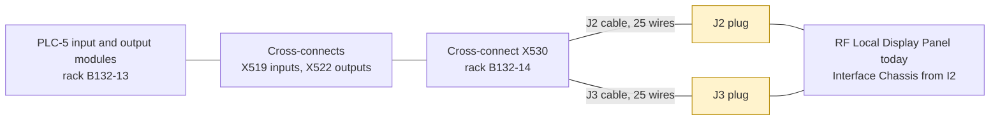
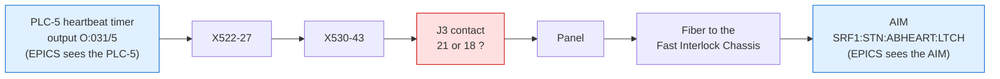
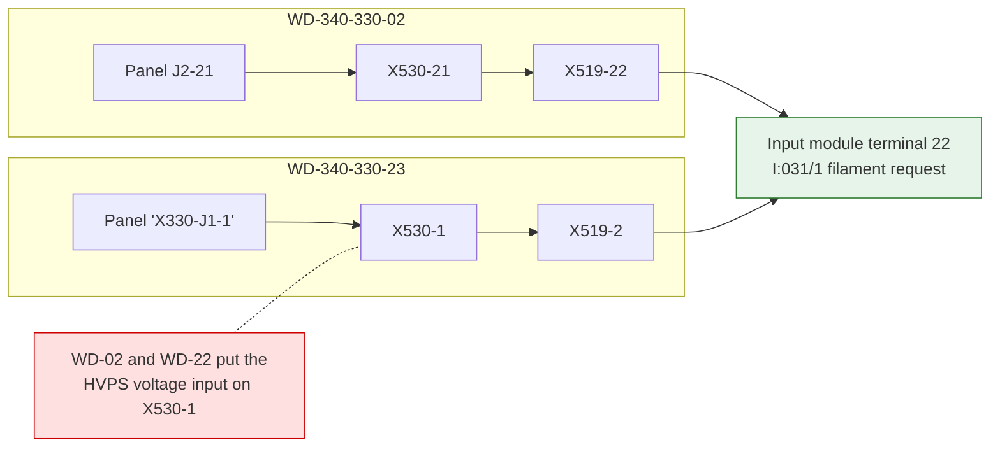
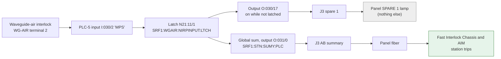

# Open item O5: contact numbers of the panel cables J2 and J3

Doc C O5, which is the same item as Doc M O2. Rewritten for review on 11 November 2026.
Live values were read with `caget` only; nothing was written to the station.

## Summary

At I2 the Interface Chassis takes the place of the RF Local Display Panel. It plugs into
the panel's two cables, J2 and J3, which stay unchanged. The chassis is wired by contact
number, so it must know which contact of each cable plug carries which line.

| Part of the question | Status |
| --- | --- |
| Which lines the chassis takes, what each means, its PLC-5 point | **Settled.** The drawings, the PLC-5 program and the live PVs agree (Appendix C). |
| J2 contact numbers | **Settled on paper.** The panel schematic and the cross-connect diagram agree contact for contact. |
| J3 spare 1, which the cross-connect diagram calls "Waveguide Air MPS" | **Settled.** It is a PEP-II line that only lights the panel's SPARE 1 lamp (section 4.2). |
| **J3 contact numbers (disagreement 1)** | **Open.** It needs one look at the connector, or an answer from J. Sebek or J. Wachter (section 5). |
| Cross-connect terminal numbers (disagreement 2) | **Not needed by the chassis.** Record them as built at I4 (section 3). |

## 1. Where the chassis connects



The chassis touches only the two cable plugs (yellow). X530, X519, X522 and the PLC-5 stay
as they are until the RF MPS is replaced at I4.

- J2 carries the requests from the panel to the PLC-5, the coil-supply summaries and the
  HVPS voltage and current.
- J3 carries the PLC-5's summaries to the panel, among them the AB summary, the AB
  heartbeat, the waveguide pressure and the collector permit.

## 2. Disagreement 1: J3 is numbered from opposite ends

### 2.1 What the two drawings say

The panel schematic SD-340-311-01 and the cross-connect diagram WD-340-330-02 place the
signals of J3 in the same sequence along each row of the connector. They number that
sequence from opposite ends:

```text
Signals in the order both drawings give them (an order, not a view of the connector face)

Wide row      CavA  CavC  Klys  Foc   MT2   WGpr  Flow  Temp  ABsum Sp2   Sp4   GND   GND
  schematic   1     2     3     4     5     6     7     8     9     10    11    12    13
  WD-02       13    12    11    10    9     8     7     6     5     4     3     2     1

Narrow row       CavB  CavD  Coll  MT1   MT3   Circ  Vac   HBeat Sp1   Sp3   Sp5   n/c
  schematic      14    15    16    17    18    19    20    21    22    23    24    25
  WD-02          25    24    23    22    21    20    19    18    17    16    15    14

CavA to CavD  cavity summaries          MT1 to MT3  magic-tee (waveguide load) summaries
Klys, Foc     klystron, focus summaries Flow, Temp, Circ, Vac  area summaries
WGpr          waveguide pressure (P3)   Coll        collector permit (P4)
ABsum         AB summary (P5)           HBeat       AB heartbeat (P6)
Sp1           waveguide-air MPS line    Sp2 to Sp5  spares tied to +24 V
GND           returns                   n/c         not connected
```

The chassis uses WGpr, Coll, ABsum, HBeat and the two returns. In numbers, schematic
contact s is WD-02 contact 14 - s on the wide row and 39 - s on the narrow row.

The two drawings agree on every signal name except spare 1. Even the numbered spares match
(Sp2 to Sp5). They therefore describe the same cable and the same panel, only counted from
opposite ends. Nothing was rewired.

### 2.2 Why it matters

The chassis designer wires each input to a numbered contact. If that number is not the one
stamped on the real connector, the chassis reads the contact at the mirror-image position:

| The chassis wants | Wired by the wrong drawing, it would actually read |
| --- | --- |
| AB summary | magic-tee 2 summary |
| AB heartbeat | the magic-tee 3 summary, which never pulses: a permanent heartbeat fault |
| Waveguide pressure | temperature summary |
| **Collector permit** | **a spare tied to +24 V: the permit is always present, so a collector trip is never seen** |
| Returns | the cavity A and cavity C summary outputs, shorted whenever they are on |

The table holds whichever drawing is wrong, because the mirror is symmetric. The collector
line makes this a safety question, not just a wiring detail.

### 2.3 Why neither the drawings nor EPICS can decide

- **Spare 1 does not decide it.** The "Waveguide Air MPS" name tells us which signal sits
  at that place in the sequence (section 4.2). It does not tell us which number is stamped
  there: the schematic calls the place 22, WD-02 calls it 17. If someone measures 24 V on
  the contact stamped 22, that also fits the other count, where contact 22 is the magic-tee 1
  summary, also 24 V when healthy.
- **EPICS and the program cannot see it.** A contact number is a label on the connector and
  changes no voltage. Software sees only the two ends of each line (diagram below), so every
  PV, program bit and panel lamp reads the same under both numberings.
- **The genders only suggest a cause.** SD-340-311-01 gives J2 as AMP 745078-3 (female)
  and J3 as AMP 745078-1 (male); the panel material list ML-340-310-00 agrees. Seen face on,
  a male and a female connector are mirror images. Numbering one with the other's layout
  gives exactly this pattern, and fits J2 (female) agreeing while J3 (male) does not. But
  it does not show which drawing made the slip.



Section 5 gives the check that decides it.

## 3. Disagreement 2: cross-connect terminal numbers

### 3.1 What it is

Between a panel cable and the PLC-5, each line crosses two cross-connect blocks: X530,
where the panel cables land, and then X519 (inputs) or X522 (outputs).
- WD-340-330-02 draws each route from the panel side.
- WD-340-330-22, -23 and -25 draw the same routes from the module side.

All four agree on where each route ends: the module terminal and the PLC-5 point. They give
different numbers for the terminals in between, and different panel contacts. One example,
the filament request:



Appendix B lists every line the chassis takes.

### 3.2 Why it does not affect the chassis

The chassis plugs into the cable plugs and never touches X530, X519 or X522. These numbers
matter only to someone working at the cross-connects: when the RF MPS replacement is wired
at I4, or during a ring-out.

### 3.3 Which drawing to trust

WD-340-330-02. The other three cannot be right on the panel side as drawn:

- WD-23 puts four digital inputs on X530-1 to -4. WD-22, from the same series, and WD-02
  give those terminals to the HVPS voltage and current lines.
- WD-25 sheet 2 uses panel contacts 40 to 48 and X530 terminals 66 to 75. The panel
  connectors have 25 contacts, and WD-02 uses X530-1 to -50 for the panel.
- WD-22, -23 and -25 call the panel X330, with connectors J1 and J2. The panel's J1 is its
  AC inlet. WD-02 calls the panel X332, with J2 and J3, as on the panel itself.
- WD-23 and WD-02 number X519 differently for the same module terminals.

**Proposal:** take disagreement 2 out of O5 and record the cross-connects as built at I4
(Doc M).

## 4. Other findings

### 4.1 Connector genders

J2 on the panel is female (AMP 745078-3) and J3 is male (AMP 745078-1). This comes from
SD-340-311-01 and ML-340-310-00. The chassis needs the same genders to take the cables
unchanged. Doc C IC-28 does not say so yet.

### 4.2 Spare 1 is the PEP-II waveguide-air MPS line

The panel was designed for PEP-II. At SPEAR3 its Spare 1 input still receives the
waveguide-air MPS line, output O:030/17. The line itself goes only to the panel's SPARE 1
lamp: the panel's logic and fibers do not use it, so it never reaches the Fast Interlock
Chassis or the AIM. The condition behind it is still used, through the AB summary:



- The same latch blocks the global sum (decoded listing, line 729). A waveguide-air MPS trip
  therefore drops the AB summary, which reaches the AIM.
- The program drives O:030/17 while two latches agree (line 1027). The second latch, from
  input I:031/4, never sets, because WD-23 ties that input to 24 V (lines 577 to 580).
- Both latches read OK on 11 November, so the line is at 24 V now, and the panel photo shows
  SPARE 1 lit.

The chassis can therefore leave the spare-1 line unconnected without losing any protection.

### 4.3 Four spare contacts are at +24 V

WD-02 ties the four spares (schematic contacts 10, 11, 23 and 24) together at X530-28, -29,
-40 and -41, and to the 24 V bus X518. That bus also feeds the +DC terminals of the output
module. The panel's SPARE 2 to 5 lamps are lit
(`Designs/tex/common/photos/rf_local_display_panel_front.jpg`). The chassis leaves these
contacts unconnected. Their fixed 24 V is also what makes the meter test in section 5 work.

### 4.4 The heartbeat needs no panel

The heartbeat comes from a PLC-5 timer: 50 ms (T4:19, 0.01 s base, preset 5) while no
analog or thermocouple module reports a read error. When the timer is done, O:031/5 is on
for one scan and the timer restarts (decoded listing, lines 275 and 276). The pulses
continue with J3 unplugged, so they can be probed on the cable.

### 4.5 Drawing slips, for the record

- WD-02 labels the J3 summary lines "A-B DIGITAL INPUT", although they come from the
  output module of WD-25. J. Sebek noted the same mismatch.
- WD-25 stops the two coil-supply summaries (O:031/12 and /13) at X522. WD-02 and
  J. Sebek's fiber note carry them on to J2-07 and J2-20.

## 5. The check

### 5.1 Ask first

J. Sebek's LLRF notes record "Verify the wiring between the Local Panel, cross-connects,
and the AB modules" as completed, with J. Wachter to document X530. If either of them knows
which contact of J3 carries the heartbeat, O5 closes without an access.

### 5.2 Otherwise, 5 minutes with the station off

- Leave the PLC-5 running. Unplug **only J3** at the panel.
- **Never unplug J2.** That drops the filament request, and the PLC-5 then switches the
  klystron heater off.
- With J3 out, the panel's AB-summary and heartbeat fibers go dark and SCR ENABLE drops,
  which is the safe state.

Either test below decides. Doing both cross-checks the result.

**Meter test.** This is valid if the panel showed the klystron, cavity 1 (A) and focus
summaries green before J3 was unplugged. Measure DC volts with the black lead on the first
contact and the red lead on the second:

| Black lead | Red lead | Schematic count is physical | WD-02 count is physical |
| --- | --- | --- | --- |
| 13 | 11 | +24 V | about 0 V |
| 1 | 4 | about 0 V | +24 V |

**Heartbeat test.** Put a scope probe on contact 21 with its ground clip on contact 13.
Short pulses about every 50 ms mean the schematic count is the physical one. If there are
none, move the probe to contact 18 and the clip to contact 1; pulses there mean the WD-02
count is the physical one.

Then plug J3 back in. The operators reset the AIM latches before the next turn-on. Nothing
is written to EPICS.

## 6. Document changes once the answer is known

- **Doc C IC-28:** use the checked pinout and add the genders (J2 female, AMP 745078-3; J3
  male, AMP 745078-1).
- **Doc C tab:x530:** if the WD-02 count is physical, change the J3 contacts of the lines the
  chassis takes:
  - P3 waveguide pressure: 6 to 8;
  - P4 collector: 16 to 23;
  - P5 AB summary: 9 to 5;
  - P6 heartbeat: 21 to 18;
  - returns: 12 and 13 to 2 and 1.
- **Doc M Appendix D:** update tab:j2 and the J3 paragraph to the checked count.
- **Close the items:** Doc C O5 and Doc M O2. Disagreement 2 moves to the I4 as-built record.

## Appendix A. J3, all 25 contacts

Positions follow the schematic count. The X530 terminals, next terminals and points are
from WD-02 and WD-25 sheet 1; WD-25 sheet 2 gives other X530 numbers for the three O:031
lines (section 3).

| Schematic | WD-02 | Signal (schematic label / WD-02 label) | X530 | Next terminal | PLC-5 point | Chassis |
| --- | --- | --- | --- | --- | --- | --- |
| 1 | 13 | Cavity1 Summary / Cavity A Sum | 38 | X522-2 | O:030/0 | not connected |
| 2 | 12 | Cavity3 Summary / Cavity C Sum | 37 | X522-4 | O:030/2 | not connected |
| 3 | 11 | Klystron Summary / Klystron Sum | 36 | X522-6 | O:030/4 | not connected |
| 4 | 10 | Focus Summary / Focus Sum | 35 | X522-8 | O:030/6 | not connected |
| 5 | 9 | Magic Tee2 Summary / Magic Tee 2 Sum | 34 | X522-12 | O:030/10 | not connected |
| 6 | 8 | Waveguide Pressure / Waveguide Air | 33 | X522-14 | O:030/12 | P3 |
| 7 | 7 | Water Flow Summary / Flow Sum | 32 | X522-16 | O:030/14 | not connected |
| 8 | 6 | Temperature Summary / Temp Sum | 31 | X522-18 | O:030/16 | not connected |
| 9 | 5 | AB Summary / Interlock Sum | 30 | X522-22 | O:031/0 | P5 |
| 10 | 4 | Spare2 / Spare 2 | 29 | X518, +24 V | --- | not connected |
| 11 | 3 | Spare4 / Spare 4 | 28 | X518, +24 V | --- | not connected |
| 12 | 2 | GND / Return | 27 | return bus | --- | return |
| 13 | 1 | GND / Return | 26 | return bus | --- | return |
| 14 | 25 | Cavity2 Summary / Cavity B Sum | 50 | X522-3 | O:030/1 | not connected |
| 15 | 24 | Cavity4 Summary / Cavity D Sum | 49 | X522-5 | O:030/3 | not connected |
| 16 | 23 | Collector Summary / Collector Sum | 48 | X522-28 | O:031/6 | P4 |
| 17 | 22 | Magic Tee1 Summary / Magic Tee 1 Sum | 47 | X522-9 | O:030/7 | not connected |
| 18 | 21 | Magic Tee3 Summary / Magic Tee 3 Sum | 46 | X522-13 | O:030/11 | not connected |
| 19 | 20 | Circulator Summary / Circulator Sum | 45 | X522-15 | O:030/13 | not connected |
| 20 | 19 | Vacuum Summary / Vacuum Sum | 44 | X522-17 | O:030/15 | not connected |
| 21 | 18 | AB Heartbeat / A-B Heartbeat | 43 | X522-27 | O:031/5 | P6 |
| 22 | 17 | Spare1 / Waveguide Air MPS | 42 | X522-19 | O:030/17 | not connected |
| 23 | 16 | Spare3 / Spare 3 | 41 | X518, +24 V | --- | not connected |
| 24 | 15 | Spare5 / Spare 5 | 40 | X518, +24 V | --- | not connected |
| 25 | 14 | (spare) / N/C | 39 | not connected | --- | not connected |

## Appendix B. Lines the chassis takes, through the cross-connects

Each route reads panel contact, then X530 terminal, then next terminal, then module
terminal. Contacts in quotes are as WD-22, -23 and -25 name them; J3 contacts in the WD-02
column use WD-02's own count.

| Line | PLC-5 point | WD-340-330-02 | WD-340-330-22, -23, -25 |
| --- | --- | --- | --- |
| P1 main-focus summary | O:031/12 | J2-07, 7, X522-34, 34 | X522-34, 34; nothing drawn beyond X522 |
| P2 bucking-coil summary | O:031/13 | J2-20, 20, X522-35, 35 | X522-35, 35; nothing drawn beyond X522 |
| P3 waveguide pressure | O:030/12 | J3-8, 33, X522-14, 14 | "X330-J2-08", 33, X522-14, 14 (agrees) |
| P4 collector | O:031/6 | J3-23, 48, X522-28, 28 | "X330-J2-45", 72, X522-28, 28 |
| P5 AB summary | O:031/0 | J3-5, 30, X522-22, 22 | "X330-J2-40", 66, X522-22, 22 |
| P6 AB heartbeat | O:031/5 | J3-18, 43, X522-27, 27 | "X330-J1-12", 71, X522-27, 27 |
| P7 solenoid request | I:031/3 | J2-18, 18, X519-24, 24 | "X330-J1-3", 3, X519-4, 24 |
| P8 filament request | I:031/1 | J2-21, 21, X519-22, 22 | "X330-J1-1", 1, X519-2, 22 |
| P9 timeout request | I:031/2 | J2-22, 22, X519-23, 23 | "X330-J1-2", 2, X519-3, 23 |
| P10 reset request | I:030/0 | J2-23, 23, X519-1, 1 | "X330-J1-11", 11, X519-61, 1 |
| P11 online mode | I:031/7 | J2-25, 25, X519-28, 28 | "X330-J1-4", 4, X519-8, 28 |
| P12 local mode | I:030/1 | J2-12, 12, X519-2, 2 | "X330-J1-12", 12, X519-62, 2 |
| N3 HVPS voltage | analog 2, ch 13 | J2-03, 3, X517-13, 13 | "X330-J1-03", 3, X517-13, 13 (agrees) |
| N4 HVPS current | analog 2, ch 14 | J2-04, 4, X517-14, 14 | "X330-J1-04", 4, X517-14, 14 (agrees) |

## Appendix C. Live values, 11 November 2026 (read-only caget)

The PVs come from the head revisions of `rf_digital_All.substitutions`. Its templates
(`rf_interlock.db`, `rf_digital_plc.db` and `rf_sumy_plc.db`) read DCM table 6, in which
word 15 is N21:11, word 16 is N21:12, word 35 is N22:0 and word 36 is N22:1. Each bit was
traced in the decoded program.

| Chassis line | PLC-5 point and data bit | PV | Value |
| --- | --- | --- | --- |
| P5 AB summary | O:031/0, global sum N22:0/0 | SRF1:STN:SUMY:PLC | OK |
| P6 AB heartbeat | O:031/5, through the panel fiber to the AIM | SRF1:STN:ABHEART:LTCH | OK |
| P4 collector | O:031/6, latch N21:12/2 | SRF1:KLYSCOLL:POWER:LTCH | OK |
| P3 waveguide pressure | O:030/12, N22:1/10 | SRF1:WGAIRPRESS:SUMY:PLC | OK |
| P1 main-focus summary | O:031/12, N22:0/6 | SRF1:SOLNMAIN:SUMY:PLC | OK |
| P2 bucking-coil summary | O:031/13, N22:0/7 | SRF1:SOLNBUCK:SUMY:PLC | OK |
| P8 filament request | I:031/1, copied to N22:0/2 | SRF1:FILAMENT:ON:PLC | ON |
| P9 timeout request | I:031/2, latched in N22:0/3 | SRF1:FILAMENT:TIMEBYP:PLC | NOBYPASS |
| P10 reset request | I:030/0, copied to N22:0/1 | SRF1:STN:RESET:PLC | NORESET |
| P12 local mode | I:030/1, copied to N21:11/0 | SRF1:STN:KEY:STAT | REMOTE |
| P7 and P11 | I:031/3 and I:031/7, online bit N21:12/5 | SRF1:STN:LOCAL:ON | ONLINE |
| Spare 1 (O:030/17) | latches N21:11/1 and N21:11/15 | SRF1:WGAIR:NIRPINPUT:LTCH, SRF1:WGAIR:NIRPOUTPUT:LTCH | OK, OK |

## Appendix D. Sources

| Drawing or record | What it gives | File |
| --- | --- | --- |
| SD-340-311-01, panel schematic | J2 and J3 contact of each panel signal; J2 AMP 745078-3 (female), J3 AMP 745078-1 (male) | `llrf/documentation/localPanel/sd3403110100.pdf` |
| ML-340-310-00, panel material list | connector genders, page 2, items 22 and 23 | `llrf/documentation/localPanel/ml3403100000.pdf` |
| WD-340-330-02, wiring to local panel | panel contact, X530, X513/X517/X519/X522 and module pin | `llrf/documentation/mpsWiringDiagrams/wd3403300200.pdf` |
| WD-340-330-22, analog input 2 | channels 13 and 14 | `llrf/documentation/mpsWiringDiagrams/wd3403302200.pdf` |
| WD-340-330-23, digital input 1 | 1771-IBN, rack X4 module 9 | `llrf/documentation/mpsWiringDiagrams/wd3403302300.pdf` |
| WD-340-330-25, digital output 1 | 1771-OBN, rack X4 module 10 | `llrf/documentation/mpsWiringDiagrams/wd3403302500.pdf` |
| J. Sebek, panel to cross-connect mapping (2022) | the two drawings side by side, mirror worked out, "Spare 1?" flagged | `llrf/documentation/LocalPanelToXConnectMapping.xlsx` |
| J. Sebek, fiber-optic connections, Rev 3 | records the J3 reversal and the spare-1 line | `llrf/documentation/fiberOpticCableSignalControlRev3.docx` |
| J. Sebek, LLRF documentation notes, R2 | wiring verification marked completed; X530 action for J. Wachter | `llrf/documentation/LLRFDocumentationNotesR2.docx` |
| PLC-5 program, decoded | the use of each point; lines cited above | `llrf/allenBradley/decoded/SP3RF_original_with_comments_on_rugs.txt` |
| Panel front photo | all summary lamps green, SPARE 1 to 5 lit | `Designs/tex/common/photos/rf_local_display_panel_front.jpg` |
