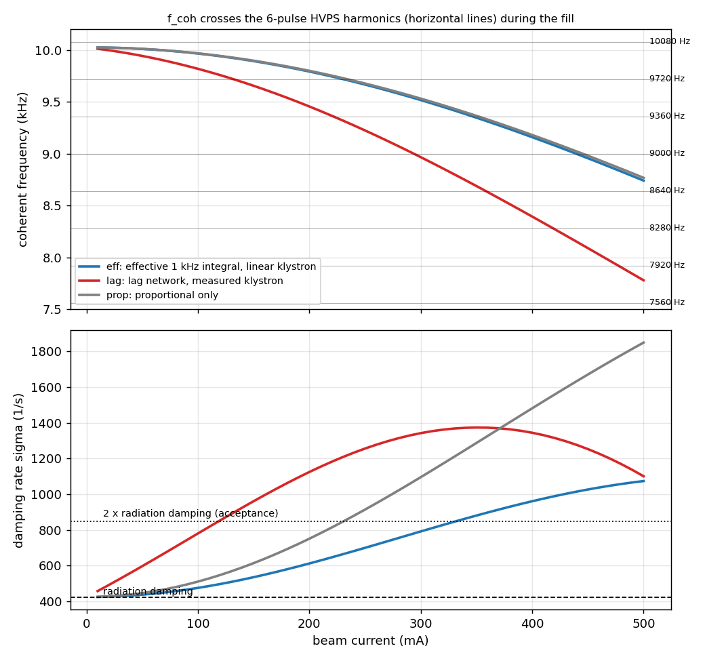
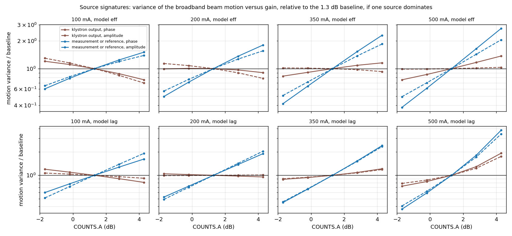
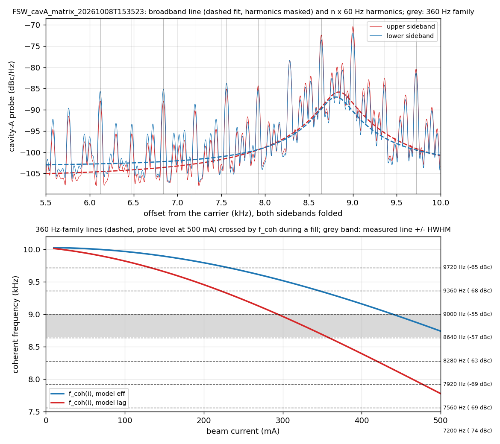
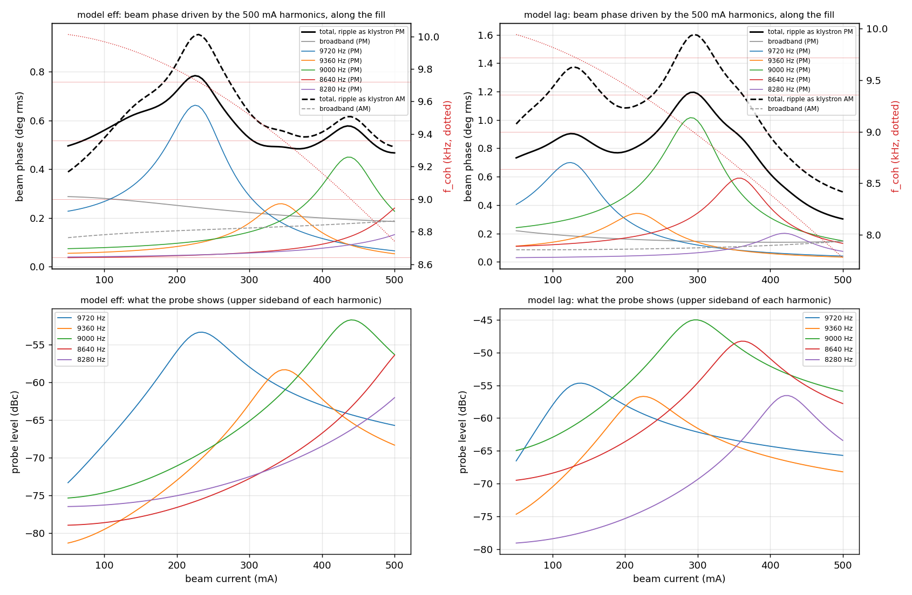
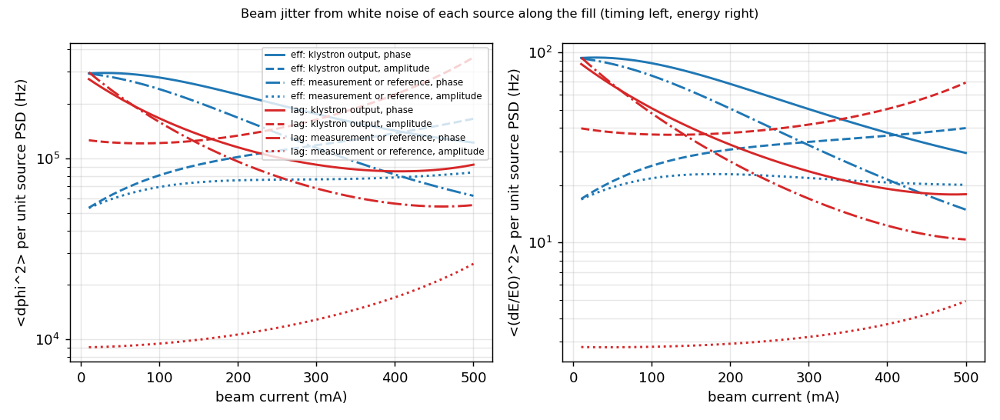
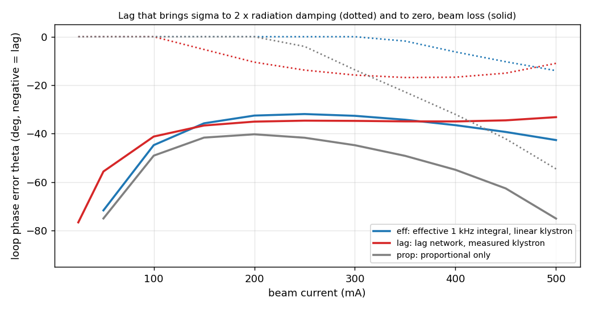
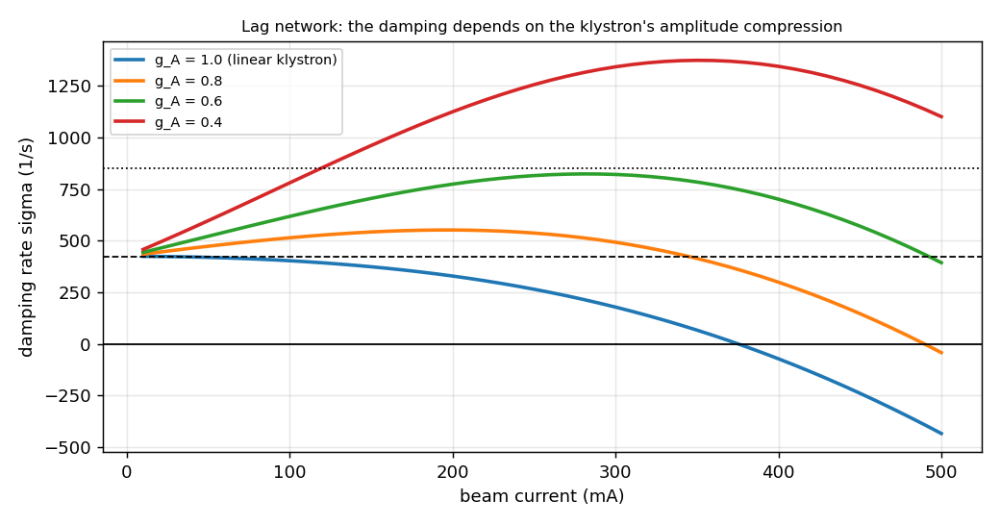

# SPEAR3 Direct-Loop Optimization: Synchrotron Motion and the 0–500 mA Ramp

*Theory and measurement plan, study optLLRF: noise and damping of the dipole mode, line harmonics, and loop settings along the fill*

Draft for discussion | SSRL RF | 23 October 2026 | Companion to Doc P §8 (Synchrotron Damping and Direct-Loop Optimization)

Code: [`code/`](code/README.md) | Results quoted here: [`results/`](results/) (each table names the script that produces it) | First draft: [`archive/`](archive/SPEAR3_Decoupling_Measurement_Plan_draft_2026-10-22.md) | Loop identification: [SPEAR3_Loop_System_Identification.md](SPEAR3_Loop_System_Identification.md)

---

## 0. What changed

### 0.1 Second revision (23 October): the 200–300 mA beam dumps, probe-only methods, loop identification

1. **Recent beam dumps at 200–300 mA are attributed to HVPS ripple harmonics overlapping the synchrotron line.** §3.4 now follows each harmonic through the fill.
   - With the ripple measured at 492 mA, the models put the largest motion of the whole fill at 225–230 mA (`eff`, the 9720 Hz harmonic) or 295 mA (`lag`, 9000 Hz). There it is 1.6–3.8 times the 500 mA motion, and the harmonic's probe level rises by 10–12 dB.
   - At that ripple level the motion is still 0.8–1.6° rms. A dump needs more: a larger ripple at those currents, damping close to zero, or a protection system that trips on the motion (§3.4, "What a dump needs").
   - E0b analyzes the dump records; E1 records the probe through the fill.
2. **The beam's pole from the probe alone, without a lineshape model** (new §3.7).
   - Output-only subspace identification (SSI) of the I/Q envelope, after removing the HVPS comb, recovers σ and $f_{coh}$ within 2 Hz and 1% for every noise source in simulated records.
   - Every per-sideband line fit is biased by up to 90 Hz and 6% when amplitude noise drives the line.
   - Long FSW I/Q records are required: 25.6 ms shots of the RFP cavity RAM are dominated by the comb.
3. **The fill as a frequency sweep.** Each 60 Hz harmonic that $f_{coh}$ passes gives one point of $f_{coh}$(I), from its peak on the probe (§3.7).
4. **Post-mortem of trips.** `fault_postmortem.py` reads the RFP fault records. The 15 records of November 2025 show no dipole oscillation before their trips.
5. **The loop network measured, not assumed.** A two-channel multisine through the RFP DACs, with TOTAL and a probe recorded in the same shot, measures the controller, the plant and the klystron block by block ([SPEAR3_Loop_System_Identification.md](SPEAR3_Loop_System_Identification.md); new experiment E6).

### 0.2 First revision: changes from the first draft

The first draft's experiment, a gain scan with frequency-offset tracking off and the cavity-probe spectrum as the beam signal, is kept as Experiment E2. Reviewing it against the station model (`spear3rf`) and the 8 October 2026 data changed the following.

| Draft item | Finding | Change in this version |
|---|---|---|
| Purpose: separate noise and damping at several currents | Right framing, but the ramp from 0 to 500 mA was not covered | Ramp theory (§4) and a passive fill measurement (E1) added |
| Eq. (5), $S_{up}/\lvert 1+G_{OL}\rvert^2 + S_{sens}\lvert T\rvert^2$ | Wrong at SPEAR3: the detuned cavities and the klystron's amplitude compression transfer amplitude and phase noise differently. At 500 mA and 0 dB, the drive from klystron phase noise is not reduced at all, where the scalar form predicts 0.41 (Doc P §8.7) | Per-source two-quadrature transfers (§3.3); fit of the two separable groups (§10) |
| "Away from the line the floor is the drive" | Below $f_{coh}$ the beam follows the drive ($\chi(0)$ = 1 with the integral path, 2.5 without feedback), and at 500 mA the floor is raised by a comb of HVPS harmonics | The floor is not used as the drive; the line is converted with the model (§3.6) |
| Broadband drive assumed | At 500 mA most of the motion is driven by two discrete 6-pulse HVPS harmonics, 8640 and 9000 Hz, that flank $f_{coh}$ (§3.4) | Harmonics masked in the broadband fit and analysed separately; line crossing during the fill is the leading hypothesis for the maximum near 200 mA |
| Stop criteria $Q \le 35$, or $Q$ up by more than 30% in one step, at every current | In the models the present setting already gives $Q$ = 40–66 at 100 mA and 26–50 at 200 mA (damping near radiation damping). At 500 mA the +1.5 dB step itself is predicted to raise $Q$ by 31–48% | $Q \le 35$ kept at 350–500 mA; otherwise stop when σ falls more than predicted (§11) |
| Phase set B (+5° lead): "phase moves σ, gain moves $S_{eff}$" | +5° changes σ by 2–12%; gain changes both σ and the drive | Kept as a short model check; klystron operating-point test (E4) added |
| Linear fit of Eq. (5) for $S_{up}$, $S_{sens}$ | The gain scan separates klystron from measurement/reference noise (condition number 3–7), but not amplitude from phase noise of the same source (11–150) or all four (220–22 600) | I/Q capture and two-channel injection (E3) added |
| Lorentzian fit; Fano shape mentioned | On synthetic I/Q records the Fano fit to the sidebands of the complex envelope recovers the beam pole to 2 Hz and 2% for phase-type drive. For amplitude-type drive every fit puts $f_{coh}$ 40–95 Hz low, with σ within 8%. Fits to the amplitude or phase spectrum of a record are off by up to 1.3 kHz. On the 30 Hz-RBW swept captures, the strong harmonics beside the peak distort the line core | Lorentzian and Fano fits over 6–10 kHz with the harmonics masked; narrow-window refits only on I/Q records; cross-check against the closed-loop pole (§3.6) |
| Closed-loop routine cleanup (draft §10.4) | Confirmed: about 25 early returns after `save_RFP_mux`; after `DACS 1` they leave the noise DACs enabled | `optllrf_measure_closed_safe.m` (§8) |

---

## 1. Purpose and questions

The stored beam shows larger synchrotron oscillation than in earlier years, largest near 200 mA. Recent beam dumps during fills cluster at 200–300 mA, where HVPS ripple harmonics overlap the synchrotron line. The amplitude of the oscillation, and its damping, are set by the direct loop together with the noise of the RF system. Both change with beam current, so the fill from 0 to 500 mA must also stay safely damped.

**Goals**

- **G1.** Minimize the synchrotron oscillation at 500 mA without losing damping margin.
- **G2.** Keep the dipole mode damped, with margin against errors of the loop settings, at every current of the 0–500 mA fill, and stop the 200–300 mA dumps.

**Questions the study answers**

| # | Question | Where |
|---|---|---|
| Q1 | Is the oscillation driven by broadband RF noise, by discrete HVPS harmonics near $f_{coh}$, or by reduced damping? | §3.4, E1, E2 |
| Q2 | Which source sets the broadband drive: the klystron (upstream) or the measurement/reference? Amplitude or phase? | §3.3, E2, E3 |
| Q3 | Which model of today's loop describes the station at 100–350 mA? | §3.2, E1, E2 |
| Q4 | How much loop-phase error, and how much loss of klystron compression, can the beam tolerate at each current of the fill? | §4, E4 |
| Q5 | Which gain, phase and integral-path settings, fixed or scheduled with current, minimize the motion within the damping limits? | §12, §13 |
| Q6 | What dumps the beam at 200–300 mA: the dipole mode at an HVPS-harmonic crossing, and if so, with how much ripple and how little damping? | §3.4, §3.7, E0b, E1 |
| Q7 | What are the loop's networks, gains and klystron response as measured, not as documented? | E6, [loop identification](SPEAR3_Loop_System_Identification.md) |

**Deliverables:** for each current, (a) the noise and damping contributions to the motion versus gain, (b) the dominant noise source group, (c) the motion driven by discrete harmonics and the currents at which $f_{coh}$ crosses them, (d) the measured σ(I), $f_{coh}$(I), which decide between the two loop models, (e) the phase-error and klystron margins along the fill, and (f) recommended settings for top-off and for the fill.

---

## 2. Summary of the predictions

These numbers come from the model and the 8 October 2026 data. The experiments test them.

1. **Damping is weakest at low current.** In both loop models σ approaches radiation damping (424 s⁻¹) below 100 mA ($Q$ = 52–72 at 50 mA). For phase-type noise, the motion's variance at 50 mA is 2.3–4.4 times that at 500 mA (§4.2).
2. **The fill's weakest point for loop-phase errors is 200–300 mA.** There a lag of 32–35° makes the beam Robinson-unstable; at 50 mA it tolerates 56–72° (§4.3).
3. **With the installed lag network, high-current damping depends on the klystron's amplitude compression.** With a linear klystron the beam is unstable above about 375 mA, and with $g_A$ = 0.8 above about 490 mA. Today's $g_A$ = 0.40 gives 1100 s⁻¹ at 500 mA (§4.4). Under this model, anything that takes the klystron out of compression during the fill is a beam-loss mechanism.
4. **At 500 mA the motion is driven mainly by two 6-pulse HVPS harmonics,** 8640 and 9000 Hz, which flank $f_{coh}$ = 8.83 kHz. Discrete lines give 0.36–0.55° rms of beam phase, broadband noise 0.14–0.19°, together 0.39–0.58° rms (2.3–3.4 ps). That is 4–6 times the 0.1° field-phase specification (§3.4).
5. **$f_{coh}$ sweeps from 10.0 kHz to 8.8 kHz during a fill and crosses the 360 Hz family.** The effective model puts the 9720 Hz crossing at 230 ± 41 mA, and the lag model the 9360 Hz crossing at 222 ± 41 mA. A resonance with an HVPS harmonic is therefore the leading hypothesis for the maximum near 200 mA (§3.4, §4.5).
6. **The crossings make 200–300 mA the worst part of the fill.** With the ripple held at its 492 mA level, the total motion peaks at 0.78–0.95° rms at 225–230 mA (`eff`, 9720 Hz) or 1.2–1.6° at 295 mA (`lag`, 9000 Hz). That is 1.6–3.8 times the motion at 490 mA. At a crossing the beam moves 0.012–0.025° per mdeg of klystron phase ripple at that harmonic, or about 0.1° per $10^{-4}$ of amplitude ripple; a 30° loop-phase lag raises this 3–6-fold (§3.4).
7. **A gain scan separates klystron noise from measurement/reference noise.** From −1.7 to +4.3 dB, measurement noise raises the variance of the motion 2.5–10 times, while klystron noise changes it by 0.6–2.7 times. The scan cannot separate amplitude from phase noise of the same source (§3.3).
8. **The two loop models both match the measured damping at 500 mA but disagree at 100–350 mA,** by up to 1.8× in σ and 0.66 kHz in $f_{coh}$ (the `lag` model's frequency is also 12% low at 500 mA). One fill with the line recorded every 25–50 mA decides between them (§3.2, E1).
9. **The probe alone measures the pole, whatever drives it.** Subspace identification of 16 s I/Q records, with the HVPS comb removed, recovers σ to 1% and $f_{coh}$ to 2 Hz in simulated records for all four noise sources (§3.7).

---

## 3. Theory

### 3.1 The dipole mode as a driven, damped oscillator (Doc P §8.1, §8.7)

Linearized about the synchronous phase, the phase $\Delta\phi$ of the bunch centroids (positive when late) obeys

$$
\frac{d^2\Delta\phi}{dt^2} + 2\sigma\,\frac{d\Delta\phi}{dt} + (\omega_{coh}^2 + \sigma^2)\,\Delta\phi \simeq \omega_s^2\,n_{eff}(t),
\qquad n_{eff} = \varepsilon_A\cot\phi_s - \varepsilon_\phi .
$$

- $\sigma$ and $\omega_{coh}$ are the dominant root of the characteristic function $D_0(s)$ (Doc P Eq. 8.4). They contain the cavities, the loop, the klystron and the beam current.
- $n_{eff}$ is the gap-voltage error the RF system produces with the bunches held fixed: relative amplitude $\varepsilon_A$, phase $\varepsilon_\phi$ (positive = advance). $\cot\phi_s$ = 0.41, so 0.1% of amplitude acts like 0.024° of phase.
- The voltage that the motion induces itself is inside $D_0$. A gap error *measured with beam* contains both drive and response, so it cannot be used as the drive.

**Response.** $\chi(s) = \Delta\phi/n_{eff} = \omega_s^2/D_0(s)$. Near the line, $\lvert\chi\rvert^2$ is a Lorentzian of full width $\sigma/\pi$ with peak $\lvert\chi\rvert_{max} \simeq Q(\omega_s/\omega_{coh})^2$. Today that peak is 33.

**Flat drive.** For a drive whose spectral density is flat across the line:

$$
\langle\Delta\phi^2\rangle = \frac{\omega_s^4}{8\,\omega_{coh}^2}\,\frac{S_n(f_{coh})}{\sigma} = \lvert\chi\rvert_{max}^2\,S_n \times \frac{\sigma}{2}\ [\mathrm{Hz}] .
$$

This holds to 3% without feedback ($Q$ = 3.5) and to 1% from 0 dB of gain upwards (Doc P §8.7).

**Below the line the beam follows the drive.** $\chi(0) = \omega_s^2/D_0(0)$ is the inverse static ratio: 1.0 with an integral path, 1.3 at 0 dB proportional, 2.5 without feedback. HVPS lines far below $f_{coh}$ therefore move the beam's phase almost one-to-one, whatever the damping.

**A single line** of rms drive $n_L$ at $\omega_L$ gives

$$
\Delta\phi_L = \lvert\chi(j\omega_L)\rvert\,n_L \simeq \frac{\omega_s^2\,n_L}{\sqrt{(\omega_{coh}^2-\omega_L^2)^2 + 4\sigma^2\omega_L^2}} .
$$

**Observables.**
- Energy: each component carries $\Delta E/E_0 = (\omega/\alpha_c\omega_{RF})\,\Delta\phi$, i.e. 0.0157 per radian at 8.8 kHz.
- Orbit: $\eta\,\Delta E/E_0$ where the dispersion $\eta \ne 0$.
- Timing: $\Delta\phi/\omega_{RF}$, 0.58 ps per 0.1°.

The timing jitter includes everything the beam follows below the line; the energy and orbit motion is essentially the resonant part only.

**Noise/damping split** (draft Eq. 4, kept). It is valid for the broadband part of the line only:

$$
\ln\frac{\langle\Delta\phi^2\rangle_k}{\langle\Delta\phi^2\rangle_0} = \ln\frac{S_{n,k}}{S_{n,0}} - \ln\frac{\sigma_k}{\sigma_0} - 2\ln\frac{\omega_{coh,k}}{\omega_{coh,0}} .
$$

Discrete lines follow $\lvert\chi(\omega_L)\rvert$ instead, which changes strongly when $f_{coh}$ moves past a line (§3.4).

### 3.2 What sets σ and $f_{coh}$: two models of today's loop

Two models reproduce the measured 500 mA line, and they cannot both be right at lower current:

| Model | Integral path | Klystron | 500 mA prediction | Source |
|---|---|---|---|---|
| `eff` | Shared phase, effective corner 1 kHz | Linear | 8.74 kHz, 1074 s⁻¹ | Reproduces the measured damping (Doc P Table 27) |
| `lag` | Installed RFP lag network (2.93 kHz corner, 0.26 kHz leak) | Measured in normal operation: $g_A$ = 0.40, $k_{AP}$ = 0.10 | 7.78 kHz, 1101 s⁻¹ | The network the closed-loop data show; the klystron from fault records (Doc P §8.10) |

The `lag` model gets the damping right but the frequency 12% low, a known open discrepancy (Doc P §8.10). Both use the loop gain $G$ = 1.0 at COUNTS.A = 1.3 dB, with 625 ns delay, θ = 0 and the tuners at the optimum detuning. A third model, `prop` (proportional loop only, linear klystron), describes the station with INTCOMP off (E5) and serves as a reference in §4.3.

**Loop phase in the models.** θ is the loop-phase error for an on-tune cavity (+ = lead). The rotation that the 625 ns delay adds at the operating detuning, +8° at 500 mA (Doc P §8.4, rule 4), is part of the model. So with tracking off and PHASE.C at its low-current setting, the station is at θ = 0 at every current. The 8 October line, to which both models were matched at θ = 0, was taken with tracking on (§4.3, §6.1).

**Predicted line along the fill** ([`ramp_eff.csv`](results/ramp_eff.csv), [`ramp_lag.csv`](results/ramp_lag.csv); `predict_ramp.py`)

| I (mA) | `eff`: $f_{coh}$ (Hz) / σ (s⁻¹) / Q | `lag`: $f_{coh}$ / σ / Q |
|---|---|---|
| 50 | 10011 / 437 / 72 | 9944 / 597 / 52 |
| 100 | 9967 / 475 / 66 | 9820 / 780 / 40 |
| 150 | 9894 / 535 / 58 | 9656 / 961 / 32 |
| 200 | 9793 / 612 / 50 | 9456 / 1125 / 26 |
| 250 | 9667 / 700 / 43 | 9225 / 1256 / 23 |
| 300 | 9518 / 792 / 38 | 8967 / 1342 / 21 |
| 350 | 9348 / 881 / 33 | 8688 / 1374 / 20 |
| 400 | 9160 / 961 / 30 | 8394 / 1345 / 20 |
| 500 | 8741 / 1074 / 26 | 7778 / 1101 / 22 |
| Measured, 492–497 mA (8 Oct 2026) | 8790–8830 / 1090–1160 / 24–26 | (same measurement) |

At 200 mA the models differ by 0.34 kHz and 1.8× in σ: this is the measurement that settles Q3.

### 3.3 Where the drive comes from

Each noise source $x$ reaches the drive through its own transfer function:

$$
n_{eff}(s) = \sum_x h_x(s)\,u_x(s), \qquad S_n(f) = \sum_x \lvert h_x(j2\pi f)\rvert^2\,S_{u_x}(f) .
$$

The sources are:
- amplitude and phase noise at the klystron output (HVPS ripple, klystron noise);
- noise ahead of the klystron (through the klystron matrix);
- noise in the measured vector sum (probes, demodulators);
- noise of the reference, which acts as measurement noise of opposite sign.

The $h_x$ come from the two-quadrature model (Doc P App. C; `spear3rf.quadrature`). The scalar form $1/(1+G_{OL})$ and $T$ fails here for three reasons. The detuned cavity turns klystron amplitude into gap phase through its load angle (−45°). The loop acts differently on the two sidebands of every error. And the compressed klystron passes amplitude corrections with gain 0.40 but phase corrections with gain 1. Without feedback at 500 mA, klystron amplitude noise drives the beam 5.5 times more strongly, in power, than the same phase noise.

**Signatures.** Each entry gives the variance of the broadband motion at −1.7 dB and at +4.3 dB, relative to the 1.3 dB baseline, if one source dominates ([`scan_expected.csv`](results/scan_expected.csv); `predict_scan.py`):

| Current | Model | Klystron phase | Klystron amplitude | Measurement phase | Measurement amplitude |
|---|---|---|---|---|---|
| 100 mA | `eff` / `lag` | 1.20→0.76 / 1.20→0.81 | 1.30→0.70 / 1.07→0.92 | 0.60→1.51 / 0.60→1.62 | 0.65→1.39 / 0.51→1.92 |
| 200 mA | `eff` / `lag` | 0.99→0.90 / 1.05→0.95 | 1.14→0.78 / 0.99→1.01 | 0.50→1.80 / 0.52→1.90 | 0.57→1.56 / 0.49→2.04 |
| 350 mA | `eff` / `lag` | 0.83→1.16 / 0.89→1.21 | 1.02→0.93 / 0.90→1.19 | 0.42→2.31 / 0.45→2.41 | 0.51→1.85 / 0.46→2.34 |
| 500 mA | `eff` / `lag` | 0.76→1.37 / 0.72→1.92 | 0.99→1.03 / 0.79→1.75 | 0.38→2.73 / 0.37→3.80 | 0.50→2.06 / 0.40→3.40 |

**Identifiability.** The motion driven by measurement/reference noise always rises steeply with gain, 2.5–10-fold in variance across the scan, because $T \to 1$ while σ falls. Klystron noise changes far less. The scan therefore separates the two *groups*: the condition number of the fit is 3–7 for klystron versus measurement. It does not separate amplitude from phase noise inside a group (11–150), nor all four sources at once (220–22 600; [`scan_identifiability.csv`](results/scan_identifiability.csv)).

A synthetic scan confirms this (`fit_sources.py --synthetic`: seven points at 500 mA with 15% scatter). Under the correct hypothesis the fit returns the group levels: klystron $3.1\times10^{-11}$ against a true $3.0\times10^{-11}$, and measurement $1.5\times10^{-11}$ (bootstrap 0.8–2.0) against $1.0\times10^{-11}$. But the residuals of all five amplitude/phase hypotheses lie within 6% of each other, so the scan cannot choose between them. The amplitude/phase split needs E3.

### 3.4 Discrete HVPS harmonics near $f_{coh}$

**The 500 mA line comb.** The probe spectrum of 8 October 2026, 15:35 (RMS detector, 30 Hz RBW), carries a comb of 60 Hz harmonics up to 10 kHz, strongest on the 6-pulse (360 Hz) family. The DSP ripple loop cancels lines only up to 2.88 kHz (Doc P §6.3), and the direct loop rejects lines near 9 kHz by just a few dB. Lines near $f_{coh}$ are amplified by the beam resonance and dominate the motion ([`lines_FSW_cavA_matrix_20261008T153523.csv`](results/lines_FSW_cavA_matrix_20261008T153523.csv); `lines_near_fcoh.py`):

| 360 Hz-family line | Probe level at 500 mA (dBc, upper sideband) | Beam phase from this line, `eff` model (deg rms, upper/lower) |
|---|---|---|
| 7920 Hz | −69.3 | 0.043 / 0.039 |
| 8280 Hz | −63.3 | 0.095 / 0.096 |
| 8640 Hz | −57.3 | 0.215 / 0.192 |
| 9000 Hz | −55.3 | 0.257 / 0.240 |
| 9360 Hz | −67.6 | 0.058 / 0.052 |
| 9720 Hz | −65.3 | 0.068 / 0.065 |

**Beam motion at 492 mA:**

| | `eff` | `lag` |
|---|---|---|
| Broadband line (harmonics masked: −58.5 / −59.8 dBc) | 0.186° | 0.143° |
| Discrete lines (beam-dominated, 2–10 kHz) | 0.554° | 0.364° |
| **Total** | **0.584° rms (3.4 ps)** | **0.391° rms (2.3 ps)** |
| Energy $\Delta E/E_0$ | $1.6\times10^{-4}$ | $1.0\times10^{-4}$ |
| Broadband drive $S_n(f_{coh})$ | $1.8\times10^{-11}$ rad²/Hz | $1.1\times10^{-11}$ rad²/Hz |

Lines within ±1 kHz of $f_{coh}$ carry 93–99% of the line-driven variance, and the 6-pulse lines among them 76–79%.

**How the line share is established.** Each line on the probe is the coherent sum of field modulation and the beam's response to it. The model gives the beam's share for klystron-amplitude and klystron-phase drive. For 8640 and 9000 Hz the share is 0.8–1.3 under both hypotheses, so these lines are beam motion. (A share above one means that the beam's response partly cancels the field modulation.) There is also a consistency check. If the 9000 and 9720 Hz lines had equal drive, the resonance would make the 9000 Hz line 11.5 dB stronger on the probe; measured, it is 10.0 dB stronger.

**Line crossing during a fill.** As the current rises, $f_{coh}$ moves through the comb. The resonance with a line lasts while $\lvert f_{coh} - f_L\rvert$ < HWHM, which is ±30–43 mA of current ([`ramp_crossings.csv`](results/ramp_crossings.csv)):

| Line | `eff` crossing | `lag` crossing |
|---|---|---|
| 9720 Hz | **230 ± 41 mA** | 132 ± 42 mA |
| 9360 Hz | 347 ± 39 mA | **222 ± 41 mA** |
| 9000 Hz | 440 ± 39 mA | 294 ± 40 mA |
| 8640 Hz | not reached below 500 mA | 358 ± 38 mA |
| 8280 Hz | not reached | 419 ± 35 mA |
| 7920 Hz | not reached | 477 ± 30 mA |

Both models put a 360 Hz-family crossing at 220–230 mA. **Hypothesis H1:** the maximum near 200 mA is the resonance of the dipole mode with a 6-pulse HVPS harmonic. E1 tests it directly.

The gain scan of E2 also moves $f_{coh}$ across the comb. At 500 mA, from −1.7 to +4.3 dB, $f_{coh}$ goes from 8.36 to 9.10 kHz (`eff`). The response $\lvert\chi\rvert$ at 9000 Hz goes from 8 through 18 (baseline) to 40, so the variance that this harmonic drives changes 23-fold across the scan ([`scan_expected.csv`](results/scan_expected.csv), columns `chi_at_*`). The analysis must therefore treat lines and broadband separately.

**Along the fill: the motion at each crossing** (`fill_crossing.py`; [`fill_crossing_eff.csv`](results/fill_crossing_eff.csv), [`fill_crossing_lag.csv`](results/fill_crossing_lag.csv), [`fill_crossing_harmonics.csv`](results/fill_crossing_harmonics.csv)).

**Method.**
- The ripple at the klystron output that produces each of the 40 harmonics between 5.5 and 10 kHz is inferred from the 492 mA probe, by inverting the model's full probe response (field modulation plus beam response). This is done under two hypotheses: the HVPS modulates the klystron's phase, or its amplitude.
- That ripple is then held fixed through the fill, and the broadband part is scaled with the jitter tables of §4.2.
- At 490 mA this gives 0.32–0.51° in total. That is less than the 0.39–0.58° above, because only the harmonics of 5.5–10 kHz are counted, at the nominal operating point rather than the snapshot's.

| Model, ripple as | Total at 490 mA | Largest below 450 mA | Where, and driven by | Ratio |
|---|---|---|---|---|
| `eff`, phase | 0.47° | 0.78° | 225 mA, 9720 Hz crossing | 1.7 |
| `eff`, amplitude | 0.50° | 0.95° | 230 mA, 9720 Hz | 1.9 |
| `lag`, phase | 0.32° | 1.20° | 295 mA, 9000 Hz | 3.8 |
| `lag`, amplitude | 0.51° | 1.60° | 295 mA, 9000 Hz | 3.1 |

Each crossing (phase hypothesis) is listed with the current, the beam phase that harmonic alone drives at its peak, and its probe level relative to 500 mA:
- **`eff` model:**
  - 9720 Hz at 230 mA: 0.66°, +12.4 dB
  - 9360 Hz at 347 mA: 0.26°, +10.0 dB
  - 9000 Hz at 440 mA: 0.45°, +4.6 dB
- **`lag` model:**
  - 9720 Hz at 132 mA: 0.70°, +11.0 dB
  - 9360 Hz at 222 mA: 0.34°, +11.5 dB
  - 9000 Hz at 294 mA: 1.02°, +10.9 dB
  - 8640 Hz at 358 mA: 0.59°, +9.5 dB
  - 8280 Hz at 419 mA: 0.20°, +6.8 dB

**Sensitivity at the crossings** ([`fill_crossing_sensitivity.csv`](results/fill_crossing_sensitivity.csv)). Each entry gives the peak of the harmonic's passage: σ there, the beam phase per mdeg of klystron phase ripple at that harmonic, and the beam phase with the ripple inferred at 492 mA. A loop-phase lag θ lowers the damping and moves the crossing to a higher current:

| Harmonic, model | θ = 0 | θ = −20° | θ = −30° (near the Robinson limit) |
|---|---|---|---|
| 9720 Hz, `eff` | 226 mA, σ 657 s⁻¹, 0.025°/mdeg, 0.66° | 316 mA, 391 s⁻¹, 0.049°/mdeg, 1.30° | 363 mA, 170 s⁻¹, 0.124°/mdeg, 3.3° |
| 9360 Hz, `lag` | 217 mA, 1174 s⁻¹, 0.014°/mdeg, 0.34° | 280 mA, 669 s⁻¹, 0.026°/mdeg, 0.66° | 314 mA, 255 s⁻¹, 0.073°/mdeg, 1.8° |
| 9000 Hz, `lag` | 291 mA, 1331 s⁻¹, 0.012°/mdeg, 1.02° | 351 mA, 726 s⁻¹, 0.024°/mdeg, 2.0° | 382 mA, 275 s⁻¹, 0.067°/mdeg, 5.7° |

For amplitude ripple, the beam moves 0.09–0.10° per $10^{-4}$ of relative amplitude at θ = 0, at every crossing.

**What a dump needs.** One degree of beam phase at 250 mA means:
- an energy deviation of $3.0\times10^{-4}$;
- a 0.46% modulation of the cavity field at $f_{coh}$.

The RF bucket's half-height at 2.85 MV is 2.5% in energy, so losing particles at the momentum aperture needs coherent amplitudes of tens of degrees, far beyond these numbers. With the ripple measured at 492 mA, a crossing raises the motion to 0.8–1.6° rms with today's damping, and to 2–6° only near the Robinson limit. A dump at 200–300 mA therefore needs at least one of the following:
1. **A larger ripple at those currents.** The HVPS runs at lower voltage, and its SCRs at a different firing angle, during the fill than at 500 mA, so the 6-pulse harmonics can differ.
2. **Damping close to zero at the crossing,** from a loop-phase lag (§4.3) or a model error.
3. **A protection system that trips on a modest motion:** RF field or reflected-power limits, or beam-position interlocks at dispersive locations.

E0b and E1 distinguish these from the probe alone:
- the harmonic's own level, which separates (1);
- the line width at the crossing, which separates (2);
- what the probe shows in the seconds before a dump, which separates (3).

### 3.5 Relation to the earlier observations

- **The 2026 damping is less than half that of 2021** (Doc P §8.8: 2.5 against $(1.09$–$1.16)\times10^3$ s⁻¹). For a broadband drive this alone raises the variance 2.3–2.4×, about 1.5× in amplitude.
- **For the harmonics that flank the line the effect is larger.** Compare the 2021 line (8.93 kHz, $Q$ = 11.1) with the two 2026 captures (8.79–8.83 kHz, $Q$ = 24–26). For the same drive, the variance driven by the 9000 Hz harmonic grows 2.2–2.9-fold, and by the 8640 Hz harmonic 3.8–4.4-fold: 1.5–2.1× in amplitude.
- **A larger observed growth** (a factor of about 3 in amplitude was reported from the comparison with 2014) would require the harmonics themselves to have grown. Recording the comb (E1, E3) answers this.

### 3.6 What the probe spectrum measures, and its systematics

- **Sidebands.** Each sideband of the probe is the coherent sum of the field noise and the beam's response. Near the line it is a Fano profile, $\lvert p + r/(f - f_c + i\gamma)\rvert^2$, whose pole is the beam's.
- **Line area to beam motion.** The broadband line carries the power fraction $P_\pm/P_c = I_{b1}^2\lvert Z_{b,A}(\pm j\omega_{coh})\rvert^2\langle\Delta\phi^2\rangle/(2V_A^2)$ (Doc P Eq. 8.14). For the klystron model, the two-quadrature form gives the factor (`optllrf.probe_power_per_rad2`).
- **The floor is not the drive.** Below $f_{coh}$ the beam's response is comparable to the field noise, and at 500 mA the skirts of the 60 Hz comb raise the floor further. On 8 October the floor beside the line (−106/−103 dBc/Hz) implies a drive of $4.1\times10^{-11}$ rad²/Hz. That is 2.3–3.9 times the drive that the line itself requires ($1.8$ and $1.1\times10^{-11}$, §3.4).
- **Systematics of the pole fits.** These come from synthetic I/Q records (`analyze_iq.py --synthetic`; [`iq_synthetic_bias.csv`](results/iq_synthetic_bias.csv)): model probe records at 500 mA, one noise source each, with the 8640 and 9000 Hz lines included. Each entry gives the error in $f_{coh}$ and in σ against the model's pole:

| Fit | Phase-type drive (klystron or measurement) | Amplitude-type drive |
|---|---|---|
| Lorentzian to each sideband of the complex envelope, 6–10 kHz | +28 to +40 Hz, σ +2 to +5% | −84 to −94 Hz, σ −3 to −8% |
| The same, refitted within ±3 HWHM | +12 to +18 Hz, σ +2 to +4% | −42 to −45 Hz, σ 0 to +2% |
| Fano profile to each sideband, 6–10 kHz | within 2 Hz, σ within 2% | −84 to −94 Hz, σ −3 to −8% |
| Lorentzian to the phase spectrum | about −1.3 kHz, σ ×10 | −283 to −286 Hz, σ +21 to +23% |

  - The Fano profile is exact for phase-type drive.
  - For amplitude-type drive the probe line is not a Fano profile: every fit puts $f_{coh}$ 40–95 Hz (≤ 1%) low, with σ within 8%. These errors are small next to the differences between the models (up to 12% in $f_{coh}$ and 1.8× in σ).
  - **Never fit σ or $f_{coh}$ in the amplitude or phase spectrum of a record**: each mixes the two sidebands.
- **Swept captures.** On the two captures of 8 October, the Fano and Lorentzian fits over 6–10 kHz agree to within 5% in σ and 50 Hz in $f_{coh}$. A refit within ±3 HWHM gives 17–31% more damping.
  - The 8640 and 9000 Hz harmonics sit one HWHM from the peak, 16 dB above the floor. At 30 Hz RBW their filter skirts most likely raise the bins between the lines.
  - Narrow-window fits therefore need the I/Q records, which resolve the comb. (The 13:31 capture also used the Auto-Peak detector.)
- **Cross-check** σ against the beam pole pair fitted in the closed-loop record (Doc P §8.8).
- **Analyzer.** Use the RMS detector with power averaging; the Auto-Peak detector biases noise levels. Record the analyzer floor with the input terminated, at the same settings.

### 3.7 Probe-only measurement methods

Everything in this section uses only the complex envelope (I/Q) of a cavity probe (`probe_sysid.py`; validation in [`probe_sysid_synthetic.csv`](results/probe_sysid_synthetic.csv) and [`probe_sysid_ram.csv`](results/probe_sysid_ram.csv)). The swept spectrum gives two numbers per frequency, the powers of the two sidebands. The I/Q record gives four, adding their complex correlation, and it resolves the 60 Hz comb.

**I/Q as the primary record.** Record 16 s at 50 kS/s, as in §9, for every experiment, not only E3. A swept capture is a cross-check and a quick look.

**Harmonic regression.**
- The mains frequency comes from the strongest harmonics in the record: each one's peak is interpolated and divided by its order. On synthetic records this recovers 60.0120 Hz for a true 60.012 Hz.
- Both sidebands of every harmonic up to 12 kHz are then estimated in 2 s blocks and subtracted.
- The residual is the broadband process. It no longer has the comb's skirts, which bias the floor and narrow-window fits of a 30 Hz-RBW swept spectrum (§3.6).
- The harmonics' complex amplitudes are a by-product: their AM and PM content, and their level against current (below).

**The beam's pole by subspace identification (SSI).**
- **Principle.** The beam's mode is a pole of the station: every source, amplitude or phase, klystron or measurement, reaches the probe through it. A lineshape fit must assume how the field noise and the beam's response interfere in each sideband. Covariance-driven stochastic subspace identification of the two real channels (I, Q) of the residual identifies the poles directly, whatever the zeros.
- **Procedure.** Decimate to 50 kS/s and use 60 lags. Take the stabilization diagram over model orders 8–60, and the median of the stable poles in 6–11 kHz.
- **Result on simulated 16 s records** at 492 mA (eff model; line peak −86 dBc/Hz; the 40 HVPS harmonics of 5.5–10 kHz at their 492 mA levels; analyzer floor −125 dBc/Hz; 3 seeds). Errors against the model's pole (8776 Hz, 1068 s⁻¹), mean ± scatter:

| Method | Klystron phase | Klystron amplitude | Measurement phase | Measurement amplitude |
|---|---|---|---|---|
| Lorentzian per sideband, comb masked (used so far) | +34 Hz, +3% | −88 Hz, −5% | +33 Hz, +3% | −88 Hz, −5% |
| Fano per sideband, comb masked | +2 Hz, +1% | −88 Hz, −5% | +2 Hz, +1% | −88 Hz, −5% |
| Both sidebands, common pole | +2 Hz, +1% | −105 Hz, −3% | +2 Hz, +1% | −105 Hz, −4% |
| **SSI, comb removed** | **0 ± 1 Hz, +1 ± 1%** | **+1 ± 1 Hz, +1 ± 1%** | **0 ± 1 Hz, +1 ± 1%** | **+2 ± 3 Hz, +1 ± 2%** |

Removing the comb changes the per-sideband fits by less than 1 Hz. Their bias comes from the lineshape, which is not a Fano profile when amplitude noise drives the line. SSI is therefore the primary estimator of σ and $f_{coh}$; the line fits are cross-checks.

**Short records: the RFP cavity RAM.** The cavity RAM records 25.6 ms of any cavity's probe I/Q passively (`measure_beam_phase.m` reads it this way). The question was whether the station could measure its own damping without the FSW, by averaging the covariances of many shots:
- **Without the comb, forty shots suffice:** within 2–7 Hz and 1–7% at 100, 250 and 492 mA, with a scatter of 3–16 Hz and 3–4%.
- **With the 492 mA comb, the method fails.** In 25.6 ms the HVPS lines near $f_{coh}$, about 15 dB above the beam's broadband response, cannot be separated from a line 340 Hz wide. SSI is biased by 40–80% in σ, and removing the 24 strongest sidebands per shot does not help.
- **Reading the RAM also borrows the fault-buffer multiplexers** (`save_RFP_mux`). It would blind the trip recorder exactly when a dump should be caught.

The RAM therefore stays a cross-check where no strong harmonic is near $f_{coh}$; long FSW I/Q records are needed at the crossings.

**The fill as a frequency sweep.**
- As $f_{coh}$ moves from 10.0 to 8.8 kHz during a fill, it passes about 20 harmonics of 60 Hz. Each harmonic's level on the probe peaks where $f_{coh}$ passes it, by up to 10–12 dB for the 360 Hz family (§3.4; bottom row of the figure there). The model puts the peak within 8 mA of the exact crossing.
- The harmonic levels against current therefore give $f_{coh}$(I) at every 60 Hz, independently of any lineshape. That is a direct test between the `eff` and `lag` models, which differ by up to 660 Hz.
- A smooth change of the ripple with HVPS voltage affects all harmonics alike, while a crossing is a peak of one harmonic. So a reference set of harmonics far from $f_{coh}$ separates the two.
- **What does not work:** the ratio of a harmonic's upper to lower sideband does not mark the crossing. The beam's resonance enters both sidebands and cancels in the ratio, which turns by only 20–40° in the model.

**Post-mortem of a dump.**
1. **The FSW I/Q analyzer**, armed with an external trigger from the beam-abort or RF-trip signal and a negative trigger offset (pre-trigger), keeps the last seconds before the event. To be set up and bench-tested; the SCPI of `fsw_iq_capture.py` is still a draft. Alternatively, record 16 s records back to back during fills, with short gaps for the transfer, and keep the last ones before a dump.
2. **The RFP fault records** (about 5 ms of drive and probe I/Q, frozen at every RF trip), with `fault_postmortem.py`. For each record it gives the field modulation in 5–11 kHz, its excess over the floor, its peak frequency, and its growth into the trip.
   - The 15 records of November 2025 (10 usable) show 0.03–0.05% rms in that band. That is at most 0.06–0.12° of beam phase at 250 mA. The strongest component sits at the 5–6 kHz band edge, the carrier's skirt, not at a resonance, and does not grow into the trip (×1.0–1.8 between the first 2 ms and the last 1 ms, within noise).
   - These trips were not preceded by a dipole oscillation. The records of the recent dumps, if the RF tripped, answer Q6 directly.

**Active beam transfer function through the probe.** A narrow-band multisine through the RFP DACs (±6–12 kHz, a few millidegrees of drive phase per line), read on the probe, measures χ·h directly: σ, $f_{coh}$ and the absolute drive transfer, which the passive spectrum cannot calibrate.
- One mdeg of drive phase modulation at $f_{coh}$ moves the beam by 0.013–0.034° (100–500 mA).
- The ambient motion in one 39 Hz bin at the 500 mA peak is about 0.04°, so about 100 periods averaged suffice.
- Design and analysis: [SPEAR3_Loop_System_Identification.md](SPEAR3_Loop_System_Identification.md) §3, §7.

---

## 4. The 0–500 mA ramp

### 4.1 Damping and frequency along the fill

See the table in §3.2 and the figure above.
- **Low current:** at 50 mA σ exceeds radiation damping by only 3% (`eff`) to 41% (`lag`), so the dipole mode rings with $Q$ = 52–72.
- **Higher current:** σ rises with the detuning. In the `lag` model it peaks near 350 mA and falls again towards 500 mA, as the klystron compression limits the loop's amplitude path.

### 4.2 Noise response along the fill

Beam phase variance per unit white source spectral density ([`ramp_eff.csv`](results/ramp_eff.csv), [`ramp_lag.csv`](results/ramp_lag.csv)):

| Source | `eff`: 50 → 500 mA | `lag`: 50 → 500 mA |
|---|---|---|
| Klystron phase | $2.9\times10^5$ → $1.2\times10^5$ Hz (×0.41) | $2.1\times10^5$ → $9.2\times10^4$ (×0.43) |
| Klystron amplitude | $6.6\times10^4$ → $1.65\times10^5$ (×2.5) | $1.2\times10^5$ → $3.6\times10^5$ (×3.0) |
| Measurement phase | $2.75\times10^5$ → $6.2\times10^4$ (×0.23) | $2.2\times10^5$ → $5.5\times10^4$ (×0.25) |
| Measurement amplitude | $6.2\times10^4$ → $8.4\times10^4$ (×1.4) | $9.2\times10^3$ → $2.6\times10^4$ (×2.9) |

- Phase-type noise moves the beam most at low current, where the damping is weakest.
- Klystron amplitude noise moves it most at high current, where the detuning turns amplitude into gap phase.
- None of the white sources produces a maximum near 200 mA. A narrow line does (§3.4).

### 4.3 Loop-phase margins

The lag of the loop phase θ at which σ falls to 2α_rad and to zero ([`ramp_phase_tolerance.csv`](results/ramp_phase_tolerance.csv)). "Already" means σ is below that level at θ = 0.

| I (mA) | `eff`: σ = 2α_rad / σ = 0 | `lag`: σ = 2α_rad / σ = 0 | `prop`: σ = 2α_rad / σ = 0 |
|---|---|---|---|
| 50 | already / −72° | already / −56° | already / −75° |
| 100 | already / −45° | already / −41° | already / −49° |
| 150 | already / −36° | −5° / −37° | already / −42° |
| 200 | already / **−33°** | −11° / **−35°** | already / −40° |
| 250 | already / −32° | −14° / −35° | −4° / −42° |
| 300 | already / −33° | −16° / −35° | −14° / −45° |
| 400 | −6° / −36° | −17° / −35° | −32° / −55° |
| 500 | −14° / −43° | −11° / −33° | −55° / −75° |

A lead is safe: it adds damping at every current (Doc P §8.4). Sources of a lag during a fill:
- **A mis-set PHASE.C.** θ = 0 was found near PHASE.C ≈ −19° at 20 mA, with tracking on. A more negative setting is a lead, by 1.2–1.3° of loop phase per degree (Doc P Table 26).
- **Frequency-offset tracking with the stale tuner model.** On 8 October PHASE.L read −10.9° at 13:31 and −6.5° at 15:35 with PHASE.C = −20°.
  - φ_tr drifted by 4.4°, about 5.5° of loop phase towards lag, at constant current. Positive φ_tr is a lag (Doc P §8.8).
  - The model predicts 7% less damping for that change. The two captures show 6% (1160 → 1086 s⁻¹; the 13:31 capture used the Auto-Peak detector).
- **A loop delay different from the one the phase was set for.**
- **Klystron phase pushing as the HVPS voltage rises with current,** if the ripple loop's DC phase tracking is off (Doc P §6.3, D6).
- **A shared-phase integral path,** which lowers the damping much as a lag does (Doc P §8.6).

Each of these must be verified across a fill (E1).

### 4.4 Klystron compression

Damping of the `lag` model versus the klystron's amplitude gain $g_A$ ([`ramp_klystron.csv`](results/ramp_klystron.csv)):

| I (mA) | $g_A$ = 1.0 (linear) | 0.8 | 0.6 | 0.4 (measured) |
|---|---|---|---|---|
| 100 | 403 | 514 | 618 | 780 |
| 200 | 329 | 552 | 774 | 1125 |
| 300 | 178 | 492 | 821 | 1342 |
| 400 | **−72** | 299 | 701 | 1345 |
| 500 | **−434** | **−42** | 393 | 1101 |

With the installed lag network, the station is stable at high current only because the klystron compresses amplitude corrections.
- The HVPS loop holds the drive at a fixed point of the transfer curve. $g_A$ = 0.40 was measured both at 40% and at full output power (Doc P §8.10).
- A lower drive setpoint, an HVPS loop lagging the fill, a replaced klystron, or a different controller (the LLRF9) could each linearize it.
- The `eff` model has no such dependence. E4 tests which description is right.

### 4.5 Line crossings during the fill

See §3.4. With the line HWHM of 106–220 Hz along the fill, each 360 Hz harmonic is resonant over ±30–43 mA. The effective model also predicts the 9360 Hz crossing at 347 mA and 9000 Hz at 440 mA. Recording the line every 25 mA during a fill (E1) maps $f_{coh}$(I) and the motion directly.

### 4.6 Tuner lag and other ramp factors

Damping versus detuning as a fraction of the optimum ([`ramp_tuner.csv`](results/ramp_tuner.csv)); entries are $f_{coh}$ (Hz) / σ (s⁻¹):

| I (mA) | Model | 0.6 | 0.8 | 1.0 (optimum) | 1.2 |
|---|---|---|---|---|---|
| 100 | `eff` | 9991 / 456 | 9979 / 466 | 9967 / 475 | 9955 / 485 |
| 200 | `eff` | 9884 / 545 | 9838 / 580 | 9793 / 612 | 9751 / 641 |
| 300 | `eff` | 9708 / 678 | 9609 / 742 | 9518 / 792 | 9435 / 828 |
| 500 | `eff` | 9161 / 996 | 8928 / 1061 | 8741 / 1074 | 8599 / 1054 |
| 100 | `lag` | 9842 / 798 | 9831 / 790 | 9820 / 780 | 9810 / 768 |
| 200 | `lag` | 9541 / 1218 | 9494 / 1179 | 9456 / 1125 | 9426 / 1058 |
| 300 | `lag` | 9133 / 1603 | 9034 / 1492 | 8967 / 1342 | 8927 / 1173 |
| 500 | `lag` | 8038 / 1901 | 7841 / 1496 | 7778 / 1101 | 7811 / 756 |

- **Under-detuning** (tuners lagging a rising current) lowers σ by at most 6% at 0.8 (`eff`), and raises it in the `lag` model.
- **Over-detuning** (current falling faster than the tuners follow, as after a partial beam loss) lowers σ in the `lag` model by 13% at 300 mA and 31% at 500 mA, for 20% excess.
- E1 records the load-angle errors during the fill.

Other factors along the fill:
- **Gain tracking** keeps the loop gain constant while the klystron gain changes by up to 7 dB over the fill (Doc P §6.4). If it stops, the loop gain, and with it σ and the noise transfer, changes with current.
- **Klystron headroom:** at 500 mA the klystron runs at 99% of the IOC's 800 kW forward-power limit (Doc P §8.8). A saturating drive removes the loop's amplitude authority, which is the extreme of §4.4.

### 4.7 Recommendations for the fill (to be confirmed by E1)

1. Run with frequency-offset tracking off and PHASE.C set for θ = 0 at low current. Alternatively, recalibrate the tuner model (Make Polynomials) and set PHASE.B to 625 ns (Doc P §8.8, Finding 3).
2. Verify that PHASE.L is constant through the fill, and that the ripple-loop DC phase and gain tracking are active.
3. Keep the klystron drive margin of the HVPS loop (Doc P §8.9, step 1). Do not change the drive setpoint during a fill.
4. Do not hold the fill at currents where $f_{coh}$ sits on a strong 360 Hz harmonic (from E1).

---

## 5. Experiment overview

| Exp. | Goal | Beam conditions | Risk | Time | Priority |
|---|---|---|---|---|---|
| E0 | Dry runs: tools, analysis on 8 Oct data, FSW I/Q on a test signal, wrapper review | No beam / any | None | Before the shift | Required |
| E0b | Post-mortem of the recent 200–300 mA dumps: interlock that fired, beam-current history, RF fault records (`fault_postmortem.py`), probe captures if any | None (existing records) | None | Desk work | **1** |
| E1 | Passive fill with continuous probe I/Q: σ(I), $f_{coh}$(I) by SSI, harmonic levels against current (the crossings), motion, PHASE.L(I), klystron state | Normal fill | None (no setting changed) | One fill | **1** |
| E2 | Gain scan at 100, 200, 350, 500 mA: noise/damping split, source groups | Fixed currents, tracking off | Low (bounded steps, stop criteria) | ≈ 1 h per current | **2** |
| E3 | Source identification: I/Q capture; two-channel injection near $f_{coh}$ (beam transfer function) | 500 mA, then 200 mA | Low (small injection) | ≈ 1 h | 3 |
| E4 | Klystron operating point: drive setpoint +0.5, −0.5, −1 dB at 300–350 mA | Fixed current | Moderate (σ can fall); guarded | ≈ 30 min | 4 |
| E5 | Integral and lead paths: line with INTCOMP, then LEADCOMP, off and on (Doc P §8.10, item 1) | 200–300 mA | Low (σ rises; line rejection falls) | ≈ 30 min | 5 |
| E6 | Loop identification: two-channel multisine, TOTAL and probes per shot ([SPEAR3_Loop_System_Identification.md](SPEAR3_Loop_System_Identification.md)) | Bench (P0), no beam or < 30 mA (P1, P2), then with E2's currents (P3) | Low (same disturbance as Measure Direct Closed) | 1–2 h bench, 30–60 min per condition | 2 |

---

## 6. Configuration

### 6.1 Frequency-offset tracking off (E2–E5)

With tracking on, the applied phase is `PHASE.L = PHASE.C + φ_tr`. Here φ_tr comes from the IOC tuner model, which disagrees with the physical detuning by more than 60 kHz for cavity 3. It drifted by 4.4° between the two captures of 8 October at constant current, so during a scan it would alias into the damping (§4.3).

With tracking off, the applied phase is the commanded PHASE.C at every point. The cost is the delay-induced lead at the operating detuning, up to about +8° at 500 mA (Doc P §8.4, rule 4). That direction is damping-safe, and it is in the model (§3.2).

The 500 mA line will move when tracking is switched off. In the models, each degree of lead at 500 mA raises σ by 1.1–1.6% and lowers $f_{coh}$ by 14–16 Hz. How many degrees the switch adds depends on φ_tr at the time of the low-current phase calibration, which was not recorded. So at each current the first baseline after the switch, not the 8 October line, is the reference.

Procedure (from the first draft, with a sign check):
1. Switch at the lowest study current, where the detuning and therefore φ_tr are smallest.
2. Record PHASE.L, PHASE.C, the tracking state and FREQ:OFFS of all cavities.
3. If φ_tr is negative, removing it is a lag step: first lower PHASE.C by |φ_tr| in ≤ 2° steps.
4. Turn tracking off. The total-phase record is rate-limited (`subSysPhaseTot`), so PHASE.L ramps rather than steps; wait until it settles.
5. Set PHASE.C to the phase-set-A value in ≤ 2° steps and verify that PHASE.L follows.
6. At the end of the study, restore PHASE.C and the tracking state in reverse order.

### 6.2 Phase setting

- **Set A (primary):** PHASE.C for θ ≈ 0 at low current. Doc P Table 26 puts it near −19°, but that was measured with tracking on and φ_tr not recorded. Confirm it with one closed-loop measurement at the first current, then hold it for the whole study. If in doubt, err towards a more negative PHASE.C (lead).
- **Set B (model check, 200 and 500 mA only):** about +5° of lead (PHASE.C ≈ −24°) at 1.3, −1.7 and +2.8 dB. The models predict σ +2 to +12% and $f_{coh}$ −43 to −86 Hz ([`scan_expected.csv`](results/scan_expected.csv), phase set B). A clearly larger change means the loop phase is not where we think it is.

### 6.3 Held fixed and recorded

| Item | Condition |
|---|---|
| Integral and lead compensation | Operating states (INTCOMP, LEADCOMP on), except in E5 |
| Ripple loop, DC-coefficient (gain) tracking | On; record the DC coefficient |
| Tuner loop | On; wait for load-angle errors < 1° after each change |
| DAC and HVPS loops | On; status GOOD; drive setpoint unchanged (except E4) |
| Gap voltage | 2.85 MV |
| Fill pattern | Operational pattern, unchanged within a current |
| Top-off | Paused during records, or injection times logged and those records excluded |

---

## 7. Experiments in detail

### E0b. Post-mortem of the recent dumps (no beam time)

**Purpose:** Q6, from records that already exist.

1. **For each dump at 200–300 mA, collect:**
   - the time and the beam current;
   - which system aborted the beam (MPS, RF trip, beam-loss or orbit interlock);
   - the beam-current history: one-turn loss or decay over seconds;
   - PHASE.L, the HVPS voltage, the klystron drive and FREQ:OFFS from the archiver;
   - the RF fault records, if the station tripped (FAULTRfp*, FAULTIqa*).
2. **Run `fault_postmortem.py <folder>`** on the fault records. It reports the field modulation in 5–11 kHz, its excess over the floor, its frequency, and its growth into the trip:
   - a coherent oscillation at $f_{coh}$ growing into the trip implicates the dipole mode;
   - nothing beyond the floor, as in the 15 records of November 2025, points elsewhere.
3. **Compare** the dump currents with the crossing currents of §3.4, and the archived PHASE.L with the margins of §4.3.

### E1. Passive fill (no setting changed)

**Purpose:** test H1 (line crossing) and Q6; measure σ(I) and $f_{coh}$(I) to decide between the models (Q3); check that the loop phase and klystron state stay constant through the fill (§4.3, §4.4).

**Procedure.**
1. **The fill.** A normal fill from injection to 500 mA. Do not pause between 180 and 320 mA, where the crossings and the dumps are. If operations allow, pause for 1–2 min at 50, 100, 150, 350, 400, 450 and 500 mA.
2. **The probe.** Record I/Q of the cavity-A probe continuously: 16 s records back to back (`fsw_iq_capture.py`), each paired with a snapshot (`optllrf_snapshot.m` or `spear3rf.live`). A swept "robinson" capture (15 s) at each pause is a cross-check.
3. **Continuously:** beam current, PHASE.L, COUNTS.L, ripple DC coefficient, klystron drive and output power, HVPS voltage, load-angle errors, FREQ:OFFS.

**Analysis.**
- **Per record:** `probe_sysid.py <record>`. This does the harmonic regression; SSI gives σ and $f_{coh}$; the harmonic table gives each harmonic's level and AM/PM content. `analyze_line.py` on the swept captures serves as the cross-check.
- **Plot against current:**
  - $f_{coh}$ and σ, against [`ramp_eff.csv`](results/ramp_eff.csv) and [`ramp_lag.csv`](results/ramp_lag.csv);
  - each harmonic's level, against the bottom row of the figure in §3.4. Its peak current gives $f_{coh}$(I) at that harmonic;
  - the broadband and line-driven motion.
- **H1 holds** if the motion peaks where $f_{coh}$ crosses a strong harmonic, and that harmonic dominates the line-driven motion there.
- **The three conditions of a dump (§3.4)** are read directly:
  - the harmonic's level at the crossing, against its 500 mA level scaled by the model: is the ripple larger?
  - σ at the crossing, against the model: is the damping lower?
  - whether the motion reaches the size an interlock would see.

**Success:** $f_{coh}$(I) and σ(I) within 5% and 15% of one model; motion versus current explained by the broadband and line terms within a factor 1.5.

### E2. Gain scan at fixed currents

**Currents:** 100, 200, 350 and 500 mA. 200 mA is the priority (the observed maximum, and the largest model difference). 100 mA has the weakest damping; 500 mA is the operating point. Hold each current by stopping top-off and letting the beam decay slowly, or by topping off between records.

**Span.** ±1 dB is too small (first draft): it changes $1/\lvert 1+G\rvert^2$ and σ by only 15–20%, comparable with the 7% difference between the two captures of 8 October (1160 against 1086 s⁻¹), which the tracking drift explains (§4.3). From −1.7 to +4.3 dB, σ changes 1.2–1.3-fold at 100 mA, 1.7-fold at 200 mA and 2.3–4.1-fold at 350–500 mA (Appendix A).

**Gain steps** (relative to COUNTS.A = 1.3 dB, in ≤ 0.5 dB increments; lower gain first, because it raises σ):

| Step | ΔCOUNTS.A | Absolute | Condition |
|---|---|---|---|
| 1 | 0 | 1.3 dB | Baseline |
| 2 | −1.5 dB | −0.2 dB | — |
| 3 | −3 dB | −1.7 dB | Field regulation in tolerance; 360/720 Hz lines < +10 dB from baseline |
| 4 | 0 | 1.3 dB | Repeat: drift and repeatability |
| 5 | +1.5 dB | 2.8 dB | No stop criterion of §11 at steps 2–4. At 350 mA the `eff` model puts this step at $Q$ = 42, beyond the limit: if the baseline there follows `eff`, skip steps 5–6 |
| 6 | +3 dB | 4.3 dB | Only if step 5 is within §11 with margin. The loop gain is then +3 dB, the limit of Doc P §8.9 (step 3) at 500 mA, and the models give $Q$ = 46–57 at 500 mA and 33–52 at 350 mA: skip there unless step 5 shows margin |
| 7 | 0 | 1.3 dB | Closing repeat |

Phase set B at 200 and 500 mA after step 7 (§6.2).

**Expected values** for every point are in Appendix A and [`scan_expected.csv`](results/scan_expected.csv). On the legacy RFP, COUNTS.A also scales the integral path and the IOC conversion constant $(1 + \text{COUNTS.L})$, so the DAC loop re-settles after each step.

### E3. Source identification

1. **I/Q capture** at 500 mA and 200 mA, at the baseline and at the gain extremes of E2.
   - `analyze_iq.py` gives the AM and PM content of every harmonic and the sideband line.
   - The AM-PM coherence and the phase between AM and PM identify the source of each 6-pulse line. HVPS ripple through the klystron is mostly amplitude after the direct loop (Doc P §8.10, June 2020: the loop removed 35 dB of phase but only 6 dB of amplitude at 360 Hz).
2. **Two-channel injection: the beam transfer function through the probe** (Doc P §8.10, items 2 and 7; [SPEAR3_Loop_System_Identification.md](SPEAR3_Loop_System_Identification.md) §3, §7).
   - Play a narrow-band two-channel multisine through the RFP DACs: lines within ±(6–12) kHz on a 39 Hz grid, off the 60 Hz harmonics, each line on one side of the carrier only. Then play the mirrored design.
   - At 1–3 mdeg of drive phase per line, it moves the beam by 0.013–0.034° per mdeg at $f_{coh}$. Average about 100 periods.
   - The probe's direct and image responses give the beam's pole and the absolute drive transfer χ·h for amplitude and for phase drive. That is the amplitude/phase split that the gain scan cannot make.
   - Do it at the E2 currents, and compare the pole with SSI on the passive records.
   - **Prerequisite:** the bench test of the DAC playback (E6, P0), and `optllrf_sysid_acquire.m` reviewed.

### E6. Loop identification

The station's blocks are measured one by one, with the two-channel multisine and TOTAL plus one probe recorded per shot: the controller (the loop network), the plant per cavity and the klystron. The full method, its validation and the campaign (bench P0, no beam P1, networks off in turn P2, with beam P3) are in [SPEAR3_Loop_System_Identification.md](SPEAR3_Loop_System_Identification.md).

What E6 contributes here:
- **The loop gain $G$ and the integral corner, measured.** This replaces the `eff`/`lag` choice of §3.2.
- **$g_A$ and $k_{AP}$ at the operating drive level and at ±1 dB.** E4 then becomes a confirmation, not a search.
- **A data-driven station model,** from which σ(I) and $f_{coh}$(I) are predicted and checked against E1.

### E4. Klystron operating point

**Purpose:** test whether high-current damping depends on the klystron's amplitude compression (§4.4).

**Procedure** (300–350 mA, after E2 at 350 mA):
1. Step the HVPS-loop drive setpoint by +0.5 dB (more compressed). The drive was 4.4 dB below the saturation setting at 500 mA on 7 October. Record the line, then return.
2. Step by −0.5 dB and, if §11 allows, by −1 dB (less compressed). Record the line at each step, then restore the setpoint.
3. If a method is available, measure $g_A$ at each setpoint (Doc P §8.10, item 3). Otherwise, compare the change of σ with §4.4 to estimate it.

**Prediction.** In the `lag` model σ rises with compression. At 300 mA it falls from 1342 to 821 s⁻¹ if $g_A$ rises from 0.40 to 0.60 (§4.4). The `eff` model predicts no change. How far $g_A$ moves per dB of drive is not known.

**Guard:** only if the 350 mA baseline of E2 has σ ≥ 2α_rad ($Q \le 35$). Stop at once if σ falls by more than 30% or the line splits, and restore the setpoint.

### E5. Integral and lead paths

From Doc P §8.10, item 1. At 200–300 mA, record the line with INTCOMP on and then off, and then the same with LEADCOMP (worth about 2% in the model).
- **Prediction.** Switching the integral path off raises σ in both models:
  - at 300 mA, from 792 to 1096 s⁻¹ (`eff` → `prop`), or from 1342 to 2164 s⁻¹ (`lag`, compressed klystron);
  - at 200 mA, from 612 to 751, or from 1125 to 1462.
- **What it gives.** E5 measures the integral path's cost in damping, and fixes the effective integral corner of the `eff` model independently.
- **Watch** the 360/720 Hz lines: without the integral path the loop rejects them less.

---

## 8. Procedure at each point (E2)

| # | Action | Tool | Detail |
|---|---|---|---|
| 1 | Set COUNTS.A | Operator panel | ≤ 0.5 dB increments |
| 2 | Settle | `optllrf_wait_settled.m` | Load angles < 1°, voltage ±0.2%, drive ±2%, HVPS ±0.2%, PHASE.L ±0.3° over 10 s (≈ 1–2 min) |
| 3 | Snapshot | `optllrf_snapshot.m` | JSON + .mat; the Python analysis reads it |
| 4 | Probe I/Q record | `fsw_iq_capture.py`, then `probe_sysid.py <record>` | 16 s at 50 kS/s: σ, $f_{coh}$ by SSI; harmonic table |
| 5 | Probe capture, line | `fsw_matrix.py` (robinson setup, RMS, 100 averages) | One capture; both sidebands; the Lorentzian/Fano cross-check |
| 6 | Probe capture, lines and wide | `fsw_matrix.py` (lines and wide setups) | ±1.1 kHz at 3 Hz RBW; 3 MHz span |
| 7 | Closed-loop response | `optllrf_measure_closed_safe.m`, then `analyze_closed_loop.py` | After the probe records; save `DIRECT_I/Q_CLOSED` |
| 8 | Check capture | `fsw_matrix.py` (robinson) | One record: state unchanged after injection |
| 9 | Quick analysis | `probe_sysid.py` (SSI) and `analyze_line.py <capture> --tag E2_<I>mA` | σ, $f_{coh}$, Q against Appendix A and §11 before the next step |

About 7–9 minutes per point; seven points per current; about one hour per current, and 4–5 hours for the four currents with phase set B, as in the first draft.

---

## 9. Acquisition

**I/Q (primary, §3.7):**
- 50 kS/s complex baseband (±25 kHz), 16 s per record, giving 0.5 Hz resolution with 2 s Welch segments. The first draft asked for ≥ 100 kS/s and ≥ 10 s. 50 kS/s covers both sidebands and $2f_s$; use 100 kS/s if the same record should also give the ±50 kHz floor.
- This resolves the 60 Hz comb, separates AM and PM, gives SSI its two channels, and keeps the relative phase of field noise and beam response.
- The record must be long compared with $1/\sigma$ (1–2 ms) and short compared with the current decay.
- During fills (E1): records back to back. For the post-mortem of a dump: an external trigger from the beam-abort or RF-trip signal with a pre-trigger (to be set up and bench-tested).

**Swept** (cross-check, as on 8 October; `fsw_matrix.py` saves and restores the instrument state):
- 20 kHz span centred on $f_{RF}$, 30 Hz RBW, RMS detector, 100 power-averaged sweeps (15 s);
- plus 2.2 kHz at 3 Hz RBW for the 60 Hz family, and 3 MHz at 1 kHz RBW.

**Signal and references:**
- Cavity-A probe. If a vector-sum or second probe signal can be connected, record it too: the beam responds to the vector sum, and one cavity can carry its own tuner noise.
- Note how the FSW is referenced. Master-oscillator noise at $f_s$ is part of the drive, and is partly removed from the measurement if the FSW is locked to the master oscillator.
- Analyzer floor: once per session, with the input terminated, at the same settings.

---

## 10. Analysis

**Per capture** (`analyze_line.py`; `optllrf.analyze_capture`):
1. Convert to dBc/Hz (RMS detector) and to dBc per RBW (lines).
2. Fit the broadband line on each sideband over 6–10 kHz, with the 60 Hz harmonics masked (±0.6 RBW). The Lorentzian gives σ, $f_{coh}$ and the line area; the Fano profile cross-checks the pole. The run log also records a refit within ±3 HWHM. On swept captures the harmonics beside the peak bias it (§3.6), so use it only as a flag.
3. List the harmonics. Compute each line's beam share and beam phase with the model at the snapshot's operating point, and sum the beam-dominated lines.
4. Convert the broadband line to beam phase (Doc P Eq. 8.14) and to the broadband drive (Doc P Eq. 8.10).
5. Append everything to the run log.

**Per I/Q record** (`probe_sysid.py`; `analyze_iq.py` for the AM/PM spectra):
- mains frequency and harmonic regression: both sidebands of every 60 Hz harmonic, their AM and PM content, and the residual broadband process;
- σ and $f_{coh}$ by SSI on the residual (primary). Fano and Lorentzian fits of the two sidebands are cross-checks (systematics in §3.6, §3.7);
- broadband AM and PM levels away from the line.

**Per point** (`analyze_closed_loop.py <DIRECT_I_CLOSED...> --tag E2_<I>mA`, with the fits of Doc P from `spear3rf/scripts/analyze_measure_direct.py`):
- G, θ, τ, $Q_L$ and the detuning over 18.8–382 kHz, the band the RFgui routine fits;
- at ≤ 100 mA, the integral corner within ±25 kHz, which the routine blanks (first draft). On the 22 mA run of 2 October it gives 3.5 kHz, against 2.93 kHz for the lag network; the fit is looser there (rms 0.11, against 0.013 over the routine's band);
- above 100 mA, the beam's pole pair near ±$f_s$, an independent σ and $f_{coh}$ (497 mA on 2 October: 8.32 kHz, 969 s⁻¹);
- above 300 mA, the compressed-klystron model ($g_A$ 0.40, $k_{AP}$ 0.10) with G, τ, $Q_L$ held at their low-current values (`--klystron --held`). A linear fit within ±25 kHz is meaningless there.

**Per current:**
1. Noise/damping split (§3.1) for the broadband part.
2. Line-driven motion against $\lvert\chi(\omega_L)\rvert$ (§3.4).
3. Group fit `fit_sources.py runlog_<tag>.csv --model eff|lag`: klystron and measurement levels under each amplitude/phase hypothesis, with bootstrap intervals.
4. Compare σ($G$), $f_{coh}$($G$) with Appendix A and decide the model.

**Along a fill (E1):** σ, $f_{coh}$ and each harmonic's level against current. Find the harmonics' peak currents (the crossings, §3.7), and compare with `fill_crossing.py`'s predictions.

---

## 11. Stop criteria

Return to the baseline gain and stop the scan at that current if any of the following occur:

| Criterion | Value |
|---|---|
| Damping falls more than predicted | Measured σ / σ(baseline) below 0.7 × the smaller of the two models' predicted ratios for the step (Appendix A, second table) |
| Absolute damping floor | σ < α_rad (424 s⁻¹) at any current: the RF system anti-damps the beam |
| Acceptance limit at 350–500 mA | $Q$ > 35 (σ < 2α_rad), as in Doc P §8.9 |
| Line shape | Sideband growing, splitting, or $f_{coh}$ moving towards the incoherent 10.0 kHz at 350–500 mA |
| Machine | Beam loss, RF trip precursors, MPS warnings |
| Klystron and DACs | Gap DAC above 0.95 of full scale; drive approaching the saturation setting; forward power at the IOC limit (99% on 7 October) |
| Low gain | Field regulation out of tolerance; 360/720 Hz lines more than 10 dB above baseline |

- **Why not $Q \le 35$ everywhere.** At 100 mA the models put the baseline itself at $Q$ = 40–66, and at 200 mA at 26–50. So $Q \le 35$ applies only at 350–500 mA, where both models start below it.
- **Why the draft's "Q up by more than 30% in one step" is dropped.** At 500 mA the +1.5 dB step is itself predicted to raise $Q$ by 31% (`eff`) to 48% (`lag`).
- **Downward steps.** In the steps to lower gain, the ratio criterion flags a station that does not respond as modeled. Do not continue to the upward steps until that is understood.

---

## 12. Interpreting the results

| Result | Meaning | Action |
|---|---|---|
| Motion peaks where $f_{coh}$(I) crosses a 360 Hz harmonic (E1) | H1: line-driven | Reduce the harmonic (§13) or keep $f_{coh}$ off it |
| Line-driven motion ≫ broadband at 500 mA (E2, E3) | HVPS harmonics dominate | Ripple-loop extension, HVPS ripple reduction (§13) |
| Broadband motion variance follows the measurement signature of §3.3 at that current (2.5–10-fold rise from −1.7 to +4.3 dB) | Measurement/reference noise dominates | Lower gain; reduce the probe, demodulator or reference noise |
| Broadband motion variance follows the klystron signature (0.6–2.7-fold change) | Klystron noise dominates | Gain trade-off of Doc P §8.7; reduce the source |
| σ(I), $f_{coh}$(I) follow `eff` | Effective 1 kHz integral, klystron behaves linearly in damping | Integral path is the damping cost; E5 sizes it |
| σ(I), $f_{coh}$(I) follow `lag`; E4 moves σ as predicted | Damping relies on klystron compression | Treat the drive setpoint as a stability parameter; protect it during fills and before LLRF9 commissioning |
| Phase set B moves σ by ≫ 10% | Loop phase not where assumed | Re-measure the loop phase (Doc P §8.9, step 2) |
| PHASE.L changes during a fill (E1) | Tracking or ripple-loop DC phase error | Tracking off / recalibrate; verify ripple DC tracking |
| Dump records show a coherent 9–10 kHz oscillation growing into the trip (E0b) | The dipole mode causes the dumps (Q6) | Reduce the ripple at the crossing harmonic; restore damping at 200–300 mA (§13) |
| At the crossing, the harmonic's own level is well above its 500 mA level scaled by the model (E1) | The HVPS ripple is larger at those currents | HVPS: firing symmetry and filtering at the operating voltage of the fill |
| At the crossing, σ is well below the model (E1) | Damping lower than modeled at 200–300 mA (loop phase, integral path, klystron) | E6 to find which block; tracking off; loop-phase margin |
| Neither, and no oscillation before the dumps | The dumps are not the dipole mode | Look outside the RF dipole mode: interlock thresholds, injection, other instabilities |

---

## 13. Mitigation options

| Option | Acts on | Expected effect | Cost and risk |
|---|---|---|---|
| Extend the ripple loop to the 6-pulse harmonics at 5.8–10 kHz | Discrete lines near $f_{coh}$ | Removes the dominant 500 mA drive if they are phase lines. The firmware table already lists 5.76–7.2 kHz lines that the SPEAR3 build does not process (Doc P §6.3) | DSP capacity; amplitude lines need an amplitude path (removed in 2006) |
| Reduce HVPS 6-pulse ripple (12-pulse balance, firing symmetry, filter) | Source of the comb | Lowers every harmonic. To keep a crossing below 0.1° rms with today's damping, the klystron ripple at the 8.5–10 kHz harmonics must stay below about 4–8 mdeg rms of phase or $1 \times 10^{-4}$ of amplitude (§3.4: 0.012–0.025° per mdeg, 0.1° per $10^{-4}$). The ripple inferred at 492 mA is 6–10 times larger at the crossing harmonics: 26 mdeg at 9720 Hz in `eff`, 85 mdeg at 9000 Hz in `lag`, as phase ripple | HVPS work |
| Do not dwell at the crossings | Resonant build-up during the fill | Fill through 180–320 mA without pauses, and choose top-off and decay targets away from the crossing currents found in E1 | Operations |
| Keep $f_{coh}$ between strong harmonics at 500 mA | Line resonance | At 500 mA ±1.5 dB moves $f_{coh}$ by ±190 Hz (`eff`), about half the line spacing | Gain also changes σ and the broadband transfer (§3.3) |
| Gain lower than today | Measurement/reference noise; damping | At −3 dB, 0.37–0.65 of today's broadband motion variance if measurement noise dominates (§3.3) | Field regulation; 360/720 Hz lines; $f_{coh}$ moves, so the line-driven motion changes too (§3.4) |
| Tracking off (or recalibrated) | Loop-phase drift | Removes the 3–6° excess lag of today's tracking and its drift (Doc P §8.8, Finding 3) | Delay-induced lead at high current (safe) |
| Integral path weaker or rotated (LLRF9: independent phase) | Damping cost of the integral path | Recovers damping at all currents | Line rejection at 360/720 Hz |
| Protect the klystron operating point during fills | Compression-dependent damping (`lag` model) | Avoids the instability of §4.4 | Operating procedure |

---

## 14. Preparation and open issues

1. **Dry-run the analysis.** Done on stored data:
   - `analyze_line.py --demo` on the 8 October captures reproduces the numbers of §3.4;
   - `analyze_closed_loop.py --demo` on the 2 October runs reproduces Doc P Table 26 and the beam pole;
   - `fit_sources.py --synthetic`, `analyze_iq.py --synthetic`, `probe_sysid.py --synthetic --ram` and `sysid_multisine.py --selftest` run their self-tests;
   - `fault_postmortem.py` reads the 15 fault records of November 2025.
2. **Bench-test the I/Q capture.** Test `fsw_iq_capture.py` on a signal generator: verify the SCPI sequence, the record length, the state restore and the return to local. Then run `probe_sysid.py` and `analyze_iq.py` on the record.
3. **Review the closed-loop wrapper.** Review `optllrf_measure_closed_safe.m` with the RF group. Confirm the PV names, that DACS 0 is safe at any time, and the reset/load/run cycle.
4. **Check the snapshot PV list.** Run `optllrf_snapshot.m` and `spear3rf.live.read_snapshot()` side by side once; confirm no PV is missing.
5. **Prepare injection.** The two-channel multisine designs are written (`sysid_multisine.py --write-dac`, [`data/sysid_dac/`](data/sysid_dac/)). Before E3 and E6, bench-test their playback and the alignment of the DAC sequence with the RAM records (E6, P0). Then review `optllrf_sysid_acquire.m` with the RF group, and write the narrow-band (±6–12 kHz) design for E3.
6. **Coordinate with operations** on top-off handling, the fill of E1 (no pauses at 180–320 mA) and the stop criteria. Coordinate with J. Safranek so that independent beam-based data (SPARK) can be taken in parallel, as in the first draft.
7. **Confirm the tracking-off procedure** and the behaviour of PHASE.L with the RF group.
8. **Collect the dump records (E0b).** For each dump at 200–300 mA: time, current, the system that aborted the beam, the current history, archived PHASE.L, HVPS voltage and drive, and the RF fault records if the station tripped. Then run `fault_postmortem.py` on them.
9. **Set up the dump trigger.** Configure and bench-test the FSW I/Q capture with an external trigger and pre-trigger from the beam-abort or RF-trip signal. Until then, record back to back during fills.
10. **Regenerate the predictions after any change of model parameters:**
   - `predict_ramp.py`
   - `predict_scan.py`
   - `lines_near_fcoh.py`
   - `fill_crossing.py`

Open physics issues:
- the 12% frequency error of the `lag` model at 500 mA (E6 measures the blocks that set it);
- whether the 6-pulse harmonics near 9 kHz are amplitude or phase lines (I/Q harmonic table, E1/E3);
- how the HVPS ripple at 8.5–10 kHz depends on the HVPS operating point during the fill;
- the upper/lower sideband asymmetry of the line (+1.3 dB measured, with the harmonics masked, against −0.35 dB predicted; Doc P §8.8).

---

## Appendix A. Expected values for the gain scan (phase set A)

From [`scan_expected.csv`](results/scan_expected.csv): $f_{coh}$ (Hz) / σ (s⁻¹) / $Q$ for each COUNTS.A setting.

| I | Model | −1.7 dB | −0.2 dB | 1.3 dB (baseline) | 2.8 dB | 4.3 dB |
|---|---|---|---|---|---|---|
| 100 mA | `eff` | 9947 / 529 / 59 | 9957 / 500 / 63 | 9967 / 475 / 66 | 9976 / 456 / 69 | 9985 / 441 / 71 |
| 100 mA | `lag` | 9815 / 880 / 35 | 9817 / 832 / 37 | 9820 / 780 / 40 | 9824 / 725 / 43 | 9831 / 668 / 46 |
| 200 mA | `eff` | 9715 / 806 / 38 | 9755 / 701 / 44 | 9793 / 612 / 50 | 9830 / 541 / 57 | 9863 / 486 / 64 |
| 200 mA | `lag` | 9405 / 1423 / 21 | 9429 / 1274 / 23 | 9456 / 1125 / 26 | 9486 / 978 / 30 | 9518 / 839 / 36 |
| 350 mA | `eff` | 9130 / 1328 / 22 | 9240 / 1089 / 27 | 9348 / 881 / 33 | 9450 / 708 / 42 | 9545 / 572 / 52 |
| 350 mA | `lag` | 8517 / 1969 / 14 | 8600 / 1667 / 16 | 8688 / 1374 / 20 | 8781 / 1096 / 25 | 8878 / 841 / 33 |
| 500 mA | `eff` | 8358 / 1682 / 16 | 8550 / 1363 / 20 | 8741 / 1074 / 26 | 8925 / 824 / 34 | 9098 / 620 / 46 |
| 500 mA | `lag` | 7474 / 1839 / 13 | 7621 / 1465 / 16 | 7778 / 1101 / 22 | 7944 / 759 / 33 | 8116 / 449 / 57 |

**Stop thresholds (§11).** For each step:
- the predicted σ relative to the baseline, `eff` / `lag`;
- after the arrow, the threshold, 0.7 × the smaller of the two.

Stop if the measured σ / σ(baseline) falls below the threshold (columns `sigma_ratio`, `stop_below_ratio` of [`scan_expected.csv`](results/scan_expected.csv)).

| I | −1.7 dB | −0.2 dB | 2.8 dB | 4.3 dB |
|---|---|---|---|---|
| 100 mA | 1.11 / 1.13 → 0.78 | 1.05 / 1.07 → 0.74 | 0.96 / 0.93 → 0.65 | 0.93 / 0.86 → 0.60 |
| 200 mA | 1.32 / 1.27 → 0.89 | 1.14 / 1.13 → 0.79 | 0.88 / 0.87 → 0.61 | 0.79 / 0.75 → 0.52 |
| 350 mA | 1.51 / 1.43 → 1.00 | 1.24 / 1.21 → 0.85 | 0.80 / 0.80 → 0.56 | 0.65 / 0.61 → 0.43 |
| 500 mA | 1.57 / 1.67 → 1.10 | 1.27 / 1.33 → 0.89 | 0.77 / 0.69 → 0.48 | 0.58 / 0.41 → 0.29 |

## Appendix B. Model parameters

| Parameter | Value | Source |
|---|---|---|
| Ring | 3 GeV, $h$ = 372, $\alpha_c = 1.18\times10^{-3}$, $U_0$ = 1.09 MeV, $V_{RF}$ = 2.85 MV, α_rad = 424 s⁻¹ | Doc P §1.2 |
| Cavities | $R/Q$ = 116.6 Ω, $Q_0$ = 32 000, β = 3.78 ($Q_L$ = 6700), tuners at the optimum detuning | Doc P §2.2 |
| Loop | $G$ = 1.0 at COUNTS.A = 1.3 dB (fits allow 0.9–1.4), 625 ns, 2.5 MHz amplifier pole, θ = 0 | Doc P §8.2, §8.8 |
| Integral path | `eff`: 1 kHz, shared phase; `lag`: 2.93 kHz with 0.26 kHz leak, shared phase | Doc P §6.2, §8.8 |
| Klystron | `eff`: linear; `lag`: $g_A$ = 0.40, $k_{AP}$ = 0.10 | Doc P §8.10 |
| Probe | Cavity A, voltage from the snapshot | — |

## Appendix C. Code

See [`code/README.md`](code/README.md) for inputs and outputs. In order of use:

| Step | Python (`code/python/`) | MATLAB (`code/matlab/`) |
|---|---|---|
| Predictions (§2–§4, Appendix A) | `predict_ramp.py`, `predict_scan.py`, `lines_near_fcoh.py`, `fill_crossing.py` | — |
| Dump post-mortem (E0b) | `fault_postmortem.py` | — |
| At each point (§8) and through a fill (E1) | `probe_sysid.py`, `analyze_line.py`, `analyze_closed_loop.py`, `fsw_iq_capture.py` (draft), with `spear3rf/scripts/fsw_matrix.py` | `optllrf_wait_settled.m`, `optllrf_snapshot.m`, `optllrf_measure_closed_safe.m` |
| Per current and after the shift (§10) | `fit_sources.py`, `analyze_iq.py` | — |
| Injection and loop identification (E3, E6) | `sysid_multisine.py` (designs, DAC files, analysis) | `optllrf_sysid_acquire.m` |
| Shared | `optllrf.py` (station models, capture analysis) on the `spear3rf` package | `original/`: verbatim copies of the operations routines the wrappers call |

The self-tests (`--demo`, `--synthetic`) run on stored data and on model records; §14 lists what is still untested on the machine.
