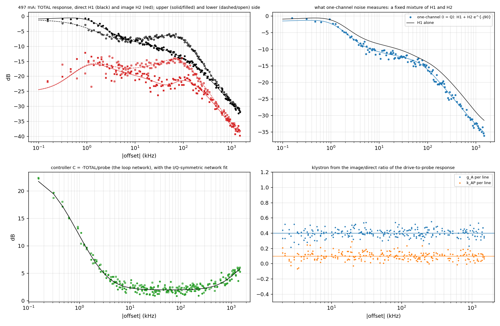

# SRF1 Direct Loop: Data-Driven System Identification

*Measuring the loop network, the klystron and the plant from designed excitation through the RFP DACs*

Draft for discussion | SSRL RF | 23 October 2026 | Companion to the [study plan](SPEAR3_Decoupling_Measurement_Plan.md) and Doc P §6.2, §8.8, §8.10

Code: [`code/python/sysid_multisine.py`](code/python/sysid_multisine.py), [`code/matlab/optllrf_sysid_acquire.m`](code/matlab/optllrf_sysid_acquire.m) | Results: [`results/sysid_*`](results/) | DAC files: [`data/sysid_dac/`](data/sysid_dac/)

---

## 0. Summary

Doc P describes the direct loop with a model assembled from documents: the RFgui loop models' lead and lag networks, a klystron inferred from fault records, and gains and phases fitted to closed-loop records with up to eight free parameters. Two models fit 500 mA equally well and disagree below it. This document proposes to measure the station block by block instead, with the existing hardware:
- **excitation:** the RFP noise DACs, which sum into the klystron drive after the controller;
- **records:** the signal RAM (controller output, TOTAL) and the cavity RAM (one probe), recorded in the same triggered shot.

Two changes to today's routine make that possible:

1. **A two-channel periodic multisine instead of one-channel noise.** Today's DAC files carry the same sequence on I and Q (correlation 0.9998).
   - Such an excitation measures one fixed mixture of the station's direct and image responses. That is why Doc P could not separate the klystron's amplitude gain from its AM/PM conversion.
   - A complex multisine whose lines sit on one side of the carrier only measures both responses. A second, mirrored design completes them at every line.
   - Power concentrated in about 130 lines, weighted against the measured noise, also lifts the coherence below 10 kHz (today 0.15–0.22).
2. **Two signals per shot instead of one.** With TOTAL and a probe recorded together, the loop can be cut into its blocks at every line, without a model:
   - the controller, C = −TOTAL/probe: the loop network itself;
   - the plant, from the drive to the probe;
   - the klystron, from the ratio of the image and direct parts of the plant.

On simulated measurements with the noise measured on 2 October 2026 (four shots per design, the same rms as today's noise), the method recovers the following ([`sysid_497mA.log`](results/sysid_497mA.log), [`sysid_22mA.log`](results/sysid_22mA.log), [`sysid_selftest.log`](results/sysid_selftest.log)):

| Quantity | Truth (Doc P values) | Recovered, 497 mA | Recovered, 22 mA | Through the RFP file format (self-test) |
|---|---|---|---|---|
| Lag network zero / pole | 3.19 / 0.26 kHz | 3.12 / 0.28 kHz | 3.13 / 0.28 kHz | 3.16 / 0.25 kHz |
| Lead network zero / pole | 944 / 2394 kHz | 979 / 2465 kHz | 985 / 2477 kHz | 965 / 2495 kHz |
| Klystron $g_A$ / $k_{AP}$ | 0.40 / 0.10 | 0.408 / 0.101 | 0.409 / 0.097 | 0.401 / 0.098 |
| Delay, $Q_L$, detuning (plant) | 618 ns, 6921, −37.7 kHz | 619 ns, 6860, −38.1 kHz | 619 ns, 6679, −1.19 kHz (true −1.10) | 621 ns, 6842, −37.9 kHz |

The whole-loop fit of TOTAL from the same amount of data shows the gain over today's excitation:

| Parameter (truth at 497 mA) | Two-channel multisine | One-channel (I = Q), today's |
|---|---|---|
| $G$ (1.26) | 1.250 ± 0.009 | 1.24 ± 0.13 |
| θ (9.1°) | 9.26 ± 0.23° | 7.4 ± 2.6° |
| $g_A$ (0.40) | 0.410 ± 0.003 | 0.42 ± 0.03 |
| $k_{AP}$ (0.10) | 0.099 ± 0.004 | 0.11 ± 0.03 |
| Condition number of the fit | 8 | 59 (210 at 22 mA) |

At 22 mA the one-channel fit fails outright ($G$ = 0.52 ± 0.25, $g_A$ = 1.0 ± 0.5). This is the mixture Doc P met as "the gain that a one-dimensional injection sees".

---

## 1. What a data-driven model must settle

| Open item (Doc P) | Why today's data cannot settle it | What the identification measures |
|---|---|---|
| Effective 1 kHz integral path against the installed lag network (§8.6, §8.8) | The closed-loop routine blanks ±18.8 kHz and fits 1.25 kHz bins; below 10 kHz the coherence is 0.15–0.22 | The controller C(f) from 0.16 kHz to 1.5 MHz, at 156 Hz resolution: the lag network's zero and pole directly |
| Klystron amplitude gain and AM/PM, $g_A$ and $k_{AP}$ (§8.10) | One-channel injection measures one mixture of the direct and image responses | Both responses; $g_A$, $k_{AP}$ in closed form from the plant's image-to-direct ratio |
| The loop gain $G$ (0.88 from MeasDirCls, 1.0–1.4 from refits) | $G$ and the klystron's mean gain enter TOTAL only as a product; 1-D excitation mixes in $g_A$ | $G$ from the controller block alone, independent of the klystron |
| 12% frequency offset of the `lag` model at 500 mA | The model's blocks are assumed, not measured | Every block measured; the model rebuilt from them (§6.4) |
| I/Q imbalance of the analog RFP | Invisible to a one-channel measurement | The image part of C: zero for a perfect I/Q controller |
| Vector-sum weights and cavity-to-cavity differences | Only TOTAL is recorded | Each cavity's probe, CAVSEL 0–3, in the same excitation |

---

## 2. The system and what can be recorded

### 2.1 Signals

Each signal is listed with how it is recorded and what it gives:
- **Controller output, TOTAL:** signal RAM with FBSIG 0, 2^18 samples at 10.24 MS/s (25.6 ms). This is the routine's measured quantity: TOTAL/noise = −L/(1+L), which Doc P's fits confirm.
- **Klystron drive:** signal RAM with FBSIG 3, as in the fault records. Its mean gives the drive phase φ_u. Note that drive = TOTAL + excitation.
- **One cavity probe:** cavity RAM with CAVSEL, recorded in the same shot as the signal RAM (fault records; `measure_beam_phase.m`). It is the plant output; four shots give all four cavities.
- **Klystron output amplitude:** IQ&A history. The amplitude response (fault-record method of Doc P).
- **Excitation:** I and Q DAC files, 2^19 words, played in step with the RAM acquisition (STATE reset/load/run). The routine's transfer function uses the stored sequence, scaled by 1/10 (`get_RFP_noise_gain`), as its input reference.

Confirmed from the routines: `measure_direct_closed.m` sets FBSIG 0 = TOTAL, RMSZ 256 (k samples), SSCONT 0, DACS 1, then `cyclerfstates`. `measure_beam_phase.m` reads the cavity RAM (CIRF/GCIR/CIST) with CAVSEL in a single shot.

To be confirmed on the bench (§9, P0):
- the other FBSIG codes;
- the CAVSEL numbering;
- whether the DAC sequence restarts at each shot or loops;
- the role of the DAC words' low four bits (the files carry 2 or 6 there; the writer copies them).

### 2.2 Widely linear description

Each signal responds to a complex excitation $n(t)$ as

$$
y(f) = H_1(f)\,n(f) + H_2(f)\,\overline{n(-f)} .
$$

- **A rotation-invariant (complex-linear) block has $H_2 = 0$.** This includes a detuned cavity, a delay, and a controller with gain, phase and identical I and Q networks.
- **$H_2 \ne 0$ comes from blocks that treat amplitude and phase differently:**
  - the compressed klystron ($g_A \ne 1$, $k_{AP} \ne 0$);
  - any I/Q imbalance in the analog chain;
  - the beam, which responds to the gap phase and, through $\cot\phi_s$, to the amplitude.
- **Today's excitation cannot separate them.** Its I = Q noise has $\overline{n(-f)} = e^{-j90^\circ}n(f)$, so the routine measures $H_1 + H_2 e^{-j90^\circ}$ and nothing else.

At 497 mA the image response of TOTAL is about −9 dB relative to the direct one ($\lvert H_2\rvert/\lvert H_1\rvert$ = 0.37). That is a large effect to leave unmeasured.

### 2.3 Block decomposition

The loop: controller output $x$ = TOTAL; drive $d = x + n$; klystron output $y_k = k_d\,d + k_i\,\overline{d(-f)}$; probe $v = P\,y_k$; and $x = -C\,v$.

With $H_1$, $H_2$ of TOTAL and probe at $+f$ and $-f$, every line gives:

$$
\begin{pmatrix} H_{1,v} & H_{2,v} \end{pmatrix}
= \begin{pmatrix} P k_d & P k_i \end{pmatrix}
\begin{pmatrix} H_{1,x}+1 & H_{2,x} \\ \overline{H_{2,x}(-f)} & \overline{H_{1,x}(-f)}+1 \end{pmatrix},
\qquad C = -\frac{H_{1,x}}{H_{1,v}} = -\frac{H_{2,x}}{H_{2,v}} .
$$

- **Klystron.** The ratio $\rho = (k_i/k_d)\,e^{-2j\varphi_u}$ gives the klystron in closed form, $g_A + j k_{AP} = (1+\rho)/(1-\rho)$. Here φ_u is the drive phase from the drive shot.
- **Built-in consistency checks:**
  - the two expressions for C must agree, or else the controller has an I/Q imbalance;
  - ρ must not depend on frequency, or else the klystron is not memoryless;
  - $d = x + n$ must match the drive shot, which checks the injection point and the scale factor 10.

---

## 3. Excitation design

| Choice | Value | Reason |
|---|---|---|
| Period | 2^16 samples = 6.4 ms, lines on a 156.3 Hz grid | Four periods per RAM record; the first is discarded (start-up transient: the lag network's 0.6 ms, the beam's 1–2 ms), three averaged; eight periods per DAC file |
| Lines | About 130, log-spaced in \|f\| from 0.16 kHz to 1.5 MHz; bins within 8 Hz of a 60 Hz harmonic left out | Covers the lag network (0.26–3.2 kHz), the beam (±8.7–10 kHz), the cavity and loop (±35–300 kHz), the lead network (0.94–2.4 MHz) |
| Non-mirrored lines | Each line on one side of the carrier, alternating; design B mirrors design A | The response at an excited line gives $H_1$, at its unexcited mirror $H_2$; A + B give both at every line |
| Line powers | Proportional to the measured noise over the expected response, within 30 dB | Equal signal-to-noise ratio along the band. Below 10 kHz the station's own noise (HVPS lines, loop noise) is 100–1000× higher than at 10–200 kHz, so those lines get most of the power |
| Level | rms 0.00268 in reference units (0.019 of full scale per DAC), as NOISE_[IQ]_BL; crest factor 3.4–3.7 after clipping iterations | The same disturbance as the routine already run at 497 mA. DAC codes: rms 39 (as today), peaks within ±143 of ±2047 (today's noise ±178) |
| Files | `SYSID_MS_A_[IQ]`, `SYSID_MS_B_[IQ]` and identical `.out` reference files: 16-byte header, 2^19 big-endian words, 12-bit code × 16, low nibble copied from NOISE_[IQ]_BL.out; round trip checked | `sysid_multisine.py --write-dac` |

For the beam transfer function at stored current (§7), use a second, narrow-band design:
- lines only within ±(6–12) kHz, on a 39 Hz grid (2^18-sample period, one period per shot, or long FSW records);
- 1–3 mdeg of drive phase per line, which moves the beam by 0.013–0.034° per mdeg at f_coh (eff and lag models, 100–500 mA);
- about 100 periods averaged. The ambient motion in one 39 Hz bin is about 0.04° at 500 mA.

---

## 4. Measurement procedure

`optllrf_sysid_acquire.m` (untested on the machine; review with the RF group):

1. **Preconditions** (as Measure Direct Closed): RF on, direct loop closed. Then copy the design files to `<rfData>/<station>/`, which the IOC sees as `/dat`.
2. **Save state and set up.** Read and save DACS, FBSIG, CAVSEL, DINJ, MODU.RMSZ, RUNMODE and SSCONT; `onCleanup` restores them on every exit, DACS first, then reset/load/run. Take a snapshot (`optllrf_snapshot.m`). Set RMSZ 256 and RUNMODE 1.
3. **For each design:**
   - load the I and Q files (DIRF/DQRF, LDIR/LDQR, wait for DIST/DQST);
   - set the RAM file names; SSCONT 0; DACS 1;
   - for each cavity (CAVSEL) and each shot: FBSIG 0, `cyclerfstates`, read the signal RAM (GSIR/GSQR) and the cavity RAM (GCIR/GCQR), copy the four files to the study folder;
   - optionally one drive shot (FBSIG 3), which gives φ_u;
   - DACS 0.
4. **Finish:** snapshot, restore, and save the shot list.

Two designs × four cavities × three shots take about 24 shots, about 5 minutes.

**Conditions to repeat:**
- no beam or low current (network, klystron, plant);
- several klystron drive levels: $g_A$ against the operating point, which E4 of the plan needs;
- INTCOMP and LEADCOMP off in turn: each network's own response;
- 100, 200, 300 and 500 mA: plant and beam; tracking off, as in the plan.

Analysis: `python sysid_multisine.py --analyze <folder>`.

---

## 5. Estimation

1. **Line responses.** Split each RAM record into periods, drop the first, and take the FFT of the rest at the excited lines and their mirrors. Average over periods and shots; their scatter gives the uncertainty.
2. **$H_1$ and $H_2$** of TOTAL and probe per design, merged over A and B.
3. **Block decomposition (§2.3)** at every line, with the three consistency checks.
4. **Vector sum.** The controller acts on the weighted sum of the four probes. Record CAVSEL 0–3 with the same design and form $v = \sum_k w_k v_k$, either with the combining-network weights read from EPICS or with the weights fitted jointly with C. A single cavity gives C up to a nearly constant complex factor.
5. **Disturbances.** The HVPS comb is not periodic in 6.4 ms. Its strongest lines can be regressed out of each 25.6 ms record (known mains frequency), and lines near strong harmonics are given their measured scatter as uncertainty.

---

## 6. Models from the data

### 6.1 The loop network (controller)

The analog RFP applies identical networks to I and Q after one gain and rotation, so

$$
C(s) = K\,\prod_i \frac{1 + s/z_i}{1 + s/p_i}, \qquad K \text{ complex},\ z_i, p_i \text{ real}.
$$

`fit_network` fits this with two zeros and two poles. The result is the lag and lead networks' corners and the loop gain and phase (§0 table).

An unconstrained vector fit, with complex poles and no symmetry, serves as a black-box check. On the simulated data it places the lag pole correctly (0.267 kHz) but uses its second pole on a cancelling pair. A pair like this on real data would be the first sign of dynamics outside the network model, or of I/Q imbalance.

### 6.2 The plant and klystron

- **Plant:** fitted as complex gain × delay × 2.5 MHz amplifier pole × detuned cavity, giving the delay, $Q_L$ and the detuning per cavity.
- **Klystron:** comes in closed form from the image-to-direct ratio (§2.3) at every line above the HVPS lines. On the simulated data, 130 lines between 20 and 600 kHz give $g_A$ = 0.408 and $k_{AP}$ = 0.101, with a line-to-line scatter of 0.05.

### 6.3 Whole-loop gray-box fit

This fits the TOTAL response ($H_1$ and $H_2$) with G, θ, τ, $Q_L$, Δf, $g_A$ and $k_{AP}$, as a cross-check of the blocks.

TOTAL alone cannot separate G from the klystron's mean gain. With all eight parameters free, both fits are degenerate (condition number about $10^7$). The drive phase φ_u, which the drive shot measures, must therefore be held.

### 6.4 The data-driven station model

The measured blocks replace the assumed ones in `spear3rf`: C(f), and P(f) per cavity, with $k_d$, $k_i$.
- **Fill predictions:** closed with the beam (two-quadrature model, Doc P App. C), they predict σ(I), $f_{coh}$(I) and the per-source noise transfers $h_x$ along the fill. These are the quantities of study plan §4, now without the `eff` and `lag` assumptions.
- **Validation:** against measurements not used in the fit. These are the passive probe line at each current (σ and $f_{coh}$ from SSI, study plan §3.7), the HVPS harmonics' crossing currents (study plan §3.4), and the closed-loop records of 2 October.

---

## 7. With beam: the beam transfer function through the probe

With beam stored, the plant contains the beam's dipole mode. Near ±$f_{coh}$ the drive-to-probe response acquires the beam's pole pair, in both the direct and the image part.

The narrow-band design of §3 measures it at a few millidegrees of drive modulation. The result is σ and $f_{coh}$ from an active measurement, plus the absolute response χ·h for drive noise, which the passive spectrum cannot calibrate.

This complements the passive methods of the study plan (§3.7):
- **SSI** gives the pole without any excitation;
- **the beam transfer function** gives the pole, the residue and the drive transfer;
- **the two must agree.**

---

## 8. What the simulation does and does not show

**What it shows:**
- the estimators and the decomposition are correct;
- the excitation design gives the stated precision with the measured noise;
- the file chain (DAC files, RAM files, 12-bit quantization) is consistent.

**What it does not show:**
- **The station model.** The simulation uses Doc P's model as the truth, so it cannot show that the model is right. The measurement will.
- **Hardware assumptions,** to be checked on the bench (§9, P0): the DAC timing, the injection point and the scale factor 10.
- **Effects left out of the simulation:**
  - harmonics leaking from the HVPS comb into neighbouring lines;
  - drift between shots;
  - nonlinear distortion of the klystron at the excitation level (test by repeating at half and double the level);
  - differences between the four cavities.

---

## 9. Campaign

| Phase | Conditions | Purpose | Time |
|---|---|---|---|
| P0 bench | RF off, or station in a safe test configuration, with the RF group | DAC → signal RAM alignment and looping; FBSIG codes; CAVSEL numbering; the low-nibble role; a design played and read back | 1–2 h |
| P1 | No beam or < 30 mA, operating voltage | Network (C), klystron, plant per cavity; repeat at ±1 dB drive setpoint (g_A against the operating point) | 30 min |
| P2 | As P1 | INTCOMP off, LEADCOMP off in turn: each network alone | 20 min |
| P3 | 100, 200, 300, 500 mA, tracking off | Plant with beam; narrow-band beam transfer function; compare with the passive probe (SSI) | 20 min per current |
| P4 | LLRF9 commissioning | The same analysis with the LLRF9's own injection and records | — |

---

## 10. Code

| File | Purpose |
|---|---|
| [`sysid_multisine.py`](code/python/sysid_multisine.py) | Excitation design and DAC files (`--write-dac`); widely linear station model, checked against Doc P's `closed_loop_wl` to $10^{-9}$; simulation with the measured noise; estimation, decomposition, network and plant fits, gray-box comparison; `--selftest` (synthetic shots in the RFP file format); `--analyze` (real shots) |
| [`optllrf_sysid_acquire.m`](code/matlab/optllrf_sysid_acquire.m) | Acquisition of the shots with the RFP state restored on every exit (untested; review with the RF group) |
| [`analyze_closed_loop.py`](code/python/analyze_closed_loop.py) | Today's routine's records: the same fits as Doc P, plus the integral corner at low current and the beam pole |
| `spear3rf/scripts/analyze_measure_direct.py` | Doc P's closed-loop models and fits, reused |
