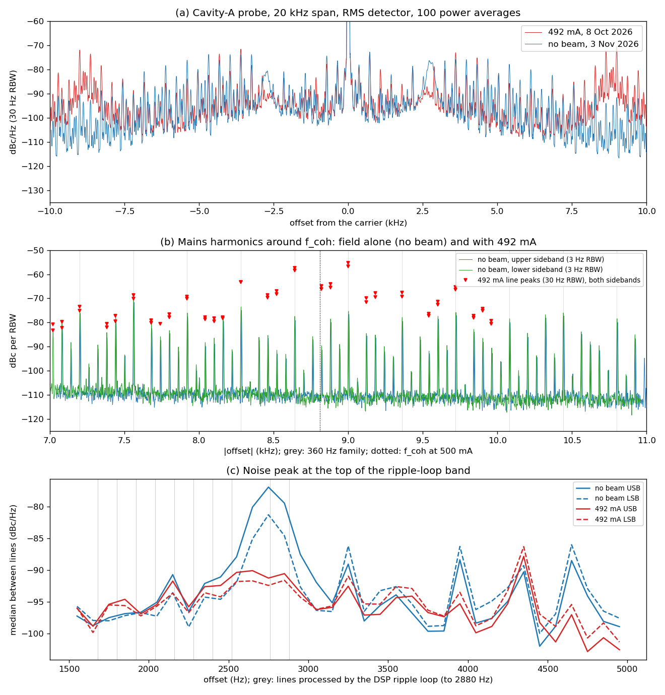
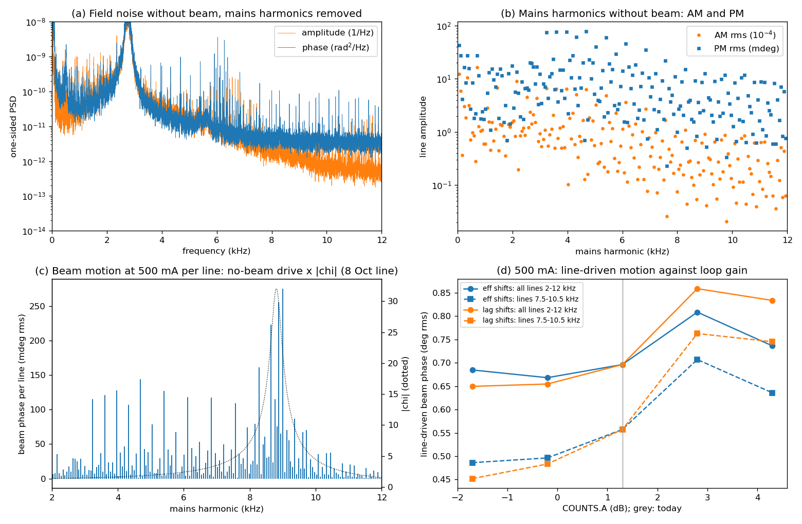

# SPEAR3 Synchrotron Oscillation: Doc P Review, No-Beam Baseline and Experiment Options

*Review and measurement report, study optLLRF: what sets the synchrotron (dipole) oscillation of the stored beam, what a direct-loop gain and phase scan can show, and what else would reduce the oscillation*

Report | SSRL RF | 3 November 2026 | Companion to [Doc P](../../Designs/tex/docP-rf-physics/P_rf_physics_and_plant.pdf) §8, the [study plan](SPEAR3_Decoupling_Measurement_Plan.md) and the [loop identification](SPEAR3_Loop_System_Identification.md)

Numbers: [`code/python/nobeam_baseline.py`](code/python/nobeam_baseline.py) → [`results/nobeam_20261103.log`](results/nobeam_20261103.log) and [`results/nobeam_20261103_lines.csv`](results/nobeam_20261103_lines.csv). Quantities quoted from Doc P or the study plan name their section.

---

## 0. Summary

**The question.** How can the synchrotron oscillation be reduced? The proposal is to record cavity-probe spectra at several direct-loop gains and phases.

**Findings.**

1. **At 500 mA the oscillation is mostly driven, not under-damped.**
   - Doc P §8.8 measures the line at 8.8 kHz with $Q$ = 24–26, i.e. σ = 2.5–2.7 α_rad. That is adequate damping, although only half that of 2021.
   - The beam's phase moves 0.39–0.58° rms. Most of it is at two HVPS harmonics beside $f_{coh}$, 8640 and 9000 Hz.
2. **Today's no-beam data identify that drive as klystron phase ripple.**
   - The same mains harmonics are on the field without beam. 97% of their drive on the beam is phase modulation.
   - Multiplied by the beam's response, the no-beam ripple at 8640 and 9000 Hz reproduces the motion that Doc P infers from the 500 mA probe, within 4–7%.
   - At the klystron output the ripple is 15–28 mdeg per 360 Hz line. A line crossing stays below 0.1° only at 4–8 mdeg (study plan §13).
3. **Doc P's jitter budget leaves out the lines at 3–7.5 kHz.**
   - They lie above the DSP ripple loop's reach (2.88 kHz) and below $f_{coh}$, where the beam follows them with $\lvert\chi\rvert$ = 1.5–4.
   - They add 0.33–0.41° of timing jitter. The total at 500 mA becomes 0.54–0.73° rms (3.1–4.2 ps), against 0.40–0.60° in Doc P.
4. **A gain or phase scan will not by itself reduce the oscillation much.**
   - Predicted line-driven motion: −2 to −7% at −1.7 dB, +16 to +23% at +2.8 dB, about −2% for a 5–10° lead.
   - At −1.7 dB the part near $f_{coh}$ falls by 13–19% and the energy jitter by 10–15%, but $f_{coh}$ moves onto other lines.
   - The scan is still the right experiment to identify the noise sources and the loop model (§5).
5. **Switch frequency-offset tracking off first.**
   - Without beam, the tracking correction moved between +2.4° and +6.1° within 14 minutes.
   - It follows an IOC tuner model whose detuning estimates (−6 to −62 kHz) contradict the measured reflections (|Δf| ≤ 7 kHz).
6. **The big lever is the ripple.** Removing the 360 Hz family alone would cut the line-driven motion from 0.70° to 0.40° rms (0.31° with the 8880 Hz line also removed). The options are a DSP ripple-loop extension above 2.88 kHz or HVPS 12-pulse balance.
7. **The 6-pulse residual appears to depend on the HVPS operating point.**
   - Below 5 kHz, the odd multiples of 360 Hz are 6.6–9.1 dB weaker, relative to their 720 Hz neighbours, at 492 mA (HVPS 75 kV) than without beam today (67 kV).
   - If this holds near 9–10 kHz, the odd lines that $f_{coh}$ crosses during a fill (9720 Hz near 230 mA, 9000 Hz) are stronger than the 500 mA data imply. A larger ripple at those currents is one of the conditions the study plan lists for the 200–300 mA dumps.
8. **There is a noise peak at 2.75 kHz**, on the DSP ripple loop's 2760 Hz resonator.
   - Without beam it is 30 dB above the floor, with 0.17% of amplitude and 0.10° of phase rms. It is 11–14 dB lower at 492 mA.
   - Hypothesis: the top resonators of the ripple loop are mis-phased at some operating points.

**Recommended order:** tracking off; a passive fill with I/Q records; the gain/phase scan; a ripple-loop on/off test without beam; then work on the ripple itself (§6).

---

## 1. Scope, data and safety

- **Read:**
  - Doc P: all of §8, plus §1.4, §2.2, §4 (D3, D5, D10), §5.2, §6.2–6.3 and Appendix C;
  - the study plan and the loop-identification plan;
  - `spear3rf.live`, `fsw_matrix.py` and the RFP ripple-loop table `Sp3PhsCoefs.tbl`.
- **Measured on 3 Nov 2026, 09:34–09:48, with no stored beam:**
  - **EPICS:** `caget` only, for three snapshots (`spear3rf.live.read_snapshot`) and a 60 s record of the loop phase and tuner readbacks. No `caput` was issued, and no setting of the station was changed.
  - **FSW, cavity-A probe:** two remote sessions, a swept capture (73 s) and a 16 s I/Q record (17 s).
    - Each session saved the complete instrument state first, measured, and reloaded the saved state.
    - It then verified every checked setting against the original (no differences) and returned the analyzer to local control.
    - An earlier attempt stopped at an unsupported query before changing anything; its error message is the "errors before" entry of the swept record.
- **Limitation:** everything measured today is without beam. Statements about 500 mA combine today's field ripple with the beam response and the models of Doc P, whose beam data are from 8 Oct 2026 at 492–497 mA.

---

## 2. Doc P: the physics, as I understand it

### 2.1 Operating point

| Quantity | Value | Note |
|---|---|---|
| $f_{RF}$ | 476.30 MHz | Set by the ring circumference through an external feedback. It moves by about 100 Hz per day and 4 kHz per year; the RF system and the tuners follow it |
| Gap voltage | 2.85 MV in 4 cavities | One klystron, one I/Q modulator, feedback on the vector sum |
| $U_0$, $\phi_s$ | 1.09 MeV, 67.5° | $\cot\phi_s$ = 0.41 |
| Incoherent $f_s$, radiation damping α_rad | 10.0 kHz, 424 s⁻¹ | |
| $Q_L$, β, half-bandwidth | 6700, 3.8, 35.5 kHz | |
| Detuning at 500 mA | −36 kHz (load angle −45°) | Beam-loading compensation; proportional to the current |
| Loop delay | 625 ns | Limits the gain to about 15 dB for 45° of phase margin |
| Direct-loop gain today | About 0 dB (G ≈ 0.9–1.0) | Not the 15 dB of the PEP-II design |

### 2.2 The dipole mode is a driven, damped oscillator (Doc P §8.1, §8.7)

$$
\ddot{\Delta\phi} + 2\sigma\,\dot{\Delta\phi} + (\omega_{coh}^2+\sigma^2)\,\Delta\phi \simeq \omega_s^2\,n_{eff}(t),
\qquad n_{eff} = \varepsilon_A\cot\phi_s - \varepsilon_\phi
$$

- **The two sides.** The left side (σ, $f_{coh}$) is set by the cavities, the loop and the beam current. The right side is the gap error the RF system produces with the bunches held fixed; 0.1% of amplitude acts like 0.024° of phase.
- **The response** $\chi = \Delta\phi/n_{eff} = \omega_s^2/D_0(s)$:
  - **below $f_{coh}$ the beam follows the drive** ($\chi$ = 1 at DC with an integral path, 1.3 at 0 dB with a proportional loop);
  - **near $f_{coh}$ it amplifies the drive** by up to $Q\,(f_s/f_{coh})^2$, about 33 today;
  - far above $f_{coh}$ it ignores the drive.
- **Broadband drive:** $\langle\Delta\phi^2\rangle = \omega_s^4 S_n/(8\,\omega_{coh}^2\,\sigma)$, i.e. proportional to 1/σ.
- **A discrete line:** $\Delta\phi_L = \lvert\chi(\omega_L)\rvert\,n_L$. It depends strongly on where $f_{coh}$ sits relative to the line.
- **What users see:**
  - timing jitter $\Delta\phi/\omega_{RF}$ (0.58 ps per 0.1°), which includes everything the beam follows below $f_{coh}$;
  - energy jitter $(\omega/\alpha_c\omega_{RF})\,\Delta\phi$ (0.016 per radian at 8.8 kHz), and with it the source motion where the dispersion is not zero. These are essentially the resonant part only.

So there are two separate ways to reduce the oscillation:
- **more damping**, which lowers the resonant response;
- **less drive** near and below $f_{coh}$.

Today the drive dominates.

### 2.3 What the loop does to σ and $f_{coh}$ (Doc P §8.2–8.6)

The loop lowers and widens the cavity resonance seen by the beam, $Z_b = \sum_k Z_k/(1+G_{OL})$. Robinson damping comes from the *difference* of the resistive impedance at the two synchrotron sidebands, so it falls with gain roughly as $(1+G)^{-3}$:

| 500 mA, θ = 0, 625 ns | $f_{coh}$ (kHz) | σ (s⁻¹) | $Q$ |
|---|---|---|---|
| No feedback | 6.41 | 5760 | 3.5 |
| 0 dB (today) | 8.77 | 1850 | 15 |
| 6 dB | 9.41 | 866 | 34 |
| 15 dB (PEP-II design) | 9.89 | 434 | 72 |

The rules (Doc P §8.4–8.6):
1. **Gain buys impedance reduction and costs damping.** No instability at SPEAR3 needs the impedance reduction.
2. **A lead adds damping and a lag removes it**, and the asymmetry grows with gain. At 0 dB and 500 mA, 30° of lag costs 20% of the damping.
3. **A lag is most dangerous at low current.**
   - At 0 dB the cavities stop adding damping at a lag of 9° (100 mA), 21° (200 mA) and 31° (300 mA).
   - The study plan (§4.3) finds the weakest point of a fill at 200–300 mA, where a lag of 32–35° makes the beam unstable.
4. **The delay is a frequency-dependent phase error.** At the 500 mA detuning it amounts to a lead of 8°.
5. **An integral path that shares the loop phase removes damping.** At 500 mA a 1 kHz corner takes σ from 1850 to 1074 s⁻¹, and a 3 kHz corner makes the beam unstable. The legacy RFP cannot rotate the integral path separately; the LLRF9 can.

**The model is not closed.** With the installed lag network (about 2.9 kHz, 0.26 kHz leak), the linear model makes the beam *unstable* at 500 mA, yet σ ≈ 1.1×10³ s⁻¹ is measured. Two descriptions fit 500 mA:
- **`eff`:** an effective 1 kHz integral path with a linear klystron.
- **`lag`:** the installed network with the klystron's measured amplitude compression ($g_A$ = 0.40, $k_{AP}$ = 0.10), which supplies the missing damping. Under this model, anything that takes the klystron out of compression during a fill removes damping (study plan §4.4).

The two models differ at 100–350 mA by up to 1.8× in σ and 0.66 kHz in $f_{coh}$. The `lag` model also puts $f_{coh}$ 12% low at 500 mA.

### 2.4 What the loop does to the drive (Doc P §8.7)

Each noise source reaches $n_{eff}$ through its own transfer. The cavities are detuned by one half-bandwidth, so the loop treats amplitude and phase differently, and klystron amplitude noise becomes gap phase through the load angle. At 500 mA there are three regimes:
1. **Measurement and reference noise** always moves the beam more as the gain rises. From 0 to 6 dB the timing variance grows 4.9-fold for phase noise and 2.8-fold for amplitude noise.
2. **Klystron amplitude noise** is reduced at every gain.
3. **Klystron phase noise** moves the beam *more* with feedback than without: 1.8 times the timing variance at 0 dB with a linear klystron, because the loop removes damping faster than it removes this drive. With the measured klystron compression, the timing ratio becomes 0.84 and the energy ratio 1.13.

The best gain therefore depends on which source dominates near $f_{coh}$, and Doc P has not measured that.

### 2.5 The station as Doc P found it (October 2026)

- **The line.** At 492–497 mA it sat at 8.79–8.83 kHz with σ = 1090–1160 s⁻¹ and $Q$ = 24–26; in 2021 it was at 8.93 kHz with $Q$ = 11.1.
  - The proportional model overestimates this damping by 60–70%.
  - An effective 1 kHz integral path reproduces it.
- **The beam's motion** was 0.39–0.58° rms near $f_{coh}$.
  - Two lines dominate: 8640 and 9000 Hz, at −57 and −55 dBc, 16 dB above the floor.
  - The broadband line adds 0.14–0.19°.
- **During a fill** $f_{coh}$ sweeps from 10.0 to 8.8 kHz through the 360 Hz comb. Both models put a crossing at 220–230 mA. That crossing is the leading hypothesis for the larger oscillation and the dumps at 200–300 mA (study plan §3.4).
- **Station settings:**
  - frequency-offset tracking was on (a diagnostic mode), following a stale tuner model, which added 3–6° of drifting lag at 500 mA;
  - the klystron ran at 99% of its 800 kW limit.

### 2.6 Assessment

Doc P's model of the dipole mode is complete: characteristic equation, two-quadrature drive and time-domain cross-checks. It also states its own discrepancies. For the question of reducing the oscillation, the gaps are:
1. **The damping model is not closed** (§2.3). Which of `eff` and `lag` holds below 400 mA decides how safe the fill is. E1 (passive fill) and E6 (loop identification) settle it.
2. **The drive is not identified**: klystron or measurement, amplitude or phase. For the discrete lines above 3 kHz, today's data answer part of it (§4.2).
3. **The line budget is incomplete.** It counts a line only where the probe shows it to be beam-dominated, which misses the 3–7.5 kHz lines that the beam follows (§4.4).
4. **The HVPS ripple versus the operating point is unknown**: 67 kV without beam, 75 kV at 500 mA, in between during fills. The crossings depend on it, and today's data suggest it matters (§4.4).
5. **The field specification has no band** (0.1% and 0.1° rms, Doc P §1.4). Doc P itself argues that the beam needs a limit on the spectral density near $f_{coh}$ and on the lines below it.

---

## 3. Station state, 3 November 2026 (no beam, read-only)

Sources: snapshots [`SRF1_20261103T093444.json`](../../spear3rf/data/snapshots/SRF1_20261103T093444.json), [`…093809.json`](../../spear3rf/data/snapshots/SRF1_20261103T093809.json), [`…094549.json`](../../spear3rf/data/snapshots/SRF1_20261103T094549.json), and the record [`data/epics/SRF1_loop_tuner_60s_20261103T094714.csv`](data/epics/SRF1_loop_tuner_60s_20261103T094714.csv); `nobeam_baseline.py` §1.

| Quantity | Value |
|---|---|
| Beam | 0 mA; station ON_CW, direct loop on |
| $f_{RF}$ (SPEAR:RFFreq) | 476.304794 MHz, +830 Hz since 7 Oct (ring circumference) |
| Station voltage | 2852 kV |
| Klystron | 398 kW, drive 28.2 W (4.5 dB below the SAT setting); HVPS 67.2 kV, 18.8 A |
| Direct loop | COUNTS.A 1.3 dB (L 1.161), PHASE.C −20°, PHASE.B 699.5 ns, PHASE.F 0.80 |
| Networks and DSP | INTCOMP on, LEADCOMP on, DSP ripple loop on (DC coefficient 0.90, gain tracking on) |
| Frequency-offset tracking | **On** |

The loop settings are those of Doc P's October snapshots.

### 3.1 The tracking correction follows a tuner model that contradicts the cavities

With tracking on, PHASE.L = PHASE.C + φ_tr, with φ_tr = −0.00036 · PHASE.B [ns] · ⟨FREQ:OFFS⟩ [kHz] · PHASE.F (`subSysPhaseTot`).

| Time | φ_tr (PHASE.K) | PHASE.L | ⟨FREQ:OFFS⟩ | FREQ:OFFS, cavities 1–4 (kHz) |
|---|---|---|---|---|
| 09:34:44 | +4.61° | −15.39° | −22.9 kHz | −3.2, −20.2, −56.7, −11.2 |
| 09:38:09 | +2.42° | −17.58° | −12.0 kHz | +8.7, −15.5, −42.6, +1.2 |
| 09:45:49 | +5.99° | −14.01° | −29.7 kHz | −5.7, −30.8, −61.5, −20.9 |
| 09:47:14–09:48:14 | +6.11 ± 0.02° | −13.89 ± 0.02° | −30.3 kHz | −9.2, −29.6, −61.8, −20.7 |

Without beam the cavities should sit near $f_{RF}$, and their reflections say they do. The check uses $\lvert\Gamma\rvert^2 = ((\beta-1)^2+t^2)/((\beta+1)^2+t^2)$ with $t = 2Q_0\Delta f/f_0$, $Q_0$ = 32 000 and β = 3.8 (09:45:49):

| Cavity | $\lvert\Gamma\rvert^2$ measured | On tune | $\lvert\Delta f\rvert$ implied | FREQ:OFFS | $\lvert\Gamma\rvert^2$ if FREQ:OFFS were right |
|---|---|---|---|---|---|
| 1 | 0.306 | 0.340 | 0 (within the β uncertainty) | −5.7 kHz | 0.357 |
| 2 | 0.323 | 0.340 | 0 | −30.8 kHz | 0.621 |
| 3 | 0.327 | 0.340 | 0 | −61.5 kHz | 0.833 |
| 4 | 0.366 | 0.340 | 7.1 kHz (or β ≈ 4.0) | −20.9 kHz | 0.509 |

The load-angle errors were within ±0.7°, so the tuner loop is converged; only the IOC's frequency-offset model is wrong. It contradicts the reflections in three ways:
- **A common offset.** $f_{RF}$ follows the ring and has moved by kHz since the polynomials were calibrated, while the model maps tuner position to frequency.
- **A per-cavity spread.** The estimates spread from −6 to −62 kHz, so the per-cavity coefficients are stale too.
- **Position readbacks disagree.** The readback the model uses (TUNR:POSN) differs from the motor readback (STEP:MOTOR.RBV) by −0.38 to −0.90 mm, which is 10–28 kHz at 27–31 kHz/mm. Which readback the polynomials were calibrated against is a question for the RF group.

Consequences:
- **The loop phase steps when the tuners move.** At constant (zero) current, φ_tr moved by 3.7° within 14 minutes, i.e. about 4.5° of loop phase (1.2–1.3° per degree, Doc P Table 7). Over 60 s it was steady (±0.02°).
- **A scan with tracking on aliases this into σ.** At 500 mA each degree of loop phase changes σ by 1.1–1.6% (study plan §6.1), comparable with the effects a scan has to resolve.
- **Switching tracking off today is a safe step.** φ_tr is positive, which is a lag, so removing it is a lead step of 3–8° of loop phase (study plan §6.1).

---

## 4. No-beam baseline of the cavity-A probe

### 4.1 Records

| Record | Content |
|---|---|
| [`FSW_cavA_nobeam_20261103T093904.json`](../../spear3rf/data/spectra/FSW_cavA_nobeam_20261103T093904.json) | Swept, RMS detector, power averaging. Set-ups: "robinson" (20 kHz span, 30 Hz RBW, 100 averages), "lines" (2.2 kHz, 3 Hz, 20), "wide" (3 MHz, 1 kHz, 50), all as in the 8 Oct capture; plus "comb_usb"/"comb_lsb" (±7–11 kHz, 3 Hz, 10). Restore verified |
| [`data/iq/FSW_IQ_20261103T094550.npz`](data/iq/FSW_IQ_20261103T094550.npz) | I/Q, 16 s at 50 kS/s (±25 kHz), recorded in a temporary I/Q channel that was deleted afterwards. Restore verified |
| Snapshots and 60 s EPICS record | §3 |

The comparison is with the swept capture of 8 Oct 2026, 15:35, at 492 mA ([`FSW_cavA_matrix_20261008T153523.json`](../../spear3rf/data/spectra/FSW_cavA_matrix_20261008T153523.json)) and its line table ([`results/lines_FSW_cavA_matrix_20261008T153523.csv`](results/lines_FSW_cavA_matrix_20261008T153523.csv)).

*(a) The probe spectrum within ±10 kHz. (b) The mains harmonics at 7–11 kHz: without beam at 3 Hz RBW, and their peaks at 492 mA. (c) The level between the lines at 1.5–5 kHz, with the lines that the DSP ripple loop processes.*

### 4.2 The lines near $f_{coh}$ are klystron phase ripple

The I/Q record gives each mains harmonic's amplitude and phase modulation from both sidebands, with the mains frequency tracked every second (`nobeam_baseline.py` §3–4). The 360 Hz family near $f_{coh}$:

| Line | No beam, USB / LSB (dBc) | 492 mA, USB / LSB (dBc) | 492 mA minus no beam (dB) | Field PM without beam (mdeg rms) | Klystron PM = field PM × \|1+L\| (mdeg rms) |
|---|---|---|---|---|---|
| 7920 Hz | −77.2 / −76.1 | −69.3 / −70.2 | +7.9 / +5.9 | 11.0 | 20 |
| 8280 Hz | −74.5 / −73.5 | −63.3 / −63.3 | +11.1 / +10.2 | 15.0 | 28 |
| 8640 Hz | −78.6 / −77.5 | −57.3 / −58.5 | +21.3 / +19.1 | 9.3 | 17 |
| 9000 Hz | −75.9 / −75.0 | −55.3 / −56.8 | +20.6 / +18.2 | 12.6 | 23 |
| 9360 Hz | −79.0 / −77.9 | −67.6 / −69.2 | +11.4 / +8.7 | 9.0 | 16 |
| 9720 Hz | −76.4 / −75.6 | −65.3 / −66.3 | +11.1 / +9.3 | 11.8 | 21 |

- **The lines are there without beam.** In the 492 mA capture, the lines near $f_{coh}$ are up to 21 dB stronger, which is the resonance of the dipole mode. Away from it (7200 and 7560 Hz) the two captures agree within 1.3 dB.
- **They are phase modulation.** In every one of these lines, AM is 15–16% of $a^2+p^2$. Weighted by $\cot\phi_s$, as the beam weights it, 97% of the drive at 7.5–10.5 kHz is phase. Doc P could not tell AM from PM (§8.8); for these lines it is PM.
- **They are consistent with the 500 mA analysis.** The no-beam drive times the beam's response at the 8 October line (8.81 kHz, 1120 s⁻¹) gives 0.223° at 8640 Hz and 0.275° at 9000 Hz. Doc P infers 0.215° and 0.257° from the 492 mA probe (`eff`).
- **One exception: 8880 Hz.**
  - The line is harmonic 148, not in the 360 Hz family; it sits 73 Hz above $f_{coh}$, at −79.4/−78.3 dBc without beam.
  - With today's drive it would be the second-largest contributor (0.256°); the 492 mA analysis gives it 0.097°.
  - Lines within the line's half-width (about 180 Hz) are sensitive to the exact $f_{coh}$, and the ripple at 75 kV may differ from that at 67 kV (§4.4).
- **The klystron ripple is 15–28 mdeg per line.** This comes from the field ripple and the loop's rejection without beam: 5.2 dB at 9 kHz in Doc P's model with G = 0.88, or 10–20% more if the phase-path gain is 1.0–1.4 (Doc P §8.10). The study plan (§13) finds that a crossing stays below 0.1° rms only if this is 4–8 mdeg.

### 4.3 Broadband noise near $f_{coh}$

- **Level without beam.** Between the lines (I/Q record, harmonics removed), the field noise at 8.5–9.2 kHz is −118.6 dB/Hz in amplitude and −113.9 dB rad²/Hz in phase. That is a drive of $S_n$ = 4.3×10⁻¹² rad²/Hz.
- **What 492 mA needs.** The broadband synchrotron line at 492 mA requires 1.1–1.8×10⁻¹¹ (Doc P §8.8), 2.5–4 times more.
- **Candidates for the excess:**
  - noise that grows with klystron power or HVPS voltage;
  - the detuned cavities' conversion of klystron amplitude noise into gap phase (Doc P §8.7);
  - a different transfer of measurement noise with beam.

The gain scan separates the klystron group from the measurement group (§5).

### 4.4 The lines at 3–7.5 kHz, and the timing budget

**Where the field ripple is largest.** Without beam the strongest field ripple is not near $f_{coh}$ but at 3–7.5 kHz: 0.21° rms of phase, plus 0.17% of amplitude.
- **What it is:** mostly the 360 Hz family, at 61–78 mdeg per line between 3.2 and 4.7 kHz.
- **Why nothing removes it:**
  - These lines lie above the DSP ripple loop's reach. Its table lists 5.76–7.2 kHz lines, but the SPEAR3 build does not process them.
  - The direct loop rejects them by only about 5–7 dB.
- **Why it matters:** the beam follows these lines with $\lvert\chi\rvert$ = 1.5–4.

| Band | Field drive without beam (mdeg rms) | Beam phase at 500 mA (deg rms) | $\Delta E/E_0$ at 500 mA |
|---|---|---|---|
| Lines below 2 kHz (mostly 60, 360, 720 Hz) | 101 | 0.10–0.13 ($\chi$ = 1.0–1.3) | small |
| 2–3 kHz | 52 | 0.074 | 6×10⁻⁶ |
| 3–7.5 kHz | 215 | 0.408 | 6.5×10⁻⁵ |
| 7.5–10.5 kHz | 47 | 0.557 | 1.5×10⁻⁴ |
| 10.5–12 kHz | 22 | 0.048 | 1.7×10⁻⁵ |
| All lines 2–12 kHz | | 0.696 | 1.7×10⁻⁴ |

**Doc P's line budget misses them.** At 492 mA the budget counts a line only if the probe shows it to be beam-dominated under both the AM and the PM hypothesis, and the 3–7 kHz lines fail that test.
- Recomputed under the phase hypothesis that today's data support, the same 492 mA capture gives 0.329° (`eff`) and 0.330° (`lag`) for 2.9–7 kHz.
- For all lines it gives 0.686° and 0.509°, against the 0.554° and 0.364° counted.
- Two independent routes therefore agree that these lines add 0.33–0.41° of timing jitter.

**The 6-pulse residual depends on the operating point, or changed since 8 October.** Line by line, the two captures differ in a way the beam's response cannot produce:
- **Below 5 kHz the two families part.** The odd multiples of 360 Hz (the 6-pulse residual of the 12-pulse rectifier) are 4–9 dB weaker at 492 mA than without beam, while the neighbouring multiples of 720 Hz are 2–5 dB stronger (−0.8 dB at 5.0 kHz).
  - Relative to their 720 Hz neighbours, the odd lines are 6.6–9.1 dB weaker.
  - At a given frequency the beam responds to both families alike, so this is a change of the ripple itself.
- **Above 5.4 kHz both families are 7–8 dB weaker at 492 mA.** There the beam's response (beam share 0.5–1 under the phase hypothesis) can cancel part of the field modulation on the probe.
- **Interpretation:** the balance of the two 6-pulse bridges depends on the HVPS operating point (67 kV today, 75 kV at 500 mA, in between during fills), or it changed between the two days.
- **Consequence for fills:** 9000 Hz (25×360) and 9720 Hz (27×360) are odd multiples. If the 6-pulse residual is larger at lower HVPS voltage, the 9720 Hz line that $f_{coh}$ crosses near 230 mA (`eff` model) is stronger during a fill than the 500 mA data imply. That is condition (1) of the study plan's "what a dump needs" (§3.4).

**Timing budget at 500 mA** (in quadrature):

| Route | Lines 2–10 (12) kHz | Broadband line | Lines below 2 kHz | Total |
|---|---|---|---|---|
| 492 mA capture, phase hypothesis, `eff` | 0.686° | 0.186° | 0.10–0.13° | 0.72° (4.2 ps) |
| 492 mA capture, phase hypothesis, `lag` | 0.509° | 0.143° | 0.10–0.13° | 0.54° (3.1 ps) |
| No-beam drive × $\chi$ | 0.696° | 0.14–0.19° | 0.10–0.13° | 0.72–0.73° (4.2 ps) |

Doc P quotes 0.40–0.60° (2.3–3.5 ps). The energy jitter is set by the lines near $f_{coh}$ (1.5×10⁻⁴ of the 1.7×10⁻⁴), so this correction does not change it.

*(a) Field AM and PM noise without beam, harmonics removed. (b) AM and PM of every mains harmonic. (c) The beam motion each line would drive at 500 mA (no-beam drive × $\lvert\chi\rvert$ of the 8 October line). (d) The line-driven motion against COUNTS.A (§5).*

### 4.5 A noise peak at 2.75 kHz

**Measured.**
- Without beam the field carries a noise peak centred at 2.75–2.76 kHz:
  - upper sideband: −76.8 dBc/Hz at 2763 Hz, FWHM 184 Hz;
  - lower sideband: −81.4 dBc/Hz at 2752 Hz, FWHM 168 Hz.
- That is 30 dB (24 dB) above the noise floor beside it in the I/Q record, and 21 dB (15 dB) in the swept spectrum, whose floor the line skirts raise.
- It carries 0.17% rms of amplitude and 0.10° rms of phase.
- In the 492 mA capture of 8 October the same frequencies are 11–14 dB lower.

**Hypothesis.** The peak sits on the 2760 Hz resonator of the DSP ripple loop, between its 2520 and 2880 Hz lines at the top of its band (`Sp3PhsCoefs.tbl`).
- **The plant the resonators see changes with beam.** The ripple loop measures the klystron output inside the direct loop, so the plant its resonators see is the klystron times the direct loop's sensitivity $1/(1+L)$. At 2.76 kHz that is 0.47∠+28° without beam (model). It is different with the cavities detuned and the klystron compressed at 500 mA.
- **A mis-phased resonator amplifies noise.** Each resonator's numerator coefficients set its phase for one plant; mis-phased, a high-gain resonator turns its own band into a noise amplifier.
- **The widths are consistent.** From the table, the 2760 Hz resonator's gain exceeds unity within about ±80 Hz of its line. This is before the plant and the DSP's scale factors, which are not verified, but the band is comparable with the 170–190 Hz width of the peak.

**Test (RF group).** Switch the ripple loop off for a minute without beam, then on, with an I/Q record each. Also record the peak at two or three currents and at two COUNTS.A settings.

**Possible effect on the beam.** If the peak is as large at low current during a fill, the beam follows it with $\chi$ ≈ 1.1, which is about 0.1° of timing.

### 4.6 Field ripple by band, and the specification

Band-limited rms of the cavity-A probe without beam, lines included (`nobeam_baseline.py` §3):

| Band | Amplitude | Phase | Note |
|---|---|---|---|
| 0.5–55 Hz | 0.19% | 0.52° | Includes the drift between the free-running analyzer and the station, so not a field measurement |
| 55 Hz–2 kHz | 0.26% | 0.09° | The 60, 360 and 720 Hz lines, mostly AM (the ripple loop corrects phase only) |
| 2–12 kHz | 0.28% | 0.25° | The 2.75 kHz peak and the 3–7.5 kHz lines |
| 12–25 kHz | 0.02% | 0.04° | |

- **Against the specification.** Read as broadband rms on cavity A, the field exceeds the 0.1% and 0.1° specification even without beam; the specification has no band (Doc P §1.4).
- **This is the station's normal state.** The 492 mA capture has the same 60–1080 Hz lines (−51.5 against −51.3 dBc in total).
- **What matters for the beam,** as Doc P argues, is the drive spectral density near $f_{coh}$ and the lines below it.

### 4.7 Method notes

- **The mains frequency wanders.**
  - It moved from 60.012 to 60.027 Hz within the 16 s record.
  - With one mains frequency per record (`probe_sysid.harmonic_regression`), harmonics 126–162 come out 3.4–3.7 dB low, and the remainder stays in the "broadband" residual.
  - Track it per 1 s block, as `nobeam_baseline.py` does, before SSI or line fits.
- **The swept floor reads high.** At 8.5–9.2 kHz the swept capture (30 Hz RBW) gives −108.5/−107.1 dBc/Hz between the lines, the I/Q residual −115.8/−115.4. The comb's skirts add about 7 dB (study plan §3.6).
- **The analyzer is not locked to the master oscillator.** The carrier sat 39.5 Hz from SPEAR:RFFreq on its frequency axis.
  - Centre on the carrier as the analyzer sees it.
  - If a reference from the master oscillator can be connected, lock the analyzer to it.
- **The I/Q capture works.**
  - The SCPI sequence of the draft `fsw_iq_capture.py` runs on this FSW-13 (firmware 3.21).
  - The guarded version leaves FORM unchanged. FORM was REAL,32 on arrival today (ASC,0 on 8 October), and a state reload may not restore it.
- **Not yet measured:** the analyzer floor with the input terminated, and its own mains-related sidebands at the same settings (it runs on the same mains).

---

## 5. The proposed gain and phase scan

### 5.1 What it can and cannot show

It can:
- **Separate klystron noise from measurement/reference noise** in the broadband line. From −1.7 to +4.3 dB, the variance driven by measurement noise rises 2.5–10-fold and that driven by klystron noise 0.6–2.7-fold (study plan §3.3).
- **Measure σ(G) and $f_{coh}$(G)**, and with them decide between the `eff` and `lag` models.
- **Map the beam's resonance across the comb.** Each line's level at each step samples $\chi\,h$ at its frequency. With the drive now known from the no-beam record (§4.2), this also tests the model's drive transfer.

It cannot:
- **Separate amplitude from phase noise within a group** (condition number 11–150). For the discrete lines, the no-beam I/Q record already has.
- **Reduce the line-driven motion much.** The lines are an external drive; the loop only moves $f_{coh}$ across them.

### 5.2 Predictions at 500 mA

The line-driven beam phase from today's no-beam drive, with $f_{coh}$ and σ moved from the measured 8 October line by the study plan's model shifts (Appendix A; `nobeam_baseline.py` §4). The broadband line is not included; it changes as in §3.3 of the plan.

| COUNTS.A | Shifts | $f_{coh}$ (Hz) | σ (s⁻¹) | $Q$ | Lines 3–7.5 kHz | Lines 7.5–10.5 kHz | All lines 2–12 kHz | $\Delta E/E_0$ (10⁻⁴) |
|---|---|---|---|---|---|---|---|---|
| −1.7 dB | `eff` / `lag` | 8427 / 8506 | 1754 / 1871 | 15 / 14 | 0.473° / 0.458° | 0.486° / 0.452° | 0.685° / 0.650° | 1.49 / 1.41 |
| −0.2 dB | `eff` / `lag` | 8619 / 8653 | 1421 / 1490 | 19 / 18 | 0.438° / 0.433° | 0.496° / 0.483° | 0.668° / 0.655° | 1.51 / 1.48 |
| **+1.3 dB (today)** | measured line | 8810 | 1120 | 25 | 0.408° | 0.557° | 0.696° | 1.66 |
| +2.8 dB | `eff` / `lag` | 8994 / 8976 | 859 / 772 | 33 / 37 | 0.383° / 0.385° | 0.707° / 0.763° | 0.809° / 0.859° | 2.07 / 2.21 |
| +4.3 dB | `eff` / `lag` | 9167 / 9148 | 647 / 457 | 45 / 63 | 0.361° / 0.363° | 0.636° / 0.745° | 0.736° / 0.834° | 1.89 / 2.19 |

A loop-phase lead at 1.3 dB, using the plan's sensitivities per degree at 500 mA ($f_{coh}$ −14 to −16 Hz, σ +1.1 to +1.6%, plan §6.1):

| Lead | $f_{coh}$ (Hz) | σ (s⁻¹) | Lines 7.5–10.5 kHz | All lines 2–12 kHz |
|---|---|---|---|---|
| 0° | 8810 | 1120 | 0.557° | 0.696° |
| +5° | 8730–8740 | 1182–1210 | 0.529–0.535° | 0.682–0.685° |
| +10° | 8650–8670 | 1243–1299 | 0.515–0.525° | 0.679–0.685° |

How to read the predictions:
- **Lower gain or a lead** raises σ and cuts the resonant motion near $f_{coh}$ (−13 to −19% at −1.7 dB). But it moves $f_{coh}$ towards the strong 8640 and 8280 Hz lines and closer to the 3–7.5 kHz lines, which the beam then follows more. The total changes by only −2 to −7%.
- **Higher gain is worse on every count:** +16 to +23% in phase and +25 to +33% in energy at +2.8 dB.
- **The predictions use one day's ripple without beam;** the scan measures the real one.

### 5.3 How to run it

The study plan's E2 (§7–§11) is the procedure. With today's data I would change or stress the following:
1. **Switch tracking off first** (§3.1), at the lowest study current, and record φ_tr just before. Confirm θ ≈ 0 with one closed-loop measurement (`optllrf_measure_closed_safe.m`), then hold PHASE.C for the whole scan.
2. **Take an I/Q record at every point** (16 s, `fsw_iq_capture_guarded.py`) with a snapshot; use the swept "robinson" capture as a quick look only. Analyse with the mains frequency tracked per second (§4.7). Record the HVPS voltage at every point.
3. **Step the gain as in the plan:** 1.3 → −0.2 → −1.7 → 1.3 → 2.8 → (4.3) → 1.3 dB, in ≤ 0.5 dB increments, lower gain first.
   - Expected values: above and in the plan's Appendix A.
   - Stop (plan §11) if σ < α_rad at any current, if $Q$ > 35 at 350–500 mA, or if the measured σ ratio falls below 0.7 × the smaller predicted ratio.
4. **Use leads only for the phase steps:** +5° and +10° at 1.3 dB, at 200 and 500 mA. A more negative PHASE.C is a lead, by 1.2–1.3° of loop phase per degree. Take lag steps, if at all, only in small steps at ≥ 350 mA: at 200–300 mA, 32–35° of lag is the instability.
5. **Currents** as in the plan, 200 mA first.
6. **Take a no-beam reference on the day:** one I/Q record without beam, ideally at the same HVPS state, next to today's baseline.

### 5.4 What the results mean

| Observation | Meaning |
|---|---|
| Broadband line variance rises 2.5–10× from −1.7 to +4.3 dB | Measurement/reference noise dominates: run at lower gain |
| It changes by less than 2.7× | Klystron noise dominates: the gain trade-off of Doc P §8.7 applies |
| Line levels near $f_{coh}$ follow $\lvert\chi(f_L)\rvert$ as $f_{coh}$ moves | The lines are an external (HVPS) drive: the remedy is the ripple (§6) |
| σ(G) and $f_{coh}$(G) follow `eff` or `lag` (plan Appendix A) | Decides the damping margins of the fill |
| A +5° lead changes σ by far more than 10% | The loop phase is not where it is assumed to be: measure it again |

---

## 6. Other ideas, ranked

| # | Action | Acts on | Expected effect | Cost and risk | Who |
|---|---|---|---|---|---|
| 1 | Frequency-offset tracking off with PHASE.C re-trimmed, or the tuner model recalibrated (Make Polynomials) and PHASE.B set to 625 ns | Loop-phase wander; stale lag | Removes several degrees of drifting lag: σ +5–11% at 500 mA (Doc P §8.8) | A lead step today, the safe direction | Operations, RF |
| 2 | Passive fill with continuous I/Q records (plan E1) | The 200–300 mA crossings; `eff` against `lag`; ripple against HVPS voltage | σ(I), $f_{coh}$(I), crossing currents, the size of the odd 360 Hz lines during the fill | None: no setting changed | Study |
| 3 | Reduce the ripple at 3–10.5 kHz: extend the DSP ripple loop above 2.88 kHz (phase lines; coefficients per operating point), or balance the HVPS 12-pulse rectifier | The dominant drive | Without the 360 Hz family the line-driven motion falls from 0.70° to 0.40° rms (0.31° without the 8880 Hz line too) | DSP capacity and coefficient phasing (see #4); HVPS work | RF, power supplies |
| 4 | Ripple loop off and on without beam, an I/Q record each; the 2.75 kHz peak against current and gain | The 2.75 kHz noise peak | Confirms or rejects the mis-phased-resonator hypothesis; a prerequisite for #3 | Minutes, no beam | RF |
| 5 | The gain/phase scan (§5) | Source groups, loop model, σ(G) | −2 to −7% line-driven motion at −1.7 dB; identifies the broadband sources | Low with the plan's stop criteria | Study |
| 6 | A small permanent lead (+5 to +10°) | Damping margin during fills | σ +6–16% at 500 mA, −2% line-driven motion, more margin against the 200–300 mA lag limit | Low | RF |
| 7 | INTCOMP off at 200–300 mA (plan E5) | The integral path's cost in damping | σ +23 to +61% at 200–300 mA (models); 360/720 Hz rejection falls | Low, short | Study |
| 8 | Top-off and fill-hold currents chosen with $f_{coh}$ between strong lines | Line resonances | Avoids dwelling on a crossing; today the 8880 Hz line sits 70 Hz above $f_{coh}$ at 500 mA | Operating procedure | Operations |
| 9 | Two-channel injection near $f_{coh}$ (plan E3), and the loop identification (E6) with the ripple loop on and off | Absolute drive transfers; the loop's blocks | Settles AM against PM and klystron against measurement for the broadband part | Bench test first | Study, RF |
| 10 | Analyzer floor (input terminated) and mains-spur check; lock it to the station reference | Measurement integrity | Bounds the analyzer's share of the no-beam lines | Minutes | Study |

---

## 7. Suggested changes to the study plan

1. **§3.4, §10: count every line the beam follows**, not only the beam-dominated ones, and classify AM/PM from the I/Q record. Today at least 96% of the drive above 3 kHz is phase. The 500 mA budget becomes 0.54–0.73° rms.
2. **§3.7, §10: track the mains frequency per 1 s block** in the harmonic regression. On today's record a single frequency loses 3.4–3.7 dB of line power at 7.5–9.7 kHz and leaves it in the residual that SSI uses.
3. **§6.1: record φ_tr at the moment tracking is switched off.** Today φ_tr is +2.4 to +6.1° at zero current, so the switch is a lead step of 3–8° of loop phase.
4. **§7 (E1, E3): extend the crossing analysis.**
   - Add the 8880 Hz line (harmonic 148).
   - Record the HVPS voltage with every record, to test the operating-point dependence of the 6-pulse residual (§4.4).
5. **§9: characterise the analyzer.** Record its offset from SPEAR:RFFreq and its floor and mains spurs. Use `fsw_iq_capture_guarded.py`; §14 item 2 is done, on the live probe without beam.
6. **§13:** the mitigation estimate for the 360 Hz family is now 0.70 → 0.40°.
7. **Loop identification (E6): run P1 and P2 with the DSP ripple loop on and off.** The ripple loop also acts in the drive path up to 2.88 kHz.
8. **Open issues: add the 2.75 kHz peak (§4.5)** and the operating-point dependence of the 6-pulse residual.

---

## 8. Caveats

- **No beam today.**
  - The transfer of klystron ripple to the beam is different with beam (detuned cavities, compressed klystron), and the HVPS ran at 67 kV instead of 75 kV.
  - The agreement at 8640 and 9000 Hz (4–7%) is encouraging; the 2.6× disagreement at 8880 Hz shows its limits.
  - E1 and E3 test it with beam.
- **One probe.** Only cavity A was recorded; the loop regulates the vector sum of four.
- **Two days.** The no-beam and 492 mA captures are 26 days apart; part of their difference may be day-to-day.
- **The analyzer.** Its floor and mains spurs are not measured, and its time base is not locked to the station.
- **The models.** The gain and phase predictions move the measured line with the plan's `eff`/`lag` shifts. Per-line results within the line's half-width depend on the exact $f_{coh}$.
- **The hypotheses.** The 2.75 kHz mechanism (§4.5), the reasons for the tuner-model error (§3.1) and the operating-point dependence of the 6-pulse residual (§4.4) are not verified.

---

## 9. Files and reproduction

| File | Content |
|---|---|
| [`spear3rf/data/spectra/FSW_cavA_nobeam_20261103T093904.json`](../../spear3rf/data/spectra/FSW_cavA_nobeam_20261103T093904.json) | Swept capture, five set-ups, with the original and restored analyzer settings |
| [`data/iq/FSW_IQ_20261103T094550.npz`](data/iq/FSW_IQ_20261103T094550.npz) | I/Q record (`iq`, `fs`, `center_Hz`, `meta`) |
| [`spear3rf/data/snapshots/SRF1_20261103T09*.json`](../../spear3rf/data/snapshots/) | Three EPICS snapshots |
| [`data/epics/SRF1_loop_tuner_60s_20261103T094714.csv`](data/epics/SRF1_loop_tuner_60s_20261103T094714.csv) | 60 s of loop-phase and tuner readbacks |
| [`code/python/fsw_nobeam_capture.py`](code/python/fsw_nobeam_capture.py), [`code/python/fsw_iq_capture_guarded.py`](code/python/fsw_iq_capture_guarded.py) | The capture scripts as run |
| [`code/python/nobeam_baseline.py`](code/python/nobeam_baseline.py) | Every number and figure of this report |
| [`results/nobeam_20261103.log`](results/nobeam_20261103.log), [`results/nobeam_20261103_lines.csv`](results/nobeam_20261103_lines.csv), [`results/nobeam_20261103_spectra.png`](results/nobeam_20261103_spectra.png), [`results/nobeam_20261103_iq.png`](results/nobeam_20261103_iq.png) | Outputs |

To reproduce (about a minute): run `python nobeam_baseline.py` in `code/python`.
